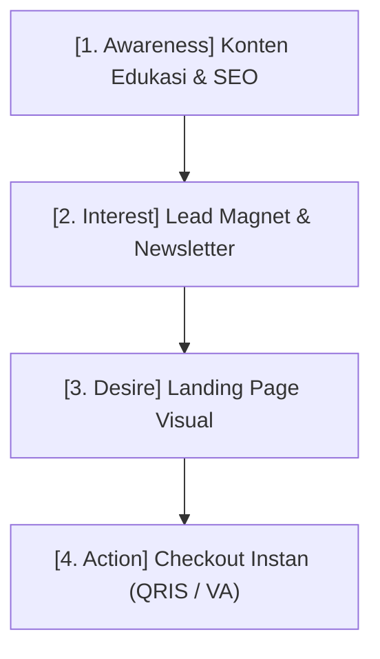

# 🚀 Blog SiBi — Publikasi Resmi SitusBisnis

Blog resmi **[SitusBisnis.com](https://situsbisnis.com)** — Publikasi catatan strategis, riset, dan panduan mendalam seputar *creator economy*, arsitektur *sales funnel*, monetisasi produk digital, dan pertumbuhan bisnis mandiri.

Dibuat menggunakan **Astro v5**, **Tailwind CSS v4**, tipografi **Plus Jakarta Sans**, dan mesin rendering diagram **Mermaid**.

---

## ✍️ Panduan Menulis Artikel Baru

Setiap artikel ditulis dalam format Markdown (`.md` atau `.mdx`) dan disimpan di direktori:
```
src/content/blog/[slug-artikel].md
```
> **Catatan:** Nama file otomatis menjadi slug URL artikel. Contohnya, file `src/content/blog/cara-riset-pasar.md` akan terbit di URL `https://blog.situsbisnis.com/posts/cara-riset-pasar/`.

---

### 📄 Template Standar Artikel

Salin template berikut saat membuat file artikel baru:

```markdown
---
title: "Judul Lengkap Artikel yang Menarik dan Jelas"
description: "Satu hingga dua kalimat ringkasan tentang esai ini. Teks ini tampil sebagai cuplikan kartu di beranda dan meta deskripsi Google."
date: 2026-11-01
categories: [Strategi Bisnis, Monetisasi]
tags: [creator-economy, digital-product, pricing]
author: "Tim SitusBisnis"
image: "/images/posts/funnel-cover.jpg"
---

Paragraf pembuka artikel ditulis di sini. Tulisan ini menjelaskan latar belakang atau tantangan utama yang dihadapi oleh audiens.

## 1. Subjudul Utama (Heading 2)

Gunakan heading level 2 (`##`) untuk membagi bab utama. Setiap heading `##` otomatis terdeteksi dalam navigasi bacaan.

Tuliskan poin-poin analisis dengan jelas. Anda dapat menyisipkan **teks tebal**, *teks miring*, atau tautan eksternal ke [SitusBisnis](https://situsbisnis.com).

### Sub-poin Penjelas (Heading 3)

Gunakan heading level 3 (`###`) untuk penjabaran teknis di bawah bab utama.

- Poin daftar pertama
- Poin daftar kedua
- Poin daftar ketiga

> **Catatan Strategis:**
> Blok kutipan ini otomatis memiliki background abu-abu lembut dan border elegan yang nyaman dibaca di mobile maupun desktop.

---

## 2. Menyisipkan Gambar

Letakkan file aset gambar di dalam folder `public/images/posts/` lalu panggil menggunakan sintaks Markdown standar:


*Pada tampilan mobile, gambar otomatis full-edge menyentuh tepi layar. Pada desktop, gambar memiliki sudut membulat (rounded-2xl) dan bayangan halus.*

---

## 3. Diagram Alur & Flowchart (Mermaid)

Blog SiBi mendukung rendering diagram alur interaktif menggunakan blok ````mermaid`:



Diagram ini otomatis dikonversi di sisi klien menjadi diagram vektor SVG responsif yang selaras dengan palet warna SitusBisnis.

---

## 4. Blok Kode & Syntax Highlighting

Untuk menampilkan kode teknis atau konfigurasi:

```json
{
  "platform": "SitusBisnis",
  "status": "online",
  "fee": 0
}
```

---

## 5. Tabel Responsif

| Fase Funnel | Metrik Utama | Target Konversi |
| :--- | :--- | :--- |
| Top of Funnel (ToFU) | Impressions, Views | 15% - 25% |
| Middle of Funnel (MoFU) | Email Opt-in | 5% - 10% |
| Bottom of Funnel (BoFU) | Paid Checkout | 1% - 3% |

---

## 6. Kesimpulan & Rekomendasi

Tuliskan ringkasan takeaways serta langkah aksi yang dapat langsung diterapkan oleh pembaca.
```

---

### 🏷️ Referensi Frontmatter (Metadata)

| Field | Wajib | Tipe Data | Deskripsi |
| :--- | :---: | :--- | :--- |
| `title` | **Ya** | `string` | Judul artikel |
| `description` | **Ya** | `string` | Ringkasan cuplikan artikel (untuk kartu & SEO) |
| `date` | **Ya** | `YYYY-MM-DD` | Tanggal publikasi |
| `categories` | Opsional | `array` | Kategori artikel (misal: `[Strategi Bisnis, Funnel Penjualan]`). Otomatis membuat rute dinamis di `/kategori/[slug]/`. |
| `tags` | Opsional | `array` | Topik spesifik (misal: `[creator-economy, pricing]`). Otomatis membuat rute dinamis di `/tags/[slug]/`. |
| `author` | Opsional | `string` | Nama penulis (default: `"Tim SitusBisnis"`) |
| `image` | Opsional | `string` | Path gambar cover di folder `public/images/posts/` |

---

## 🔍 Fitur SEO & Sindikasi Otomatis

Blog SiBi telah dilengkapi sistem SEO bawaan berstandar Google:
- **XML Sitemap**: Tergenerate otomatis di [`/sitemap-index.xml`](https://blog.situsbisnis.com/sitemap-index.xml).
- **Robots.txt**: Tersedia di [`/robots.txt`](https://blog.situsbisnis.com/robots.txt).
- **RSS 2.0 Feed**: Tersedia di [`/rss.xml`](https://blog.situsbisnis.com/rss.xml).
- **Structured Data (JSON-LD)**: Schema `Organization`, `WebSite`, `BlogPosting`, dan `BreadcrumbList` otomatis disuntikkan ke setiap artikel.
- **Kategori & Tag Index**: Arsip rute dinamis di [`/kategori/`](https://blog.situsbisnis.com/kategori/) dan [`/tags/`](https://blog.situsbisnis.com/tags/).

---

## 🚀 Menjalankan Secara Lokal & Deploy

### Pengembangan Lokal (Local Dev):
```bash
# Install dependensi
bun install

# Jalankan dev server lokal
bun run dev
```

### Deploy Otomatis ke Produksi:
Cukup *commit* dan *push* perubahan ke branch `main`:
```bash
git add .
git commit -m "feat: publish artikel baru"
git push origin main
```
GitHub Actions akan secara otomatis memvalidasi konten, men-generate halaman statis, dan memperbarui situs di **[blog.situsbisnis.com](https://blog.situsbisnis.com)** dalam waktu ~30 detik.
