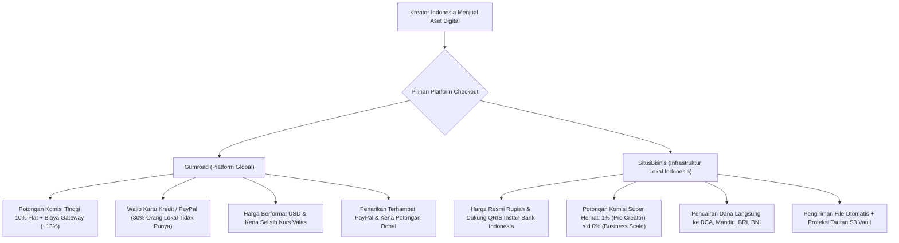
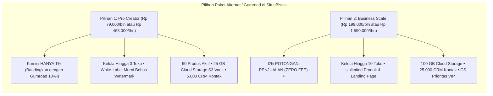

Bagi para kreator konten, desainer, dan programmer di Indonesia, nama Gumroad tentu sudah tidak asing lagi. Selama bertahun-tahun, platform asal Amerika Serikat ini menjadi kiblat para solopreneur global untuk menjual template Notion, file kode pemrograman, preset Lightroom, hingga buku elektronik.

Namun dalam beberapa tahun terakhir, menggunakan Gumroad untuk membidik pembeli di pasar Indonesia justru berubah menjadi mimpi buruk operasional yang menghambat angka penjualan:

1. **Kenaikan Biaya Sepihak Menjadi Flat 10%:** Gumroad secara mengejutkan menaikkan biaya platformnya menjadi flat **10% dari setiap penjualan**. Jika ditambah dengan biaya pemrosesan kartu kredit (~2.9% + $0.30), total potongan yang disedot bisa mencapai **13% hingga 15%** dari omzet kotor Anda!
2. **Hambatan Pembayaran Kartu Kredit di Indonesia:** Lebih dari 80% calon pembeli di Indonesia **tidak memiliki kartu kredit**. Ketika diarahkan ke halaman Gumroad yang hanya menerima kartu kredit atau PayPal, mereka langsung membatalkan niat membeli (*cart abandonment*).
3. **Mata Uang Dolar (USD) dan Friksi Kurs:** Pembeli lokal merasa cemas karena harga tertera dalam mata uang dolar. Mereka khawatir terkena biaya konversi kurs bank yang membengkak.
4. **Kerumitan Penarikan Dana (*Payout Hell*):** Uang hasil penjualan Anda tertahan dalam saldo USD dan harus ditarik lewat PayPal atau transfer internasional yang terkena potongan margin kurs kursus bank yang sangat merugikan.

Inilah mengapa semakin banyak kreator Indonesia mencari **alternatif Gumroad lokal** yang mendukung mata uang Rupiah, pembayaran instan via **QRIS**, dan skema biaya yang jauh lebih bersahabat bagi kantong.

---

## 1. Menghitung Kerugian Finansial Akibat Kebijakan Fee 10% Gumroad

Kebijakan kenaikan tarif Gumroad menjadi flat 10% adalah salah satu perubahan paling kontroversial dalam ekonomi kreator.

Mari kita hitung secara matematis:
Jika Anda menjual e-book atau template desain seharga **Rp 200.000 (setara $12 USD)** dan berhasil menjual **100 pesanan per bulan**:
* **Total Omzet Anda:** Rp 20.000.000 ($1.200 USD).
* **Potongan Komisi Gumroad (10%):** Rp 2.000.000 ($120 USD).
* **Biaya Pemrosesan Kartu Kredit:** Sekitar Rp 600.000 ($36 USD).
* **Potongan Selisih Kurs Pencairan PayPal ke Bank Lokal:** Sekitar 3% - 4% di bawah kurs pasar resmi (kehilangan sekitar Rp 600.000 lagi).
* **Total Kerugian Anda: Lebih dari Rp 3.200.000 setiap bulan!**

Dalam setahun, Anda telah membakar uang sebesar **Rp 38.400.000** hanya untuk biaya transaksi dan administrasi valuta asing.

---

## 2. Masalah Psikologis Pembeli Indonesia: Kenapa Halaman Gumroad Bikin Mental Calon Pembeli?

Bukan hanya masalah fee yang mahal, masalah terbesar Gumroad saat menargetkan audiens Indonesia adalah **angka konversi yang sangat rendah**.

Perhatikan perbedaan perilaku konsumen lokal berikut:
1. **Kebiasaan Memindai QRIS:** Di Indonesia, masyarakat dari mahasiswa hingga pengusaha sudah terbiasa membayar apa pun menggunakan QRIS lewat mobile banking (BCA Mobile, Livin Mandiri, BRImo) atau dompet digital (GoPay, OVO, Dana). Begitu mereka melihat checkout QRIS di layar ponsel, mereka langsung memindai dan membayar dalam 10 detik.
2. **Kecurigaan Terhadap Form Kartu Kredit Asing:** Meminta orang Indonesia mengetikkan 16 digit nomor kartu kredit dan 3 digit CVV di website luar negeri sering memicu kekhawatiran penipuan (*scam*).
3. **Kendala Otentikasi OTP:** Pembayaran kartu kredit internasional sering gagal karena kode OTP SMS dari bank lokal terlambat masuk atau terkena pemblokiran transaksi valas oleh sistem bank penerbit.

Hasilnya? Sebanyak 60% hingga 80% orang yang sebenarnya berniat membeli akhirnya mengurungkan niat hanya karena cara bayarnya terlalu rumit.

---

## 3. SitusBisnis: Alternatif Gumroad Modern Khusus Pasar Indonesia

Platform **[SitusBisnis](https://situsbisnis.com)** hadir sebagai jawaban langsung atas kelemahan mendasar Gumroad bagi kreator di Indonesia.

Berikut adalah perbandingan langsung antara kedua platform:

| Parameter Evaluasi | Gumroad (Global) | SitusBisnis (Indonesia) | Dampak bagi Bisnis Anda |
| :--- | :--- | :--- | :--- |
| **Mata Uang Pembayaran** | Dolar Amerika (USD) | **Rupiah (IDR)** | Pembeli lokal merasa aman tanpa cemas fluktuasi kurs. |
| **Metode Pembayaran Utama** | Kartu Kredit & PayPal | **QRIS Dinamis & Virtual Account Bank** | Konversi checkout melonjak hingga 4x lipat. |
| **Potongan Komisi Platform** | **Flat 10%** *(Sangat Mahal)* | **1% (Pro Creator) s.d 0% (Business Scale ⭐)** | Margin laba bersih Anda terselamatkan utuh. |
| **Biaya Langganan Pro** | Tidak ada tier (flat 10%) | **Pro Creator: Rp 79rb/bln (Rp 468rb/thn)** | Biaya tetap transparan dan fee transaksi sangat rendah. |
| **Penarikan Saldo (Payout)** | Melalui PayPal / Wise USD | **Langsung ke Rekening Bank Lokal (BCA/Mandiri/BRI)** | Saldo cair cepat tanpa potongan ganda kurs valas. |
| **Penyimpanan Berkas Digital** | Cloud bawaan | **Dedicated Cloud Storage S3 Vault (25 GB - 100 GB)** | File aman, anti-bocor, dan pengiriman otomatis. |
| **Kategori Produk yang Didukung** | File digital, Newsletter | **Digital, LMS Kelas Online, Jasa, & Fisik COD** | Bisa menjual kursus terproteksi atau produk fisik. |
| **Custom Domain Mandiri** | Dikenakan syarat khusus | **✓ Custom Domain CNAME Sendiri (.com / .id)** | Tampilan toko independen dengan kredibilitas tinggi. |

---

## 4. Dua Pilihan Paket Unggulan di SitusBisnis yang Menggantikan Gumroad

Untuk para kreator yang ingin berpindah dari Gumroad ke toko mandiri, SitusBisnis menyediakan dua pilihan paket strategis:

### 1. Paket Pro Creator (Hanya 1% Fee Transaksi)
* Biaya langganan sangat terjangkau: **Rp 79.000 per bulan**, atau **Rp 468.000 per tahun** (setara **Rp 39.000 per bulan**).
* Potongan komisi transaksi dipangkas dari 10% di Gumroad menjadi **hanya 1%**.
* Fasilitas lengkap: 3 toko/brand mandiri, unlimited landing page, 50 produk aktif, 25 GB penyimpanan cloud S3 vault, database 5.000 kontak CRM, dan pengiriman 1.000 email broadcast per bulan.

### 2. Paket Business Scale (0% Zero Fee)
* Biaya langganan flat: **Rp 199.000 per bulan** atau **Rp 1.590.000 per tahun**.
* **Potongan Komisi Platform: 0% (ZERO FEE) ⭐**. Anda tidak membayar komisi penjualan sepeser pun ke platform, hanya biaya gateway QRIS Bank Indonesia standar (~0.7%).
* Fasilitas skala enterprise: 10 toko mandiri, produk tanpa batas, landing page tanpa batas, 100 GB penyimpanan file cloud, dan 25.000 database CRM kontak pelanggan.

---

## 5. Alur Otomasi Pengiriman File Berkas yang Aman dan Bebas Bocor

Salah satu kekhawatiran kreator saat pindah dari platform luar negeri adalah keamanan file digital mereka. Di **[SitusBisnis](https://situsbisnis.com)**, alur distribusi produk digital dirancang dengan standar arsitektur industri:

1. **Penyimpanan Terenkripsi (S3 Vault):** Berkas materi Anda (PDF, ZIP, MP4, dsb.) tidak diunggah ke folder publik, melainkan disimpan di brankas cloud S3 terproteksi.
2. **QRIS Otomatis & Deteksi Detik:** Begitu pembeli memindai kode QRIS dinamis di layar HP mereka dan transaksi sukses, sistem perbankan langsung memverifikasi secara *real-time*.
3. **Pengalihan Akses Instan (*Instant Download Token*):** Layar pembeli langsung berganti menjadi halaman unduh dengan tombol akses berbatas waktu (*expiring link*), sehingga tautan tidak bisa disebarluaskan secara sembarangan di media sosial.
4. **Cadangan Notifikasi WhatsApp & Email:** Pembeli secara bersamaan menerima pesan WhatsApp resmi dan email notifikasi yang memuat tanda terima serta tautan akses cadangan produk mereka.

---

## 6. Saatnya Menjual Produk Digital dengan Cara yang Ramah Pembeli Indonesia

Pasar produk digital di Indonesia sedang berada di puncak gelombang pertumbuhan tertingginya. Konsumen di tanah air semakin gemar membeli materi edukasi, panduan praktis, dan aset kerja siap pakai.

Namun, Anda tidak akan bisa memaksimalkan potensi pasar raksasa ini jika Anda memaksakan pembeli lokal menggunakan platform asing yang rumit, mahal, dan tidak mendukung pembayaran lokal.

Dengan berpindah ke **[SitusBisnis.com](https://situsbisnis.com)**:
- Pembeli Anda bahagia karena bisa checkout dalam 10 detik memakai QRIS rupiah instan.
- Anda tersenyum lebar karena potongan komisi 10% Gumroad musnah menjadi **hanya 1% atau 0% Zero Fee**.
- Seluruh database nomor WhatsApp dan email pelanggan tersimpan rapi sebagai aset berharga bisnis Anda.

Daftarkan akun toko mandiri Anda sekarang di **[SitusBisnis.com](https://situsbisnis.com)** dan rasakan bedanya menjual produk digital tanpa potongan komisi yang mencekik.
