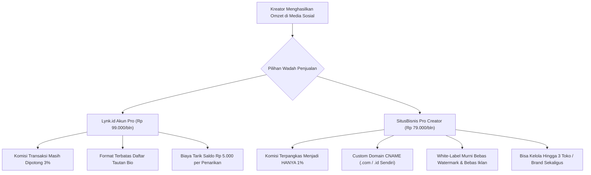
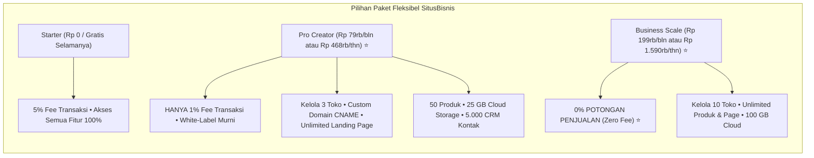

Pernahkah Anda menghitung berapa banyak uang yang dipotong dari rekening Anda setiap kali ada transaksi penjualan produk digital di akun Lynk.id Anda?

Bagi banyak kreator pemula di TikTok dan Instagram, Lynk.id memang sering menjadi pilihan pertama. Cukup daftar dengan akun Google, buat daftar tautan (*link in bio*), pasang harga, dan dalam 10 menit Anda sudah bisa berjualan e-book atau template.

Namun, begitu penjualan Anda mulai tumbuh stabil di atas Rp 10 juta hingga Rp 30 juta per bulan, ada dua hal yang mulai terasa mengganjal di hati:

1. **Paradoks Akun Pro:** Anda sudah membayar biaya sewa bulanan Rp 99.000, tetapi setiap kali ada produk laku, **platform masih memotong komisi 3%** ditambah biaya admin tarik dana Rp 5.000 per penarikan.
2. **Keterbatasan Format Link-in-Bio:** Saat Anda ingin menaikkan harga produk menjadi Rp 350.000 atau Rp 750.000, calon pembeli sering ragu karena halamannya terlihat seperti susunan tautan media sosial biasa, bukan etalase toko profesional berdomain mandiri.

Inilah alasan utama mengapa banyak kreator, mentor, konsultan, dan solopreneur di Indonesia mulai mencari **alternatif Lynk.id** dan memilih beralih ke **[SitusBisnis](https://situsbisnis.com)** yang memberikan komisi jauh lebih hemat, fitur *white-label* murni, dan kendali penuh atas toko mereka.

---

## 1. Paradoks Biaya Lynk.id: Mengapa Makin Sukses, Potongannya Makin Membengkak?

Mari kita bedah struktur biaya resmi Lynk.id berdasarkan ketentuan operasionalnya:
* **Akun Gratis (Free):** Dikenakan potongan biaya transaksi sebesar **5%** plus biaya penarikan dana ke rekening bank sekitar **Rp 5.000**.
* **Akun Pro (Berbayar):** Dikenakan biaya langganan **Rp 99.000 per bulan**, namun potongan transaksi **tetap ada sebesar 3%**.

Coba perhatikan simulasi perhitungannya:
Jika produk digital Anda menghasilkan omzet **Rp 20.000.000** dalam sebulan:
- Biaya sewa akun Pro: Rp 99.000
- Potongan transaksi 3%: **Rp 600.000**
- Biaya penarikan 4 kali seminggu: Rp 20.000
- **Total Uang yang Disedot: Rp 719.000 per bulan.**

Jika omzet Anda naik menjadi **Rp 50.000.000** per bulan:
- Potongan transaksi 3% melonjak menjadi **Rp 1.500.000** per bulan (mencapai **Rp 18.000.000 per tahun**!).

Pertanyaannya: mengapa Anda yang bekerja keras membuat konten, membangun audiens, dan melayani pembeli, tetapi platform yang hanya menyediakan halaman checkout mengambil bagian laba yang semakin besar seiring pertumbuhan Anda?

---

## 2. Masalah Persepsi Nilai (*Value Perception*): Link Bio vs. Toko Profesional di SitusBisnis

Format *link-in-bio* dirancang untuk memuat banyak link tautan (seperti link YouTube, link artikel, atau link endorsement). Namun ketika difungsikan sebagai toko produk digital bernilai menengah hingga tinggi (*mid to high ticket*), format ini memiliki kelemahan psikologis yang nyata:

* **Terlihat Seperti Lapak Sementara:** Calon pembeli yang ingin membeli kursus seharga Rp 499.000 atau template dokumen bisnis seharga Rp 250.000 mengharapkan pengalaman belanja layaknya website profesional, bukan kartu tombol mini di bio.
* **Tidak Ada Custom Domain Bersih di Paket Dasar:** Di Lynk.id, tautan toko Anda tetap membawa nama platform (`lynk.id/username`). Di mata calon klien korporat atau pembeli premium, ini mengurangi wibawa (*authority*) brand Anda.
* **Risiko Terdistraksi:** Di layar ponsel, kartu link-in-bio yang terlalu banyak tombol membuat pengunjung bingung mana produk utama yang seharusnya mereka beli (*choice overload*).

---

## 3. SitusBisnis: Solusi Alternatif Lynk.id yang Lebih Adil dan Profesional

Sebagai perbandingan langsung, platform **[SitusBisnis](https://situsbisnis.com)** dirancang bukan sekadar pemendek tautan bio, melainkan **infrastruktur toko mandiri terpadu (*all-in-one creator commerce*)** yang sangat fleksibel:

Mari kita bandingkan secara *head-to-head*:

### A. Perbandingan Paket Pro: Lynk.id Pro vs. SitusBisnis Pro Creator

| Dimensi Fitur | Lynk.id Akun Pro | SitusBisnis Pro Creator ⭐ | Pemenang |
| :--- | :--- | :--- | :--- |
| **Biaya Bulanan** | Rp 99.000 / bulan | **Rp 79.000 / bulan** | **SitusBisnis (Lebih Murah)** |
| **Biaya Tahunan** | ~Rp 1.188.000 / tahun | **Rp 468.000 / tahun** *(Diskon 51%!)* | **SitusBisnis (Hemat Rp 720rb)** |
| **Potongan Komisi Penjualan** | **3%** *(Tetap Memotong)* | **HANYA 1%** *(3x Lebih Hemat!)* | **SitusBisnis (Fee Cuma 1%)** |
| **Jumlah Toko / Brand** | 1 Akun Profil | **Hingga 3 Toko / Brand Berbeda** | **SitusBisnis** |
| **Landing Page Mandiri** | Terbatas format Bio | **Unlimited (Tanpa Batas)** | **SitusBisnis** |
| **Katalog Produk Aktif** | Unlimited | **50 Produk Aktif** | Seimbang |
| **Custom Domain CNAME** | Add-on khusus | **✓ Gratis Terhubung Domain Sendiri** | **SitusBisnis** |
| **White-Label (Hapus Watermark)** | Terbatas | **✓ White-Label Murni (100% Bersih)** | **SitusBisnis** |
| **Bebas Iklan Platform** | Ada penyesuaian | **✓ 100% Bebas Iklan Kompetitor** | **SitusBisnis** |
| **Cloud Storage S3 Vault** | Terbatas | **25 GB Dedicated Cloud** | **SitusBisnis** |
| **Database CRM Kontak** | Terkunci di platform | **5.000 Kontak CRM (Bisa Diekspor)** | **SitusBisnis** |
| **Kirim Email Broadcast** | Tidak ada bawaan | **1.000 Email Broadcast / bulan** | **SitusBisnis** |
| **Biaya Admin Tarik Saldo** | Rp 5.000 | **Rp 4.000** | **SitusBisnis** |

### B. Opsi Skala Besar: 0% Komisi di Paket Business Scale
Jika bisnis digital Anda sudah menghasilkan omzet di atas Rp 20 juta per bulan, Lynk.id tidak menyediakan opsi 0% komisi (Anda akan selalu dipotong 3%). 

Sebaliknya di **SitusBisnis Business Scale** (Rp 199.000/bln atau Rp 1.590.000/thn):
* **Potongan Komisi Platform: 0% (ZERO FEE) ⭐**
* Anda bisa mengelola hingga **10 Toko/Brand berbeda**.
* Produk dan landing page **tanpa batas (*unlimited*)**.
* Cloud storage sebesar **100 GB**.
* Database CRM hingga **25.000 kontak**.
* Hingga **10 akun staf/tim** dengan hak akses terpisah.

---

## 4. Tabel Simulasi Laba Bersih Nyata: Selisih yang Masuk ke Rekening Anda

Mari kita uji dengan contoh kasus konkret. Anda menjual panduan praktis seharga **Rp 150.000 per pesanan**. Dalam 1 bulan, Anda berhasil menjual **200 pesanan**, sehingga total omzet Anda adalah **Rp 30.000.000**.

Berikut rincian uang bersih yang Anda terima:

| Pos Keuangan | Lynk.id Akun Pro | SitusBisnis Pro Creator | SitusBisnis Business Scale |
| :--- | :--- | :--- | :--- |
| **Omzet Kotor Bulanan** | Rp 30.000.000 | Rp 30.000.000 | Rp 30.000.000 |
| **Biaya Langganan Bulanan** | -Rp 99.000 | -Rp 79.000 *(atau Rp 39rb/bln)* | -Rp 199.000 |
| **Potongan Komisi Platform** | **-Rp 900.000 (3%)** | **-Rp 300.000 (1%)** | **Rp 0 (ZERO FEE) ⭐** |
| **Estimasi Fee Gateway QRIS (0.7%)** | Termasuk | -Rp 210.000 | -Rp 210.000 |
| **Biaya Penarikan Saldo** | -Rp 5.000 | -Rp 4.000 | -Rp 3.000 |
| **Uang Bersih yang Anda Terima** | **Rp 28.996.000** | **Rp 29.407.000** | **Rp 29.588.000** |
| **Tambahan Profit yang Terselamatkan** | *Standar Lynk* | **+Rp 411.000 / bulan** | **+Rp 592.000 / bulan** |

> [!TIP]
> Selisih Rp 400.000 hingga Rp 600.000 per bulan itu setara dengan **Rp 4.800.000 hingga Rp 7.100.000 per tahun**. Uang tersebut bisa Anda alokasikan untuk menambah anggaran iklan Meta Ads, membeli mikrofon podcast berkualitas tinggi, atau langsung dinikmati sebagai dividen bersih bisnis Anda.

---

## 5. Tiga Fitur Unggulan SitusBisnis yang Tidak Ada di Lynk.id

Selain selisih biaya yang jauh lebih hemat, ada keunggulan infrastruktur mendasar yang membuat SitusBisnis jauh lebih unggul sebagai aset bisnis jangka panjang:

### 1. Multi-Kategori Bisnis (Digital, LMS Kursus, Jasa, & Fisik COD)
Lynk.id fokus utama pada file unduhan atau konsultasi santai. Di SitusBisnis, Anda bisa mengembangkan lini produk Anda ke berbagai arah tanpa perlu berganti platform:
* **Produk Digital:** E-book, PDF, spreadsheet, preset, audio.
* **Kelas Online (LMS):** Video pembelajaran terproteksi dengan progres materi murid.
* **Jasa Profesional:** Paket konsultasi, audit desain, atau jasa riset dengan kuesioner otomatis.
* **Produk Fisik:** Lengkap dengan hitungan otomatis tarif kurir JNE/J&T dan metode pembayaran Bayar di Tempat (*Cash on Delivery* / COD).

### 2. Multi-Store Management (1 Akun, Kelola hingga 10 Toko)
Di Lynk.id, jika Anda punya bisnis di dua bidang yang berbeda (misalnya satu tentang *desain grafis* dan satu tentang *resep kuliner*), Anda harus mendaftar dua akun terpisah dan membayar dua kali langganan Pro. Di SitusBisnis Pro Creator, Anda bisa mengelola **hingga 3 toko berbeda** dalam satu dashboard, dan hingga **10 toko** pada paket Business Scale.

### 3. White-Label Murni dan Kebebasan Custom Domain
Toko Anda bisa dihubungkan ke domain Anda sendiri (misal `toko.akademidigital.com`) secara gratis tanpa biaya tambahan. Pengunjung tidak akan melihat logo atau watermark platform lain, sehingga kredibilitas brand Anda meningkat secara instan.

---

## 6. Panduan Praktis Migrasi dari Lynk.id ke SitusBisnis dalam 15 Menit

Beralih ke toko mandiri tidak serumit yang Anda bayangkan:

1. **Daftar Akun di [SitusBisnis.com](https://situsbisnis.com):** Pilih paket **Starter (Rp 0)** untuk mencoba secara gratis, atau langsung aktifkan **Pro Creator** untuk menikmati komisi 1% dan fitur white-label.
2. **Unggah Produk Anda:** Masukkan judul produk, deskripsi singkat, harga jual, dan tautkan berkas materi Anda ke cloud storage aman S3 Vault.
3. **Aktifkan Pembayaran QRIS:** Sistem checkout SitusBisnis langsung siap memproses pembayaran QRIS instan Bank Indonesia secara otomatis.
4. **Hubungkan Domain Anda:** Pasang subdomain gratis `username.sibi.my.id` atau hubungkan CNAME domain pribadi Anda.
5. **Ganti Tautan di Profil Media Sosial:** Pasang link toko mandiri baru Anda di bio Instagram, TikTok, dan deskripsi YouTube.

---

## 7. Saatnya Menaikkan Level Bisnis Digital Anda ke SitusBisnis

Menjual produk digital adalah langkah awal yang brilian untuk meraih kebebasan finansial. Namun, mempercayakan seluruh aliran kas dan database pelanggan Anda pada platform sewa yang memotong komisi tinggi adalah keputusan yang merugikan di jangka panjang.

Jika Anda ingin:
- Memangkas potongan komisi dari 3%-5% menjadi **hanya 1%** (atau **0% Zero Fee**).
- Memiliki database kontak WhatsApp dan email pembeli secara utuh 100%.
- Menampilkan toko online profesional dengan domain sendiri tanpa watermark lapak pihak ketiga.

Maka ini adalah saat yang tepat untuk mengambil kendali penuh atas bisnis Anda. Mulai bangun toko digital Anda di **[SitusBisnis.com](https://situsbisnis.com)** hari ini.
