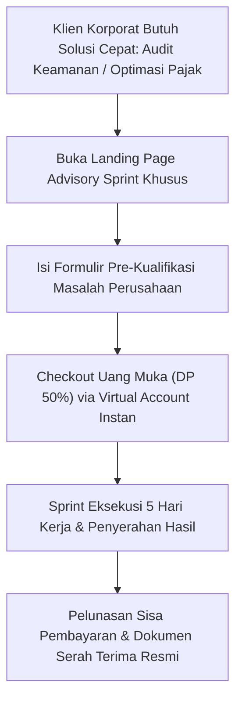
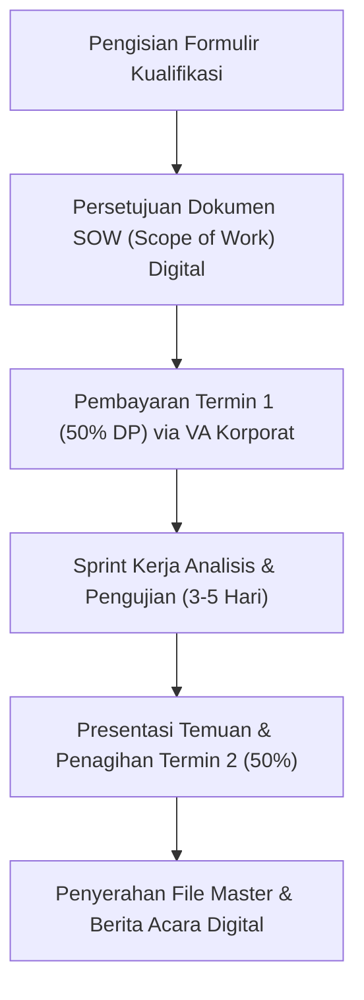

Mitos terbesar dalam dunia konsultasi bisnis di Indonesia adalah: *"Untuk menjual jasa atau advis bernilai puluhan juta rupiah, Anda wajib bertemu makan siang di restoran mewah, bertukar kartu nama fisik, dan bernegosiasi selama berbulan-bulan."*

Faktanya, generasi baru pengambil keputusan korporat (Chief Marketing Officer, Head of Engineering, dan Direktur Operasional di bawah usia 45 tahun) justru membenci pertemuan basa-basi yang membuang waktu. Mereka lebih menyukai model **Productized Advisory Sprint**: paket keahlian spesifik dengan ruang lingkup (*scope*) terkunci, tenggat waktu pasti, dan pembayaran transparan yang dapat dipesan secara instan.

Seorang spesialis audit keamanan siber, analis perpajakan korporat, atau konsultan konversi dapat dengan mudah mengunci kesepakatan bernilai Rp 15 juta hingga Rp 40 juta tanpa pernah keluar rumah.

## 4 Komponen Wajib Penawaran B2B High-Ticket Tanpa Tatap Muka

Ketika Anda tidak hadir secara fisik untuk menjabat tangan klien, landing page dan dokumen penawaran Anda harus memancarkan tingkat kepercayaan institusional yang sempurna:

### 1. Batasan Ruang Lingkup yang Kaku (Anti-Scope Creep)
Jangan pernah menjual "konsultasi umum per jam". Jual paket hasil akhir yang terdefinisi dengan sangat presisi:
- **Judul Produk**: *Sprint Audit Kerentanan Keamanan Web Aplikasi Finansial 5 Hari Kerja*.
- **Yang Didapat**: 1 Laporan Analisis Penetrasi Keamanan PDF 25 Halaman, 1 Lembar Matriks Risiko Spreadsheet, dan 1 Sesi Presentasi Solusi 60 Menit via Zoom.
- **Yang Tidak Didapat**: Menulis ulang kode backend atau instalasi server baru (ini adalah upsell terpisah).

### 2. Formulir Pre-Kualifikasi Calon Klien (Gatekeeper Questionnaire)
Jangan biarkan sembarang orang memesan slot Anda. Pasang 4 pertanyaan filter wajib di formulir checkout:
- Berapa omzet kotor bulanan perusahaan Anda?
- Siapa nama pengambil keputusan final untuk implementasi proyek ini?
- Kapan tenggat waktu implementasi yang diharapkan oleh manajemen?
- Apakah perusahaan Anda siap mengalokasikan anggaran minimal Rp 20 juta untuk sprint ini?

Klien berkualitas justru merasa lebih aman ketika mereka harus melewati formulir kualifikasi; ini membuktikan bahwa waktu Anda sangat berharga dan selektif.

### 3. Skema Pembayaran Bertahap (Milestone Billing Structure)
Untuk meruntuhkan hambatan psikologis transaksi di atas Rp 10 juta:
- **Termin 1 (Uang Muka 50%)**: Dibayarkan langsung di awal melalui tautan checkout untuk mengunci slot kalender kerja.
- **Termin 2 (Pelunasan 50%)**: Dibayarkan dalam tempo 24 jam setelah draf laporan hasil kerja diserahkan sebelum penyerahan hak akses berkas master.

### 4. Jaminan Tanpa Risiko Berbasis Metrik (Performance SLA)
Korporat takut disalahkan oleh atasannya jika menyewa konsultan yang tidak kompeten. Berikan jaminan spesifik:
- *"Jika dalam audit ini kami tidak menemukan minimal 3 celah kebocoran operasional atau efisiensi anggaran bernilai lebih dari biaya sprint ini, uang muka Anda kami kembalikan 100% tanpa potongan."*

## Mengapa Menghindari Proposal PDF Konvensional yang Panjang?

Proposal konvensional setebal 40 halaman biasanya hanya berakhir di tumpukan dokumen meja pengadaan (*procurement*). Sebaliknya, menyajikan penawaran melalui halaman web mandiri yang interaktif memberikan keuntungan psikologis yang besar:
- Klien dapat langsung membagikan tautan URL penawaran ke grup WhatsApp direksi mereka.
- Adanya tombol checkout instan dengan opsi transfer Virtual Account bank resmi menciptakan urgensi bahwa slot mingguan Anda terbatas.

Dengan toko digital mandiri seperti [SitusBisnis](https://situsbisnis.com), Anda dapat membangun landing page penawaran B2B yang elegan, menerbitkan faktur proforma instan, dan mengumpulkan pembayaran uang muka maupun pelunasan dengan sistem keamanan tinggi dan **0% komisi transaksi**.
