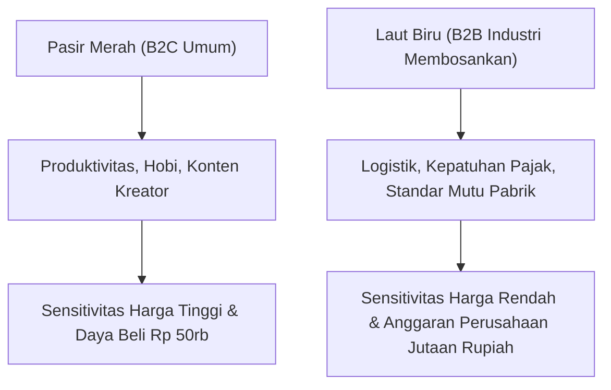
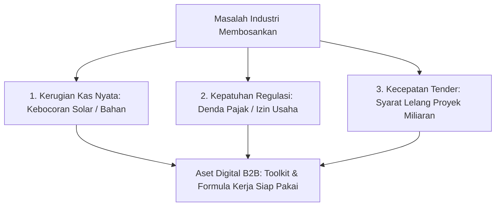

Kebanyakan kreator produk digital pemula berebut di kolam yang sama dan luar biasa sesak: jualan panduan produktivitas harian, ide konten media sosial, atau tips desain grafis pemula. Di sektor ini, perang harga terjadi sangat sadis—menjual modul seharga Rp 49.000 saja calon pembeli masih menawar atau mencari bajakannya di Google Drive publik.

Kenapa ini terjadi? Karena audiens ritel perorangan (*B2C*) berbelanja memakai uang saku pribadi dan memiliki sensitivitas harga yang sangat tinggi.

Padahal, perputaran uang terbesar dalam ekonomi digital justru mengalir deras di sektor-sektor yang dianggap 'membosankan' (*boring businesses*): **pergudangan logistik, kepatuhan audit perpajakan, sertifikasi mutu ISO pabrik, dan standar keselamatan kerja (K3)**.

Bagi perusahaan, kelalaian di bidang tersebut bisa memicu sanksi denda ratusan juta rupiah. Mengeluarkan anggaran belanja Rp 3 juta hingga Rp 15 juta untuk membeli paket aset dokumen digital yang langsung menyelesaikan masalah audit adalah keputusan bisnis yang sangat masuk akal.

Di artikel pembuka seri *B2B Digital Assets Playbook* ini, kita akan meninggalkan perang tarif receh: **bagaimana membidik celah risiko berbiaya tinggi di industri nyata dan mengubahnya jadi produk digital yang siap dibeli lewat pos anggaran resmi perusahaan**.

## Karakteristik Masalah Bernilai Miliaran Rupiah

Bagaimana cara mengenali apakah sebuah masalah di dunia nyata layak dijadikan produk digital B2B berharga jutaan rupiah? Gunakan **Kerangka Kerja 3-K** (*Kerugian, Kepatuhan, Kecepatan*):

### 1. Masalah Kerugian Kas Nyata (Direct Cost of Leakage)
Jika masalah tersebut dibiarkan, perusahaan kehilangan uang nyata setiap hari.
- *Contoh*: Truk ekspedisi logistik yang kembali dalam keadaan kosong (*empty backhaul*). Aset spreadsheet kalkulasi muatan balik dan rute optimal bisa menyelamatkan puluhan juta biaya solar per bulan.

### 2. Masalah Kepatuhan Regulasi Berdenda (Mandatory Compliance)
Perusahaan tidak punya pilihan selain mematuhi aturan pemerintah atau menghadapi sanksi penutupan izin.
- *Contoh*: Pemberlakuan sistem Pajak Pertambahan Nilai (PPN) atau pembaruan format pelaporan audit lingkungan hidup (AMDAL/UKL-UPL). Toolkit dokumen yang memastikan mereka patuh hukum akan dibeli tanpa banyak negosiasi.

### 3. Masalah Kecepatan Pengadaan (Speed-to-Contract)
Perusahaan kehilangan peluang tender proyek ratusan juta hanya karena terlambat menyiapkan proposal teknis yang dipersyaratkan panitia lelang.
- *Contoh*: Paket bundel dokumen tender konstruksi (Health, Safety & Environment Plan) yang siap disesuaikan dalam 2 jam kerja.

## Matriks Evaluasi Niche B2B: Menghitung Rasio Nyeri Pasar

Sebelum menulis satu halaman dokumen pun, uji ide Anda menggunakan tabel skoring rasio nyeri berikut:

| Kriteria Uji Niche | Bobot Nilai | Pertanyaan Evaluasi Kritis |
| :--- | :--- | :--- |
| **Akses ke Anggaran OpEx** | Tinggi (40%) | Apakah pembeli membayar dengan dana perusahaan atau tabungan pribadi? |
| **Besaran Risiko Kelalaian** | Tinggi (30%) | Apakah kesalahan format bisa memicu denda hukum atau kegagalan audit? |
| **Kelangkaan Solusi di Pasar** | Sedang (20%) | Apakah informasi ini sulit ditemukan di Google atau ChatGPT umum? |
| **Kemudahan Implementasi** | Sedang (10%) | Bisakah tim pembeli langsung menjalankannya dalam waktu 24 jam? |

Jika ide produk Anda mendapatkan nilai tinggi pada dua kriteria pertama (*Akses Anggaran OpEx* dan *Besaran Risiko Kelalaian*), Anda telah menemukan tambang emas digital.

## Langkah Konkret Pertama Anda

Tugas Anda minggu ini bukan langsung menulis materi, melainkan **melakukan 5 wawancara diagnosa masalah**:
1. Temui atau hubungi 5 kenalan yang bekerja sebagai manajer, konsultan, atau pemilik bisnis di industri tertentu.
2. Ajukan satu pertanyaan kunci: *"Dokumen kerja atau laporan apa yang paling sering membuat tim Anda pusing dan membuang waktu paling banyak setiap akhir bulan?"*
3. Catat kata kunci yang mereka ulang lebih dari dua kali. Di situlah produk digital pertama Anda berada.

Di bagian selanjutnya (**Part 2: Merancang Arsitektur Dokumen Legal Finansial dan Kepatuhan yang Tahan Audit**), kita akan membedah bagaimana menyusun struktur berkas, kode formula, dan tata letak dokumen kerja tersebut agar diakui standarnya oleh tim legal korporat.
