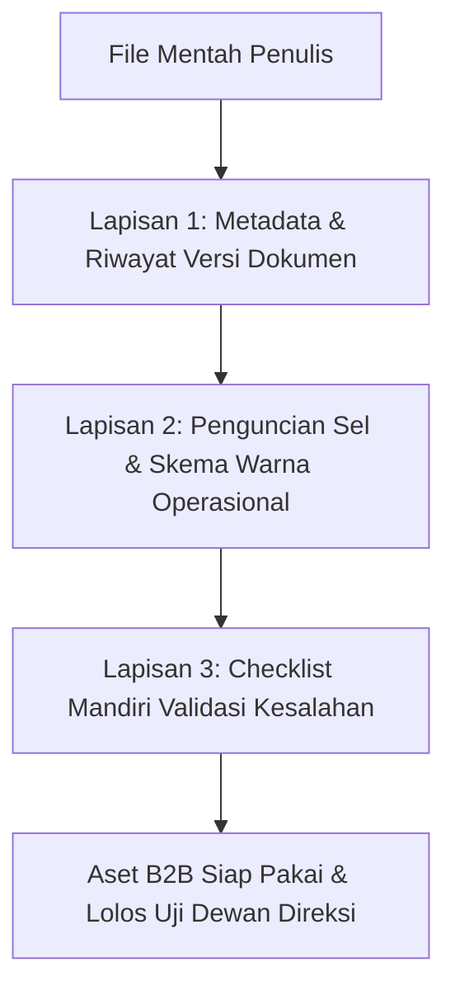
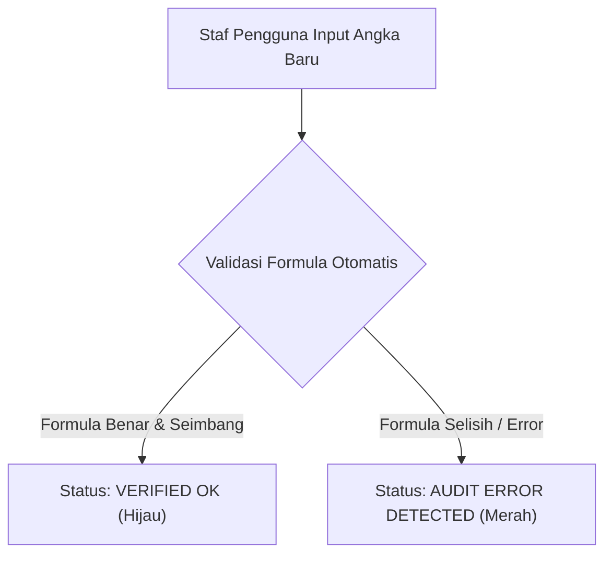

Bayangkan seorang manajer operasional korporat membeli berkas SOP atau kalkulator spreadsheet seharga Rp 2.500.000 dari toko digital Anda. Begitu file dibuka: font berantakan tanpa standar, rumus formula rusak saat diinput angka baru, dan tidak ada riwayat versi atau lembar validasi yang jelas.

Dalam hitungan menit, berkas tersebut akan langsung dicap amatir dan ditolak mentah-mentah jika dibawa ke meja dewan direksi.

Di [bagian pertama](/posts/b2b-digital-assets-part-1-membidik-celah-masalah-miliaran/), kita telah memetakan celah masalah berbiaya tinggi di industri riil. Sekarang di panduan kedua seri *B2B Digital Assets Playbook*, kita akan membedah standar teknisnya: **bagaimana merancang arsitektur dokumen digital berstandar institusional yang tahan audit (*audit-ready*)**—dokumen yang begitu solid, terkunci aman, dan presisi sehingga langsung disetujui oleh tim legal korporat.

## 3 Lapisan Arsitektur Dokumen Institusional

### 1. Blok Riwayat Kendali Versi (Document Control Block)
Setiap dokumen standar industri (ISO, GMP, atau SOP Keuangan) wajib diawali dengan tabel kendali versi di halaman pertama:
- Nomor Dokumen Dokumen resmi (misal: `SOP-FIN-2026-004`).
- Tanggal Efektif dan Tanggal Peninjauan Ulang Tahunan.
- Kolom Pengesahan: *Disusun Oleh*, *Ditinjau Oleh*, dan *Disetujui Oleh* lengkap dengan jabatan.
- Tabel Riwayat Perubahan: Versi 1.0 (Rilis Awal), Versi 1.1 (Pembaruan Tarif PPN 12%), dll.

Keberadaan tabel ini secara instan mengangkat persepsi nilai dokumen dari sekadar "ketikan blog" menjadi standar operasional resmi perusahaan.

### 2. Standar Formula Terproteksi (Fail-Safe Spreadsheet Architecture)
Jika Anda menjual aset berbasis spreadsheet (model keuangan, kalkulator COGS, matriks risiko):
- **Kunci Sel Perhitungan**: Kunci semua sel yang berisi rumus rumit menggunakan fitur *Protect Sheet*. Beri pembeli hanya izin untuk mengubah sel input yang diberi warna latar belakang kuning muda (*Soft Yellow Input Cells*).
- **Gunakan Rentang Bernama (Named Ranges)**: Jangan biarkan rumus Anda terlihat seperti `=SUM(C4:C29)*D14/E2`. Ubah menjadi formula yang mudah dibaca manusia: `=SUM(BiayaOperasional)*TarifPajak/TotalProduksi`.
- **Tambahkan Sel Pemeriksa Keseimbangan (Audit Check Flag)**: Buat indikator otomatis di sudut kanan atas: jika neraca tidak seimbang atau ada rumus pembagian dengan nol, teks tebal berwarna merah menyala: `[PERINGATAN: CEK CELL D42 - TIDAK BALANCE]`.

### 3. Sistem Anotasi Instruksi Terapung (Floating Guidance)
Pembeli sering kali bukan orang yang paling ahli di kantornya. File Anda mungkin akan diisi oleh staf junior atau admin kantor:
- Sisipkan komentar pop-up (*Notes / Data Validation Tooltips*) di setiap kolom isian penting.
- Jelaskan maksud istilah teknis dalam bahasa manusiawi (misalnya: *"Masukkan omzet kotor sebelum potongan diskon marketplace di sini"*).

## Pengujian Stres Sebelum Peluncuran (Stress-Testing Checklist)

Sebelum Anda mengunggah berkas ke halaman penjualan toko digital Anda, lakukan uji coba ekstrem berikut:

| Tahapan Uji Stres | Skenario Pengujian | Hasil yang Diharapkan |
| :--- | :--- | :--- |
| **Uji Nilai Ekstrem** | Masukkan angka 0 atau angka miliaran di kolom input spreadsheet | Tidak ada rumus yang menghasilkan error `#DIV/0!` atau `#VALUE!` |
| **Uji Kompatibilitas** | Buka berkas Microsoft Word di Google Docs dan LibreOffice | Tata letak tabel, margin, dan nomor halaman tetap rapi tanpa bergeser |
| **Uji Pengguna Awam** | Minta seorang rekan non-teknis mengisi berkas selama 10 menit | Mereka dapat menyelesaikan tanpa bertanya apa pun kepada Anda |

## Dokumentasi Pendukung yang Melipatgandakan Nilai

Jangan hanya memberikan 1 file `.xlsx` atau `.docx`. Kemas menjadi bundel profesional dengan menyertakan:
1. **Panduan Memulai Cepat (Quickstart PDF 3 Halaman)**: Panduan visual tangkapan layar untuk 10 menit pertama.
2. **Berkas Contoh Riil (Pre-Filled Realistic Benchmark)**: Satu salinan berkas yang sudah terisi data fiktif sebuah perusahaan manufaktur riil agar pembeli memiliki acuan visual tingkat kedalaman pengisian.

Di bagian berikutnya (**Part 3: Model Lisensi Multi-User dan Klausul Pembaruan Tahunan Anti Pembajakan**), kita akan membahas strategi penetapan harga lisensi korporat (*multi-seat licensing*) dan bagaimana mengunci pendapatan perpanjangan setiap tahun dari pembeli yang sama.
