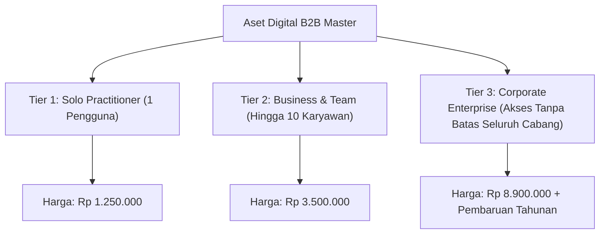
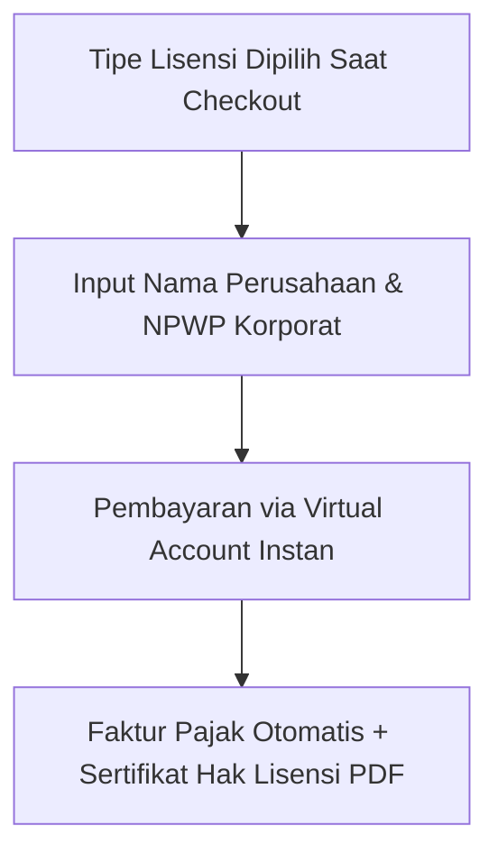

Kalau Anda menjual aset digital seharga Rp 1.500.000 dengan skema *"satu harga untuk siapa saja"*, Anda sebenarnya sedang membuang potensi laba puluhan juta rupiah ke tong sampah.

Coba bayangkan: seorang konsultan independen membeli file Anda untuk dipakai sendiri. Di sisi lain, sebuah korporasi logistik dengan 20 kantor cabang membeli file yang sama, lalu menyebarkannya ke 150 staf operasional mereka. Adilkah jika keduanya membayar nominal yang sama persis? Tentu tidak.

Korporasi besar memiliki kesediaan membayar (*willingness to pay*) yang jauh lebih tinggi dan siap membayar mahal asalkan mereka mengantongi sertifikat lisensi resmi yang sah di mata audit internal.

Setelah di [bagian kedua](/posts/b2b-digital-assets-part-2-merancang-arsitektur-dokumen-tahan-audit/) kita mengunci standar dokumen tahan audit, kini di panduan ketiga seri *B2B Digital Assets Playbook* kita akan membongkar strategi komersialnya: **bagaimana menerapkan Model Lisensi Berjenjang (*Tiered Corporate Licensing*) dan Klausul Pembaruan Regulasi Tahunan** agar satu produk bisa mendatangkan pemasukan berlipat ganda sekaligus mengamankan langganan tahunan berulang.

## 3 Tingkatan Lisensi Korporat yang Adil dan Menguntungkan

Jangan biarkan satu perusahaan membeli lisensi seharga Rp 1 juta lalu mendistribusikannya ke 5 kantor cabang mereka di berbagai kota. Buat pembedaan hak cipta yang jelas:

### Tier 1: Single Practitioner License (Lisensi Praktisi Tunggal)
- **Target Pembeli**: Konsultan independen, freelancer senior, atau pemilik toko tunggal.
- **Batasan**: Hanya boleh digunakan untuk 1 entitas bisnis pribadi. Tidak diperkenankan membagikan template ke pihak ketiga atau sub-kontraktor.
- **Harga Rata-rata**: Rp 990.000 – Rp 1.500.000.

### Tier 2: Team & Agency License (Lisensi Agensi & Tim)
- **Target Pembeli**: Kantor konsultan butik, agensi periklanan, atau perusahaan dengan tim internal hingga 10 staf.
- **Hak Akses**: Dokumen boleh dimodifikasi dan digunakan untuk melayani proyek klien agensi secara berulang tanpa biaya tambahan per proyek.
- **Harga Rata-rata**: Rp 2.900.000 – Rp 4.500.000 (sekitar 3x lipat Tier 1).

### Tier 3: Unlimited Corporate Enterprise License (Lisensi Korporat Penuh)
- **Target Pembeli**: Perusahaan skala menengah-besar, grup holding, atau jaringan waralaba multi-cabang.
- **Hak Akses**: Bebas digunakan di seluruh entitas anak perusahaan dan seluruh cabang regional. Dilengkapi sertifikat lisensi resmi bertandatangan atas nama PT pembeli.
- **Harga Rata-rata**: Rp 7.500.000 – Rp 15.000.000.

## Mengubah Pembelian Sekali Menjadi Pendapatan Berulang (Annual SLA)

Aset B2B di bidang kepatuhan, perpajakan, dan hukum memiliki keunggulan yang tidak dimiliki e-book umum: **regulasi pemerintah selalu berubah setiap tahun**.

Pemberlakuan peraturan menteri baru, penyesuaian tarif pajak, atau perubahan format sertifikasi membuat dokumen lama menjadi usang. Manfaatkan dinamika ini untuk membangun arus kas tahunan yang dapat diprediksi:

1. **Jaminan Pembaruan 1 Tahun (Yearly Maintenance Pass)**: Pembelian awal sudah mencakup semua revisi regulasi selama 12 bulan pertama.
2. **Klausul Perpanjangan Diskon 50% di Tahun Kedua**: 30 hari sebelum masa berlaku 1 tahun berakhir, kirim email dan pesan WhatsApp otomatis ke penanggung jawab perusahaan:
   > *"Selamat siang Pak [Nama]. Regulasi teknis BPOM untuk tahun 2027 telah diperbarui. Untuk memastikan dokumen operasional PT Anda tetap patuh audit, Anda dapat memperpanjang paket pembaruan tahunan versi 2027 dengan diskon khusus alumni 50% melalui tautan berikut."*
3. **Retensi Korporat yang Sangat Tinggi**: Bagi korporasi, membayar biaya perpanjangan tahunan Rp 1.500.000 adalah pengeluaran rutin yang sangat kecil dibanding harus mencari dokumen baru dari vendor lain.

## Perlindungan Hak Cipta yang Elegan Tanpa Merusak Pengalaman Pengguna

Banyak orang takut menjual file digital karena khawatir dibajak. Namun, memasang proteksi sandi yang terlalu rumit justru membuat klien korporat frustrasi. Terapkan strategi perlindungan psikologis dan hukum:

- **Sertakan Lembar Perjanjian Lisensi di Halaman Pertama**: Tulis dengan jelas sanksi perdata pelanggaran hak cipta sesuai Undang-Undang Hak Cipta Indonesia. Korporasi memiliki tim legal yang sangat berhati-hati; mereka tidak akan mengambil risiko tuntutan hukum hanya demi menyebarkan file template.
- **Pemberian Tanda Air Lisensi Dinamis (License Watermarking)**: Cantumkan teks rapi di footer: *"Dilisensikan secara eksklusif untuk operasional internal PT [Nama Perusahaan Pembeli] - Dilarang diperjualbelikan ulang"*.

Di bagian penutup (**Part 4: Menembus Pengadaan Internal Korporat Lewat Payment Gateway Mandiri**), kita akan membahas taktik operasional menembus birokrasi pengadaan (*procurement bypass*) agar transaksi jutaan rupiah bisa dibayarkan instan tanpa menunggu siklus termin 90 hari.
