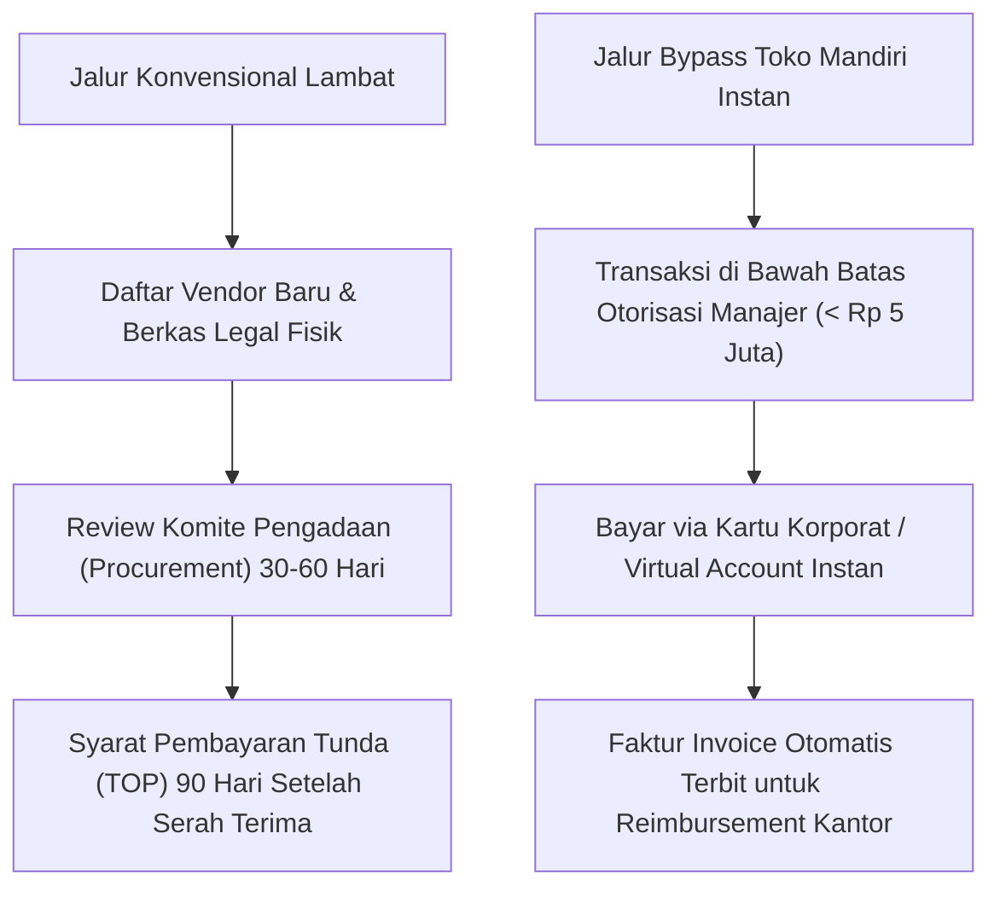
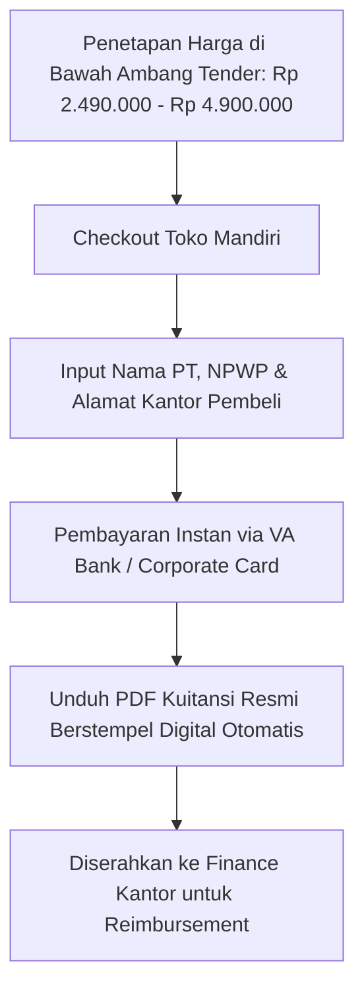

Momen paling menyebalkan saat bertransaksi dengan perusahaan besar adalah ketika manajer operasional mereka sudah mantap ingin membeli produk Anda, tapi prosesnya langsung terganjal di meja birokrasi divisi pengadaan (*procurement*).

Tiba-tiba Anda disodori tumpukan persyaratan berbelit: mengisi belasan formulir pendaftaran rekanan vendor baru, menyerahkan berkas legalitas fisik di atas meterai, dan yang paling memberatkan: dipaksa menerima syarat pembayaran tunda (*Term of Payment* / TOP) 60 hingga 90 hari. Arus kas bisnis Anda bisa mengering sebelum uang sepeser pun masuk ke rekening.

Apakah harus selalu serumit itu? Ternyata tidak.

Di [bagian ketiga](/posts/b2b-digital-assets-part-3-model-lisensi-multi-user-dan-pembaruan/), kita telah merumuskan skema lisensi berjenjang yang melindungi hak cipta Anda. Kini, di artikel penutup seri *B2B Digital Assets Playbook*, kita akan membongkar celah legal yang dipakai para solopreneur modern: **Teknik Bypass Anggaran Kas Kecil (*Petty Cash*) dan Kartu Kredit Korporat**, cara cerdas agar transaksi perusahaan bisa diselesaikan dalam 5 menit lewat toko mandiri tanpa terjebak antrean birokrasi pengadaan yang berbulan-bulan.

## Memahami Batas Otorisasi Belanja Bebas Manajer (Discretionary Budget)

Di hampir setiap perusahaan menengah hingga multinasional di Indonesia, para manajer divisi (Head of HR, Manajer Operasional, IT Lead) memiliki batas wewenang belanja langsung tanpa perlu persetujuan departemen pengadaan atau tender terbuka.

Batas anggaran kas bebas ini biasanya berkisar antara **Rp 2.500.000 hingga Rp 5.000.000 per transaksi**:
1. **Dapat Dibayarkan Menggunakan Kartu Kredit Korporat**: Manajer menggesek kartu kredit kantor dan melampirkan bukti invoice saat penutupan buku bulanan.
2. **Dapat Menggunakan Kas Kecil (Petty Cash Reimbursement)**: Karyawan membayar lebih dulu via Virtual Account atau QRIS pribadi, lalu mengklaim penggantian dana ke divisi keuangan kantor dalam waktu 48 jam.
3. **Persyaratan Dokumen Minimal**: Divisi keuangan hanya membutuhkan satu hal: **Kuitansi Faktur Proforma / Invoice Resmi Digital yang mencantumkan nama PT, NPWP, dan rincian pembelian**.

## Anatomi Halaman Checkout B2B yang Lolos Verifikasi Bagian Keuangan

Untuk memastikan manajer dapat mengklaim biaya pembelian aset Anda tanpa ditolak oleh staf akuntansi kantor mereka, halaman checkout Anda harus memiliki kolom data korporasi berikut:

1. **Kolom Nama Entitas Perusahaan (Company Name)**: Pembeli wajib bisa memasukkan nama PT atau CV mereka, bukan hanya nama pribadi.
2. **Kolom NPWP Perusahaan**: Staf keuangan korporat sangat membutuhkan nomor NPWP vendor untuk pencatatan pembukuan internal.
3. **Faktur Invoice Digital Otomatis (Instant Tax-Compliant Invoice)**: Begitu pembayaran terverifikasi, sistem toko otomatis mengirimkan file PDF faktur rapi dengan nomor seri faktur unik, stempel lunas digital (*Paid Stamp*), dan rincian transaksi lengkap.
4. **Pilihan Pembayaran Virtual Account Bank Nasional**: Korporasi lebih menyukai transfer via Virtual Account BCA, Mandiri, atau BNI karena proses pembukuan perbankan mereka terbiasa dengan metode ini.

## Kenapa Harus Toko Mandiri Tanpa Potongan Komisi?

Menjual aset korporat seharga Rp 3.500.000 di platform marketplace konsumen atau platform kreator luar negeri dengan potongan komisi tinggi (10% hingga 20%) adalah pemborosan besar:

- **Potongan Komisi 10% dari Rp 3.500.000 = Rp 350.000 per transaksi**. Jika Anda mencatat 25 transaksi per bulan, Anda kehilangan Rp 8.750.000 hanya untuk komisi perantara!
- **Tidak Memiliki Kontrol Database Klien**: Platform pihak ketiga sering menyembunyikan alamat email korporat atau riwayat transaksi, sehingga Anda tidak bisa menawarkan kontrak perpanjangan tahun berikutnya.

Dengan membangun toko digital mandiri di [SitusBisnis](https://situsbisnis.com):
- Anda mendapatkan sistem checkout modern dengan opsi pembayaran lengkap (QRIS instan, Virtual Account semua bank utama).
- Menerbitkan faktur tagihan profesional yang siap di-reimburse bagian keuangan pembeli.
- Yang paling penting: **0% komisi transaksi**. Seluruh laba bersih dari penjualan aset B2B Anda 100% masuk ke rekening bisnis Anda.

---

### Rangkuman Seri B2B Digital Assets Playbook
1. **[Part 1: Membidik Celah Masalah di Industri Membosankan](/posts/b2b-digital-assets-part-1-membidik-celah-masalah-miliaran/)**: Cari nyeri berbiaya tinggi di sektor yang diabaikan kreator B2C.
2. **[Part 2: Merancang Arsitektur Dokumen Tahan Audit](/posts/b2b-digital-assets-part-2-merancang-arsitektur-dokumen-tahan-audit/)**: Bangun aset institusional dengan kendali versi, formula terproteksi, dan checklist mandiri.
3. **[Part 3: Model Lisensi Multi-User dan Pembaruan Tahunan](/posts/b2b-digital-assets-part-3-model-lisensi-multi-user-dan-pembaruan/)**: Terapkan penetapan harga berjenjang dan kunci arus kas tahunan dari perubahan regulasi.
4. **[Part 4: Menembus Pengadaan Internal Korporat](/posts/b2b-digital-assets-part-4-menembus-pengadaan-internal-korporat/)**: Manfaatkan batas otorisasi manajer dan faktur digital otomatis tanpa birokrasi pengadaan yang berbelit.
