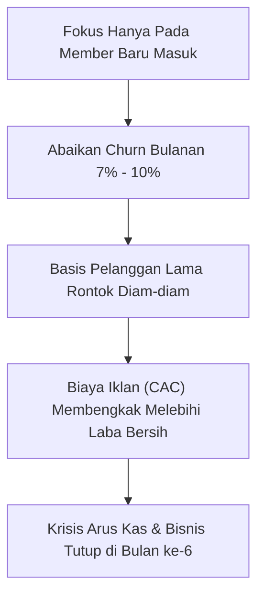
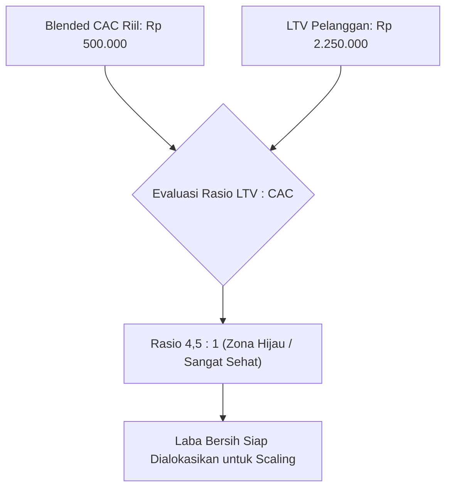

Model bisnis berbasis langganan bulanan (*subscription* atau *paid community*) sering dipromosikan sebagai cawan suci pendapatan pasif. Banyak kreator dan founder pemula membayangkan: *"Jika saya punya 1.000 anggota yang membayar Rp 100.000 per bulan, saya akan punya pendapatan pasif stabil Rp 100 juta tiap bulan."*

Kenyataannya, 90% bisnis langganan digital lokal mengalami krisis kas di bulan ke-6. Mereka terperangkap dalam ilusi metrik kesombongan (*vanity metrics*) dan lupa menghitung dua variabel paling mematikan dalam unit economics: **Churn Rate** dan **Blended Customer Acquisition Cost (CAC)**.

Bisnis berlangganan yang bocor ibarat mengisi air ke dalam ember yang berlubang: semakin keras Anda beriklan mendatangkan member baru, semakin banyak kas yang terbuang sia-sia.

## Matematika Kejam di Balik Churn Rate Bulanan

Mari kita bedah angka realistis. Katakanlah komunitas eksklusif Anda mengenakan biaya langganan Rp 150.000 per bulan dengan rata-rata **Monthly Churn Rate sebesar 6%** (angka yang umum terjadi di industri digital).

Sekilas, kehilangan 6% anggota setiap bulan tampak sepele. Namun perhatikan efek majemuknya (*compounding retention decay*):

$$\text{Tingkat Retensi Tahunan} = (1 - 0{,}06)^{12} \approx 0{,}4759 \ (47{,}6\%)$$

Artinya, dalam kurun waktu satu tahun, **52,4% dari seluruh anggota Anda akan lenyap**. 

Untuk mempertahankan skala bisnis yang sama tanpa pertumbuhan sama sekali, Anda dipaksa mengakuisisi lebih dari setengah basis pelanggan Anda setiap tahun hanya untuk bertahan hidup di titik nol.

## Membedah Rasio LTV banding CAC yang Sehat

Untuk mengetahui apakah bisnis langganan Anda sedang menuju profitabilitas atau kebangkrutan, Anda wajib menghitung rasio **Customer Lifetime Value (LTV)** terhadap **Customer Acquisition Cost (CAC)**.

### 1. Rumus Customer Lifetime Value (LTV)
LTV adalah total perkiraan laba kotor yang dihasilkan oleh seorang pelanggan sebelum mereka memutuskan berhenti berlangganan.

$$\text{LTV} = \frac{\text{Rata-rata Pendapatan per Pelanggan (ARPU)} \times \text{Gross Margin \%}}{\text{Monthly Churn Rate}}$$

Sebagai contoh:
- Biaya langganan (ARPU): Rp 150.000 / bulan.
- Gross margin (setelah biaya server dan payment gateway): 90% = Rp 135.000.
- Monthly Churn: 6% (0,06).

$$\text{LTV} = \frac{\text{Rp } 135.000}{0{,}06} = \text{Rp } 2.250.000$$

### 2. Rumus Blended Customer Acquisition Cost (CAC)
Banyak orang hanya menghitung biaya iklan langsung saat menghitung CAC. Padahal korporasi sejati menggunakan **Blended CAC**:

$$\text{Blended CAC} = \frac{\text{Total Biaya Iklan} + \text{Gaji Tim Pemasaran} + \text{Biaya Software}}{\text{Jumlah Total Pelanggan Baru yang Berhasil Diakuisisi}}$$

### 3. Matriks Kesehatan Rasio LTV : CAC
- **Di Bawah 1 : 1**: Zona Merah (Bisnis membakar uang pada setiap transaksi baru).
- **Antara 1 : 1 hingga 2 : 1**: Zona Bahaya (Kas terlalu tipis untuk menutupi biaya operasional).
- **3 : 1 atau Lebih Tinggi**: Standar Emas Industri (Bisnis sehat, menguntungkan, dan siap di-scale).
- **Di Atas 5 : 1**: Terlalu Konservatif (Anda berpotensi kurang berinvestasi dalam akuisisi pasar).

## 3 Taktik Finansial Membunuh Churn Sebelum Membunuh Anda

### 1. Utamakan Paket Tahunan Di Muka (Annual Upfront Plan)
Jangan biarkan pembeli hanya memilih opsi bulanan. Beri insentif diskon 2 bulan gratis bagi pelanggan yang membayar tahunan di muka:
- Pembayaran tahunan mengamankan kas operasional 12 bulan penuh di hari pertama.
- Secara matematis, churn rate pada paket tahunan nol persen selama 365 hari pertama.

### 2. Net Revenue Retention (NRR) via Ekspansi Aset Tambahan
Jangan hanya mengandalkan biaya langganan tetap. Tawarkan aset pelengkap sekali beli (*expansion revenue*), misalnya rekaman workshop tingkat lanjut, audit dokumen satu lawan satu, atau lisensi tim korporat.

### 3. Otomasi Penyelamatan Pembayaran Gagal (Dunning Workflow)
Sebagian besar *churn* di Indonesia bukan karena anggota tidak suka konten Anda, melainkan **karena kartu debit kedaluwarsa, saldo Virtual Account belum diisi ulang, atau lupa memperpanjang**:
- Pasang sistem pengingat otomatis WhatsApp 3 hari dan 1 hari sebelum tanggal jatuh tempo.
- Sediakan tautan pembayaran QRIS sekali klik langsung dari chat WhatsApp.

Dengan platform toko mandiri seperti [SitusBisnis](https://situsbisnis.com), Anda memegang kendali penuh atas data transaksi pelanggan, tidak terpotong komisi platform bulanan, dan dapat membangun sistem checkout dengan konversi tinggi untuk mengamankan rasio LTV:CAC bisnis digital Anda.
