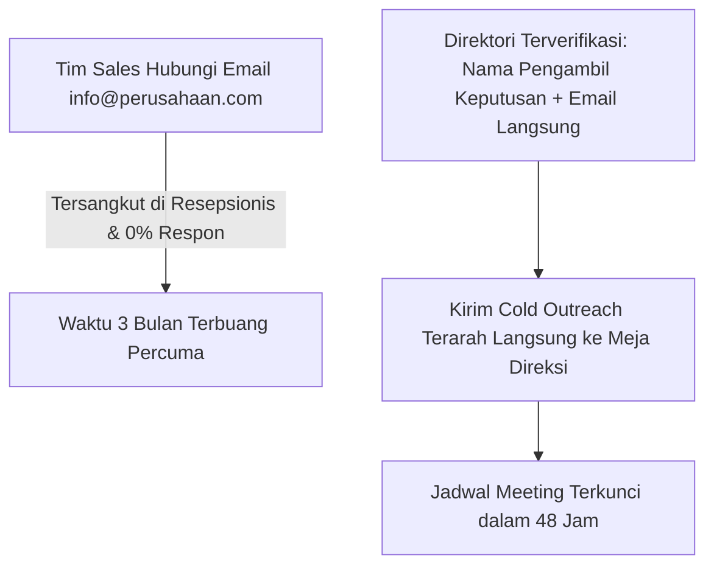
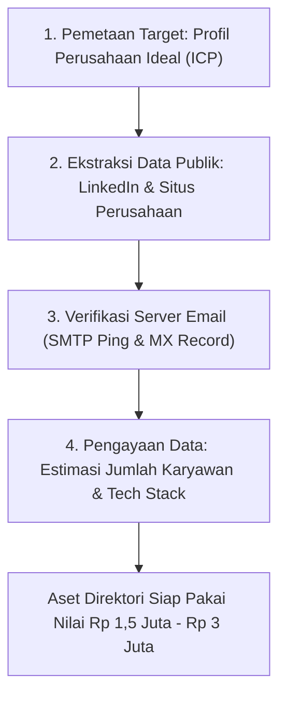

Bagi tim penjualan B2B dan agensi korporat, tantangan nomor satu yang membuat mereka kehabisan energi adalah **mencari siapa orang yang tepat untuk dihubungi**.

Berapa kali Anda atau staf sales Anda mengirim pesan ke email umum `info@perusahaan.com` atau menelepon resepsionis kantor hanya untuk diabaikan berbulan-bulan? Setiap hari, ratusan tim sales terbentur tembok tebal karena tidak tahu siapa nama manajer pengadaan (*procurement*), kepala divisi SDM (HRD), atau direktur teknologi di perusahaan target mereka.

Di sinilah lahir model bisnis data berdaya ungkit tinggi: **menjual Direktori Kontak Pengambil Keputusan B2B Terverifikasi**.

## Mematuhi Regulasi dan Menghindari Database Sampah

Banyak orang salah paham dengan bisnis database kontak. Mereka membeli DVD bajakan berisi jutaan data nomor telepon acak yang diambil ilegal dari bank atau operator seluler. Ini bukan hanya melanggar **UU No. 27 Tahun 2022 tentang Pelindungan Data Pribadi (UU PDP)** di Indonesia, tetapi juga sama sekali tidak bernilai bagi bisnis serius.

Direktori B2B yang bernilai tinggi memiliki karakteristik yang sangat berbeda:

1. **Fokus pada Data Publik Profesional Korporat**: Data yang dikumpulkan adalah informasi publik bisnis yang dipublikasikan secara resmi di profil LinkedIn profesional, situs resmi perusahaan, siaran pers, dan asosiasi industri terbuka (misalnya: Nama Lengkap, Jabatan Resmi, Alamat Email Domain Kantor `@perusahaan.co.id`, dan Profil LinkedIn).
2. **Tingkat Akurasi Email Valid > 95%**: Setiap alamat email divalidasi menggunakan alat pemeriksa MX Record dan SMTP ping (seperti ZeroBounce atau NeverBounce) untuk memastikan email tidak akan memantul (*bounce rate* rendah).
3. **Niche Sektoral yang Tersegmentasi Sangat Tajam**:
   - Bukan "100.000 Data Pengusaha Seluruh Indonesia" (sampah).
   - Melainkan "350 Kontak Head of HR & People Operations Perusahaan Manufaktur Kawasan Karawang & Cikarang".

## Apa yang Membuat Pembeli B2B Berani Bayar Jutaan Rupiah?

Sebuah agensi penyedia jasa catering pabrik ingin menawarkan jasanya ke pabrik-pabrik tekstil di Jawa Barat. Nilai satu kontrak tahunan mereka mencapai Rp 500 juta.

Bagi agensi tersebut:
- Mempekerjakan staf riset magang selama 2 bulan untuk mencari 300 kontak penanggung jawab fasilitas pabrik menghabiskan biaya gaji minimal Rp 6 juta – Rp 8 juta.
- Membeli direktori 300 kontak yang sudah terverifikasi bersih seharga **Rp 1.800.000** memangkas waktu tunggu dari 60 hari menjadi 5 menit.
- Jika dari 300 kontak tersebut mereka berhasil mengunci **hanya satu kontrak bernilai Rp 500 juta**, maka Return on Investment (ROI) pembelian direktori tersebut mencapai lebih dari 200 kali lipat.

## Mengemas Direktori Menjadi Bundel Penjualan yang Siap Pakai

Jangan hanya memberikan file spreadsheet data kosong. Naikkan nilai persepsi produk Anda dengan menyertakan alat bantu aksi langsung:

| Komponen Paket | Format Berkas | Manfaat Utama bagi Pembeli |
| :--- | :--- | :--- |
| **Master Sheet Direktori** | Google Sheets / Excel (.xlsx) | Kolom nama, jabatan, email korporat, domain web, tautan LinkedIn, ukuran tim |
| **Formula Email Outreach Dingin** | PDF Panduan Ringkas | 3 naskah email pembuka anti-spam yang dirancang khusus untuk memikat manajer korporat |
| **Tracker Saluran Penjualan** | Spreadsheet Pipeline | Tabel pemantau status komunikasi: Dikontak, Menunggu Balasan, Meeting Terjadwal, Negosiasi |

## Distribusi Terpercaya Tanpa Biaya Komisi

Klien korporat yang membeli direktori data membutuhkan jaminan kepastian unduh dan faktur transaksi formal. Menjual aset data sensitif di marketplace umum rentan memicu kesalahpahaman ulasan atau pembatalan sepihak.

Dengan toko digital mandiri melalui [SitusBisnis](https://situsbisnis.com), Anda menyajikan gerbang pemesanan eksklusif dengan verifikasi instan via QRIS dan Virtual Account, serta pengiriman tautan berkas privat terenkripsi dengan jaminan **tanpa potongan komisi**.
