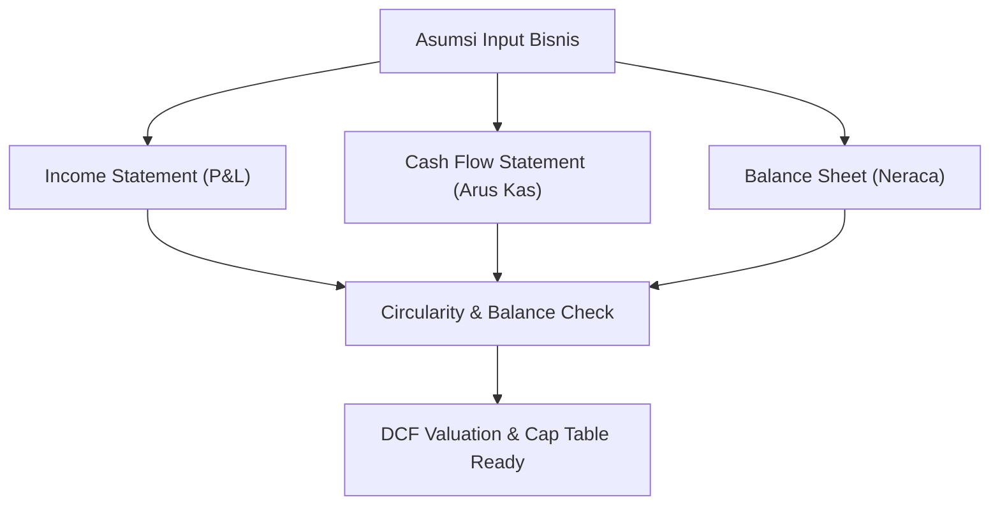
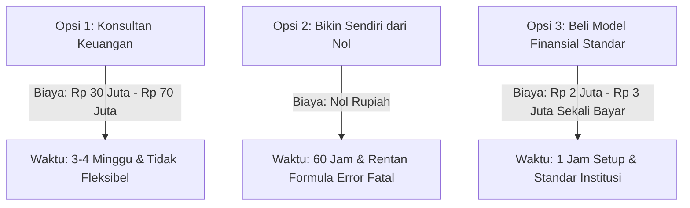

Banyak orang mengira produk spreadsheet hanya sebatas template pencatatan pengeluaran harian atau jadwal kerja sederhana. Namun di lingkaran *venture capital* dan perbankan investasi, ada pasar terselubung bernilai miliaran rupiah untuk satu jenis file digital: **3-Statement Dynamic Financial Model**.

Seorang analis keuangan independen atau mantan bankir investasi bisa menjual satu paket template model keuangan seharga Rp 1.500.000 hingga Rp 4.000.000 per lisensi. Pembelinya? Founder startup teknologi, pengusaha UMKM yang bersiap mencari pendanaan bank, konsultan M&A butik, hingga investor malaikat (*angel investor*).

Mengapa mereka rela membayar mahal untuk sebuah file spreadsheet? Karena membangun model keuangan terintegrasi dari nol membutuhkan waktu minimal 60 jam kerja dengan risiko kesalahan logika formula yang fatal.



## Anatomi Model Keuangan 3-Statement Profesional

Model keuangan amatir biasanya hanya berisi tabel proyeksi penjualan dan daftar biaya sederhana. Sebaliknya, model keuangan institusional menghubungkan tiga laporan keuangan utama secara otomatis tanpa interupsi error manual:

### 1. Tab Asumsi Makro & Variabel Dinamis (Input Sheet)
Pemisahan mutlak antara data input dan lembar perhitungan. Semua asumsi ditempatkan dalam satu tab:
- Biaya Akuisisi Pelanggan (CAC) dan pertumbuhan bulanan.
- Rasio Churn pelanggan per cohort.
- Rencana rekrutmen pegawai (*headcount planning*) lengkap dengan tunjangan dan pajak PPh 21.
- Periode penagihan piutang dagang (*Days Sales Outstanding* / DSO).

### 2. Tiga Laporan Keuangan Terpadu (Integrated 3 Statements)
- **Laba Rugi (Income Statement)**: Menghitung pendapatan kotor, COGS, Gross Margin, OpEx, hingga Net Profit setelah pajak.
- **Neraca (Balance Sheet)**: Menjaga keseimbangan antara Aset, Liabilitas, dan Ekuitas secara matematis dengan formula penyeimbang (*Balance Check Formula*).
- **Arus Kas (Cash Flow Statement)**: Memetakan aktivitas operasi, investasi, dan pendanaan. Ini adalah bagian paling krusial karena startup sering kolaps bukan karena rugi di atas kertas, tapi karena kehabisan kas fisik (*runway depletion*).

### 3. Valuasi DCF dan Cap Table Simulation
Model tingkat lanjut dilengkapi kalkulator valuasi arus kas terdiskonto (*Discounted Cash Flow* / DCF) berbasis WACC (*Weighted Average Cost of Capital*) serta simulasi dilusi saham (*Capitalization Table*) pasca putaran pendanaan.

```
Rumus Runway Kas Sederhana:
Runway (Bulan) = Total Saldo Kas Tersedia / Rata-rata Net Burn Rate Bulanan
```

## Kenapa Pembeli Tidak Menyewa Konsultan Keuangan Konvensional?

Menyewa kantor akuntan publik atau konsultan finansial independen untuk menyusun model proyeksi pitching membutuhkan biaya antara Rp 25 juta hingga Rp 75 juta. Bagi startup tahap awal (*early stage*) atau bisnis keluarga yang sedang bertumbuh, angka ini terlalu membebani kas.

Sebaliknya, membeli model keuangan teruji seharga Rp 2.500.000 memberikan solusi instan:
1. **Formula Terstandarisasi Industri**: Format yang dipakai mengikuti standar global yang disukai analis VC (Venture Capital) dan komite kredit perbankan.
2. **Kemandirian Simulasi Skenario**: Founder bisa mengubah variabel sendiri dalam hitungan detik (skenario *Best Case*, *Base Case*, dan *Worst Case*) menjelang meeting dengan pemodal.
3. **Penyelamat Waktu Kritis**: Dalam proses penggalangan dana (*due diligence*), investor sering meminta data proyeksi dalam tempo 48 jam. Membeli template siap pakai adalah satu-satunya opsi logis.



## Cara Membangun Daya Tarik Penjualan (*Product-Market Fit*)

Untuk menjual aset finansial tingkat tinggi, Anda tidak bisa menggunakan landing page generik. Penawaran Anda harus memancarkan kredibilitas teknis:

1. **Sertakan Video Demo "Tour Formula" 5 Menit**: Tunjukkan bagaimana satu angka di tab asumsi (misalnya harga langganan naik 10%) otomatis mengalir ke neraca dan mengubah valuasi akhir tanpa membuat neraca *unbalance*.
2. **Sediakan Versi Read-Only / Demo Sheet**: Biarkan calon pembeli mengklik dan menginspeksi kerapian penamaan sel (*Named Ranges*), dokumentasi formula, dan skema warna tanpa bisa mengunduh formulanya sebelum transaksi selesai.
3. **Beri Panduan PDF Kamus Metrik**: Sertakan e-book ringkas pendamping berisi penjelasan istilah (EBITDA, LTV/CAC, Quick Ratio, DSCR) agar founder non-akuntansi merasa percaya diri mempresentasikannya kepada pihak luar.

Dengan platform toko digital mandiri seperti [SitusBisnis](https://situsbisnis.com), Anda bisa mendistribusikan spreadsheet terproteksi ini dengan tautan unduh instan terenkripsi setelah pembeli melunasi transaksi via QRIS atau Virtual Account bank, tanpa potongan komisi sepeser pun.
