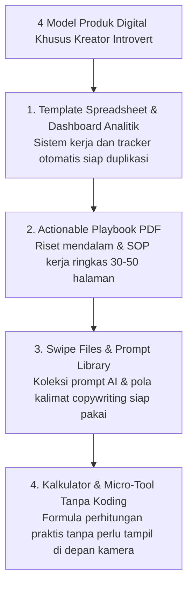

Coba tebak apa yang sering dipikirkan seorang introvert saat melihat tren *creator economy* saat ini:
> *"Aduh, kalau mau dapet duit dari internet kayaknya harus heboh di depan kamera, jago ngomong kayak presenter TV, atau bikin drama medsos tiap minggu. Itu bukan tipe saya banget. Kayaknya bisnis digital bukan buat saya deh."*

Kabar baiknya: **Anggapan itu 100% keliru.**

Di dunia ekonomi digital modern, kepribadian introvert sebenarnya adalah **keunggulan super (*superpower*) yang tersembunyi**. 

Orang introvert biasanya:
- Jauh lebih jeli mengamati masalah detail yang terlewatkan orang lain.
- Suka menyusun sistem yang rapi, runtut, dan terstruktur.
- Lebih nyaman berkomunikasi lewat tulisan yang mendalam daripada obrolan basa-basi.

Dan tahukah kamu? Produk digital yang paling dicari dan dihargai mahal oleh pasar adalah **produk yang terstruktur, rapi, dan menghemat waktu pembelinya**—persis hal-hal yang menjadi keahlian alami seorang introvert!

Di artikel ini, kita bakal membedah 4 model bisnis digital tanpa kamera (*faceless business*) yang bisa kamu jalankan dengan tenang dari sudut mejamu di rumah.

---

## 1. Empat Model Bisnis Digital Khusus Buat Kamu yang Anti Tampil

Lupakan ring light dan mic jepit. Coba perhatikan 4 format produk yang sama sekali tidak membutuhkan wajah atau suaramu:

Mari kita telaah satu per satu:

### 1. Template Spreadsheet & Dashboard Analitik
Banyak orang di luar sana malas atau pusing bikin tabel keuangan, tracker tugas, atau kalender konten dari kanvas kosong. 
- Kamu cukup merapikan sebuah spreadsheet keuangan atau dashboard operasional yang rapi dan fungsional.
- Pembeli tinggal klik tombol *"Salin ke Google Drive"*, dan kamu langsung dapat transferan uang.
- Tidak ada panggilan Zoom, tidak ada rekaman suara. Murni aset digital yang bekerja sendiri.

### 2. Actionable Playbook / E-Book Panduan Praktis (30–50 Halaman)
Buku digital yang disukai pembeli zaman sekarang bukan novel fiksi panjang, melainkan *Standard Operating Procedure (SOP)* ringkas yang to the point:
- Contoh: *"Panduan 7 Langkah Mengurus Izin Usaha PIRT Tanpa Calo"*
- Contoh: *"Checklist Audit Keamanan Website Toko Online"*
Orang membeli risetmu karena mereka tidak punya waktu untuk membaca ratusan dokumen terpisah di Google.

### 3. Library Prompt AI & Swipe File Copywriting
Dengan meledaknya era AI, orang butuh instruksi siap pakai:
- Kumpulan 100 prompt Midjourney untuk ilustrasi buku anak.
- Kumpulan 50 template email penawaran sponsor yang sudah terbukti lolos review.
Kamu mengkurasi yang terbaik, menyusunnya dalam satu file rapi, dan menjualnya seharga puluhan hingga ratusan ribu rupiah.

---

## 2. Cara Menjual Tanpa Perlu Cuap-Cuap di Live Streaming

Gimana cara mendatangkan pembeli kalau kita malu bicara di video live? Gunakan **strategi konten tulisan dan tangkapan layar (screenshots)**:

| Platform Pilihan | Format Konten yang Cocok untuk Introvert |
| :--- | :--- |
| **X / Twitter & Threads** | Thread teks berupa analisis studi kasus, tips langkah demi langkah, dan breakdown sistem. |
| **Carousel Instagram / LinkedIn** | Slide visual sederhana berlatar putih/gelap yang berisi poin-poin penting tanpa wajah. |
| **Artikel Blog SEO** | Tulisan mendalam yang dicari orang di Google saat mereka butuh solusi spesifik. |

> **Catatan Buat Kamu:**
> Orang tidak peduli seperti apa wajahmu. Yang mereka pedulikan adalah: **Apakah template atau panduan yang kamu buat beneran bisa menyelesaikan masalah mereka?**

---

## 3. Bangun Mesin Toko yang Otomatis Tanpa Melayani Chat

Salah satu hal yang paling menguras energi seorang introvert adalah melayani chat pembeli yang banyak tanya tapi nggak beli-beli (*energy vampire*).

Solusinya:
- Pasang landing page penjelasan yang lengkap dengan seksi FAQ transparan.
- Gunakan toko digital seperti [SitusBisnis](https://situsbisnis.com) yang menyediakan checkout instan QRIS dan pengiriman file otomatis.
- Pembeli masuk website, baca deskripsi, scan QRIS, lalu file langsung terkirim ke email dan WhatsApp mereka detik itu juga.

Kamu bahkan tidak perlu saling menyapa di chat untuk menutup transaksi penjualan yang sah dan menguntungkan!

---

## Ketenangan yang Menghasilkan Karya Nyata

Kamu tidak perlu mengubah kepribadianmu menjadi ekstrovert yang heboh agar bisa sukses di dunia digital.

Rangkul ketenanganmu, fokuslah membuat aset dan sistem kerja terbaik yang memudahkan hidup banyak orang, dan biarkan karya hebatmu yang berbicara dari balik layar.
