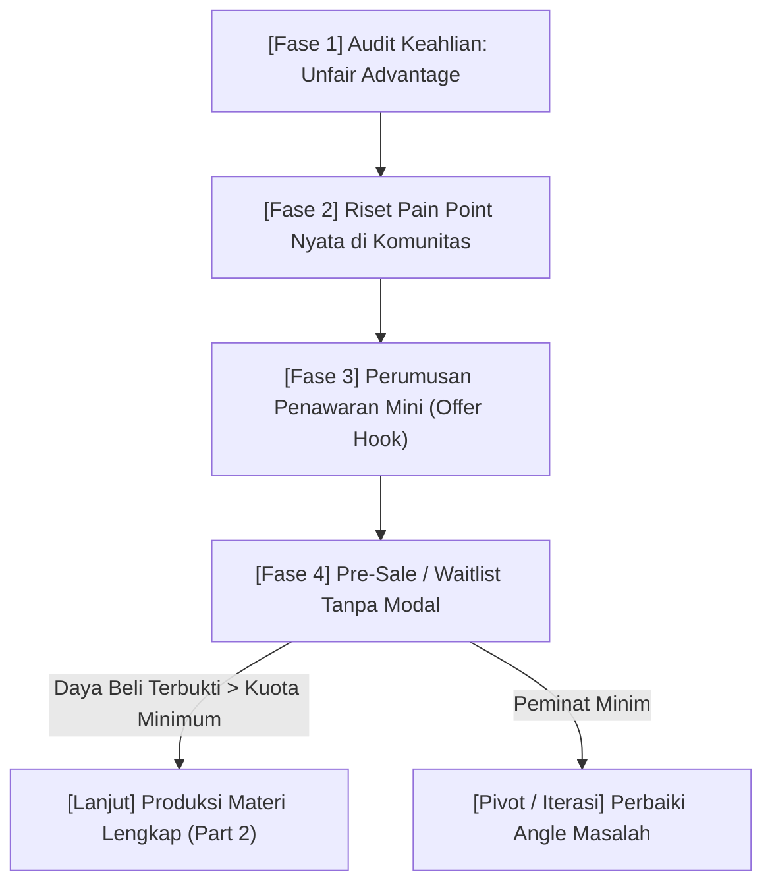

Banyak kreator, mentor, dan praktisi ahli terjebak dalam perangkap yang sama saat pertama kali ingin memonetisasi keahlian mereka: **menghabiskan waktu berbulan-bulan mengurung diri untuk membuat produk**, merancang 50 slide presentasi, merekam puluhan jam video resolusi 4K, dan mendesain cover e-book yang sempurna—hanya untuk mendapati **nol penjualan** saat hari peluncuran tiba.

Kenyataan pahit di industri *creator economy* adalah:
> **Pasar tidak membayar Anda untuk seberapa keras Anda bekerja membuat materi. Pasar hanya bersedia membayar untuk percepatan solusi atas masalah mendesak yang sedang mereka hadapi.**

Jika sebuah produk digital gagal terjual, 90% kegagalannya berakar dari tahap paling awal: **produk tersebut dibangun di atas asumsi pribadi, bukan validasi masalah nyata.**

Ini adalah **Bagian 1** dari rangkaian *Cetak Biru Creator Commerce*. Dalam esai ini, kita akan membedah metodologi sistematis untuk menemukan keunggulan unik (*unfair advantage*), memvalidasi masalah pasar dengan presisi tinggi, dan menguji daya beli calon audiens sebelum Anda menulis satu halaman pun materi produk.

---

## 1. Anatomi Alur Validasi Produk Digital

Sebelum meluncurkan produk komersial, calon pembeli harus melewati siklus konfirmasi nilai yang terukur. Berikut adalah rantai validasi yang harus Anda lalui:



Jika kuota komitmen awal tidak tercapai di Fase 4, Anda tidak kehilangan uang dan tidak membuang waktu berbulan-bulan. Anda cukup menggeser sudut pandang masalah (*pivot angle*) hingga menemukan resonansi yang tepat.

---

## 2. Mengaudit Unfair Advantage: Jangan Menjual Apa yang Anda Ketahui, Jual Apa yang Telah Anda Buktikan

Kesalahan paling umum pemula adalah mencoba menjadi "ahli serba bisa" (*generalist*) yang bersaing dengan raksasa internet. Menulis e-book berjudul *"Panduan Sukses Digital Marketing"* adalah resep instan kegagalan, karena topiknya terlalu luas, abstrak, dan sudah dibahas gratis di ribuan video YouTube.

Sebaliknya, temukan **Unfair Advantage** Anda menggunakan irisan tiga pilar berikut:

| Pilar Analisis | Pertanyaan Penuntun | Contoh Kasus Nyata |
| :--- | :--- | :--- |
| **1. Rekam Jejak (Proof of Work)** | Apa pencapaian spesifik yang sudah pernah Anda selesaikan sendiri atau bantu orang lain capai? | Berhasil menaikkan omzet toko kue dari Rp 10jt ke Rp 80jt/bln via WhatsApp. |
| **2. Friksi Unik (Hardship Overcome)** | Masalah membingungkan apa yang dulu sangat menyiksa Anda, namun kini Anda tahu jalan pintasnya? | Paham seluk-beluk birokrasi legalitas izin edar PIRT dan BPOM UMKM tanpa calo. |
| **3. Konteks Lokal (Localized Gap)** | Mengapa materi luar negeri tidak relevan dengan kondisi riil di Indonesia? | Tutorial e-commerce global hanya fokus pada Stripe & PayPal, bukan QRIS & ekspedisi COD lokal. |

Ketika ketiga pilar ini digabungkan, judul dan positioning produk Anda berubah dari yang tadinya klise menjadi sangat tajam:
- ❌ *Sebelum:* "Panduan Jualan Makanan Online" (Umum, sulit dipercaya).
- ✅ *Sesudah:* **"Sistem Otomasi WhatsApp Sales untuk Bisnis F&B Rumahan: Cara Menutup 30 Order Per Hari Tanpa Admin Tambahan."**

---

## 3. Riset Masalah Nyata: Berburu "Keluhan Berdarah" di Lapangan

Orang tidak membeli produk digital untuk menambah pengetahuan teoretis. Mereka membeli produk digital karena sedang merasakan **sakit kepala akut** yang ingin segera dihilangkan.

Ada tiga tambang emas gratis untuk memvalidasi keluhan calon pembeli di Indonesia:

### A. Kolom Komentar Media Sosial Pemimpin Pasar
Buka video TikTok, reels Instagram, atau utas X milik akun-akun besar di ceruk industri Anda. Jangan perhatikan videonya, melainkan baca **kolom komentarnya**:
- Cari pola pertanyaan berulang: *"Kak, kalau kendala saya X bagaimana solusinya?"*
- Cari ungkapan keputusasaan: *"Saya sudah coba cara A dan B tapi kok akun saya tetap sepi ya?"*
- Cari keberatan harga: *"Kelas mentor itu mahal banget, ada rangkuman praktisnya gak?"*

### B. Grup Komunitas & Diskusi (Telegram, Facebook, WhatsApp)
Masuk ke grup-grup tempat audiens ideal Anda berkumpul. Amati topik apa yang paling sering memicu perdebatan panjang. Masalah yang sering didebatkan adalah indikator kuat bahwa belum ada solusi standar yang memuaskan pasar.

### C. Analisis Ulasan Bintang 1–3 di Toko Buku & Marketplace
Lihat ulasan buku atau kursus kompetitor di Google Play Books atau platform belajar online. Ulasan bintang 1 sampai 3 biasanya mencantumkan kekurangan materi yang ada:
> *"Bukunya terlalu banyak teori motivasi, tidak ada template kalkulator Excel yang bisa langsung dipakai."*

Kekurangan kompetitor itulah yang menjadi **fitur pembeda utama** produk Anda.

---

## 4. Validasi Penawaran Tanpa Modal: Metode "Smoke Test" & Pre-Sale

Setelah Anda memiliki formulasi masalah dan solusi, **jangan langsung merekam materi**. Lakukan uji coba daya beli (*Smoke Test*) menggunakan langkah-langkah berikut:

### Langkah 1: Buat Dokumen Rencana (One-Page Outline)
Tuliskan 1 halaman dokumen yang merangkum:
1. Siapa produk ini ditujukan (dan siapa yang TIDAK cocok).
2. Tiga hasil konkret (*transformation*) yang akan diraih pembeli setelah menyelesaikan materi.
3. Daftar modul/isi yang akan mereka dapatkan.

### Langkah 2: Buat Halaman Waitlist di SitusBisnis
Gunakan platform **[SitusBisnis](https://situsbisnis.com)** untuk membuat satu halaman sederhana (*single-page landing*) dalam hitungan menit. Tampilkan informasi di atas dan pasang tombol pre-order atau daftar tunggu (*waitlist*).

```
Target Metrik Uji Coba:
- Jika Anda mengumumkan ke 100 orang dan 15-20 orang mendaftar waitlist: MASALAH ANDA VALID.
- Jika kurang dari 5 orang mendaftar: FORMULASI MASALAH ANDA BELUM MENDESAK.
```

### Langkah 3: Tawarkan Harga Pre-Sale Khusus (Early Bird)
Katakan kepada calon pendaftar:
> *"Materi ini sedang dirampungkan dan akan resmi meluncur 14 hari lagi seharga Rp 299.000. Namun, untuk 20 orang pertama yang memesan sekarang, Anda mendapatkan harga founding member Rp 99.000 + sesi konsultasi tanya-jawab langsung."*

Ketika uang sungguhan berpindah tangan, Anda telah mendapatkan **validasi mutlak**. Anda kini memiliki modal, memiliki kepastian pasar, dan memiliki batas waktu (*deadline*) yang jelas untuk menyelesaikan produk.

---

## 5. Ringkasan & Langkah Aksi Anda Hari Ini

Validasi bukanlah tentang kesempurnaan teknis, melainkan tentang **menghilangkan risiko kegagalan sejak hari pertama**.

### Checklist Tugas Anda:
1. [ ] Tuliskan 3 keahlian atau pencapaian terbesar Anda selama 2 tahun terakhir.
2. [ ] Temukan minimal 15 komentar keluhan spesifik dari calon audiens di media sosial atau komunitas.
3. [ ] Buat satu kalimat penawaran tegas: *"Saya membantu [target audiens] mencapai [hasil konkret] tanpa harus [friksi yang paling mereka benci]."*
4. [ ] Uji respon pasar dengan halaman waitlist sederhana sebelum memproduksi materi.

---

*Di **Part 2** mendatang, kita akan membedah secara mendalam: **Arsitektur Produk — Memilih Format E-book vs Mini-Course, Struktur Kurikulum Cepat, & Formula Value-Based Pricing untuk Pasar Indonesia**.*
