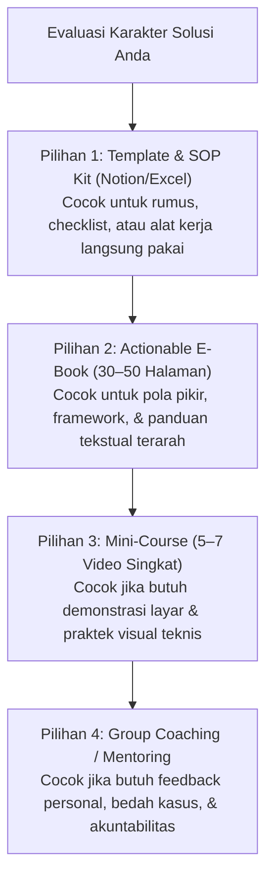

Setelah Anda memvalidasi bahwa pasar memiliki masalah nyata dan bersedia membayar solusinya (seperti yang dibahas pada [Part 1](/posts/cetak-biru-creator-commerce-part-1-validasi-ide/)), tantangan berikutnya adalah: **bagaimana mengemas solusi tersebut menjadi produk digital yang bernilai tinggi dan memuaskan pembeli?**

Banyak kreator pemula terjebak dalam perangkap *"Course Bloat"*—mengira bahwa semakin banyak jam video atau semakin tebal halaman e-book, maka produk tersebut akan semakin dihargai. Kenyataannya di era perhatian serba pendek saat ini:
> **Konsumen digital tidak membeli durasi materi. Mereka membeli percepatan waktu untuk berpindah dari Kondisi A (frustrasi) ke Kondisi B (hasil nyata).**

Dalam **Bagian 2** ini, kita akan membedah arsitektur produk: memilih format yang paling efisien untuk dibuat, menyusun kurikulum berbasis hasil (*outcome-driven*), dan menetapkan harga berbasis nilai (*value-based pricing*) yang menguntungkan tanpa memicu penolakan pasar.

---

## 1. Memilih Format Produk: Matriks Efisiensi vs Kecepatan Produksi

Format produk harus disesuaikan dengan kapasitas waktu Anda dan ekspektasi audiens. Jangan langsung memaksakan diri membuat kursus video 10 modul jika Anda baru pertama kali merilis produk komersial.

Berikut adalah perbandingan empat format produk digital terpopuler:

| Format Produk | Waktu Pembuatan | Tingkat Penyelesaian Siswa | Rentang Harga Rekomendasi (IDR) | Cocok Untuk |
| :--- | :--- | :--- | :--- | :--- |
| **Actionable E-book / Guide** | 3–7 hari | Tinggi (60%–70%) | Rp 49.000 – Rp 199.000 | Framework terstruktur, playbook langkah demi langkah, panduan teknis ringkas. |
| **SOP & Template Kit (Notion/Spreadsheet)** | 2–5 hari | Sangat Tinggi (80%+) | Rp 99.000 – Rp 299.000 | Alat bantu kerja langsung pakai: kalkulator finansial, prompt AI, template kontrak UMKM. |
| **Video Mini-Course (60–90 Menit)** | 7–14 hari | Sedang (40%–50%) | Rp 199.000 – Rp 699.000 | Keterampilan visual/software yang butuh demonstrasi layar (Figma, ads dashboard, coding). |
| **Cohort / Group Mentoring** | Persiapan 1 minggu | Sangat Tinggi (85%+) | Rp 990.000 – Rp 4.900.000 | Bimbingan intensif berkala dengan akuntabilitas dan interaksi langsung. |



> **Rekomendasi Terbaik untuk Produk Pertama:** Mulailah dari **Template Kit** atau **E-book Praktis**. Keduanya memiliki kecepatan produksi tercepat, risiko teknis terendah, dan tingkat konsumsi tertinggi oleh pembeli.

---

## 2. Merancang Kurikulum Berorientasi Hasil (The Outcome Framework)

Jangan menyusun daftar isi materi berdasarkan kronologi ensiklopedis (dari sejarah hingga teori dasar). Susunlah kurikulum menggunakan prinsip **Minimum Viable Theory (MVT)**:

```
Kondisi A (Titik Sakit Audiens) ──────[ 3 Milestone Konkret ]──────► Kondisi B (Kemenangan Pertama)
```

Bagi materi Anda ke dalam tiga fase utama:
1. **Fase 1: Quick Win (Hari 1–2):** Berikan satu tindakan kecil yang bisa langsung dipraktikkan dalam 30 menit pertama dan langsung membuahkan hasil nyata. Kemenangan awal ini membangun dopamin dan keyakinan pembeli terhadap kredibilitas Anda.
2. **Fase 2: The Core Mechanism (Hari 3–5):** Ajarkan sistem atau formula inti yang memecahkan akar permasalahan utama.
3. **Fase 3: Safeguard & Troubleshooting (Hari 6–7):** Berikan panduan antisipasi kendala: *"Apa yang harus dilakukan jika cara di atas belum berhasil pada kondisi spesifik Anda?"*

---

## 3. Menetapkan Harga Berbasis Nilai (Value-Based Pricing)

Kesalahan fatal pebisnis pemula di Indonesia adalah menghitung harga berdasarkan **biaya produksi** (misal: "karena saya buatnya cuma 3 hari di laptop, saya jual Rp 25.000 saja").

Harga produk digital harus ditentukan oleh **nilai transformasi ekonomi atau emosional** yang diperoleh pembeli:

$$Harga = \frac{\text{Nilai Hasil yang Didapat} - \text{Friksi \& Waktu Trial-Error}}{10}$$

### Rumus Perhitungan Nilai Riil:
- Jika template akuntansi Anda menghemat waktu pemilik UMKM 10 jam per bulan (setara gaji admin Rp 1.500.000/bulan), maka menjual template tersebut seharga **Rp 199.000** adalah penawaran yang sangat murah (*no-brainer offer*).
- Jika panduan portofolio Anda membantu desainer freelance mendapatkan klien pertama bernilai Rp 3.000.000, maka harga e-book **Rp 249.000** memiliki Return on Investment (ROI) lebih dari 10 kali lipat.

---

## 4. Arsitektur 3-Tier Pricing untuk Pasar Indonesia

Gunakan model penetapan harga bertingkat (*tiering*) untuk memaksimalkan pendapatan dari berbagai segmen audiens Anda:

| Paket Penawaran | Apa yang Didapatkan | Rentang Harga | Peran Finansial |
| :--- | :--- | :--- | :--- |
| **Tier 1: Starter (Standard)** | Core E-book atau Materi Inti saja (PDF). | Rp 99.000 | Menurunkan hambatan masuk bagi audiens baru. |
| **Tier 2: Pro (Best Value ⭐)** | Materi Inti + 5 Template Siap Pakai + Checklist SOP. | Rp 199.000 | **Paket utama** (menghasilkan 70% total volume pesanan). |
| **Tier 3: VIP / Implementation** | Semua isi Pro + Akses Komunitas Eksklusif + 1x Review Tertulis. | Rp 499.000 – Rp 990.000 | Memaksimalkan margin dari pembeli paling serius. |

---

## 5. Ringkasan & Checklist Langkah Aksi

Sebelum melangkah ke pembuatan saluran prospek (*lead magnet*):
1. [ ] Tentukan format tunggal yang paling cepat Anda selesaikan dalam 7 hari ke depan.
2. [ ] Formulasikan *Quick Win* pertama yang bisa dialami pembeli dalam 1 jam setelah checkout.
3. [ ] Hitung nilai penghematan waktu/uang yang diberikan produk Anda kepada pembeli.
4. [ ] Siapkan dua atau tiga tier harga agar pembeli memiliki opsi peningkatan nilai (*upsell*).

---

*Langkah berikutnya: Bagaimana mendatangkan ratusan calon pembeli potensial tanpa harus membayar iklan mahal? Simak di **[Part 3: Lead Magnet & Mesin Prospek Mandiri](/posts/cetak-biru-creator-commerce-part-3-mesin-prospek/)**.*
