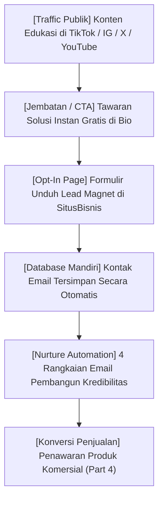

Salah satu kerentanan terbesar bagi kreator konten di era modern adalah membangun seluruh kerajaan bisnis di atas **"tanah sewaan"** (*rented land*). 

Jika Anda hanya mengandalkan *followers* di Instagram, TikTok, YouTube, atau X:
- Akun Anda bisa terkena pembatasan jangkauan (*shadowban*) kapan saja.
- Algoritma platform bisa berubah drastis dalam semalam, memotong *reach* konten Anda hingga 90%.
- Anda harus membayar iklan mahal hanya untuk menjangkau orang-orang yang sebelumnya sudah menekan tombol *follow*.

Pebisnis digital yang bertahan puluhan tahun selalu memiliki satu aset utama: **Database Calon Pembeli Mandiri (*Owned Audience / Email List*)**.

Dalam **Bagian 3** dari seri *Cetak Biru Creator Commerce*, kita akan membedah arsitektur pengalihan audiens: bagaimana merancang aset gratis bernilai tinggi (*lead magnet*) dan menyusun sistem otomatisasi pesan yang mengubah orang asing menjadi prospek siap beli.

---

## 1. Arsitektur Corong Pengalihan Audiens (Bridge Funnel)

Alur pergerakan audiens dari platform publik ke database mandiri dirancang secara bertahap tanpa paksaan:

Ketika prospek sudah berada di database Anda, biaya distribusi promosi Anda turun menjadi **Rp 0**, dan Anda memiliki jalur komunikasi langsung (*direct-to-consumer*) 24 jam sehari.

---

## 2. Tiga Kriteria Lead Magnet yang Memicu Lonjakan Konversi

Banyak kreator membagikan e-book 80 halaman sebagai aset gratis dan heran mengapa unduhannya rendah. Di era kelebihan informasi (*information overload*), tidak ada orang yang ingin membaca buku tebal gratisan dari orang yang belum mereka kenal.

Lead magnet yang memiliki tingkat konversi 30%–50% di halaman landing page wajib memenuhi tiga syarat:

| Syarat Lead Magnet | Penjelasan Praktis | Contoh Implementasi |
| :--- | :--- | :--- |
| **1. Ultra-Spesifik** | Memecahkan SATU masalah teknis kecil, bukan masalah besar dunia. | ❌ "Panduan Bisnis Kuliner"  ✅ "Kalkulator Food Cost Excel Otomatis untuk Menu Kafe" |
| **2. Konsumsi Instan (<10 Menit)** | Bisa dipahami dan langsung dipakai dalam waktu kurang dari 10 menit. | Checklist SOP, Template Notion, Cheatsheet 1 Lembar, Prompt Library. |
| **3. Jembatan Alami ke Produk Berbayar** | Memberikan solusi *"Apa yang harus dilakukan"*, sementara produk berbayar memberikan *"Cara menerapkannya secara lengkap"*. | Lead magnet memberikan template, produk berbayar memberikan sistem implementasi terpandu. |

---

## 3. Rangkaian Email Selamat Datang (The 4-Part Welcome Sequence)

Setelah calon pembeli mengunduh lead magnet, jangan langsung membombardir mereka dengan tawaran jualan (*hard selling*). Jalankan 4 urutan email otomatis (*automated sequence*) berikut selama 5 hari pertama:

### Email 1: Instant Delivery + Setup Ekspektasi (Kirim Detik Itu Juga)
- **Subjek:** `[Download File] Link akses panduan Anda sudah siap`
- **Tujuan:** Mengirimkan tautan unduhan file, menyapa dengan ramah, dan memberitahukan jadwal kirim email berikutnya agar mereka memindahkan email Anda dari tab Promosi ke tab Utama (*Inbox Primary*).

### Email 2: The Origin Story & Rekam Jejak (Kirim Hari Ke-2)
- **Subjek:** `Mengapa saya berhenti melakukan cara lama...`
- **Tujuan:** Menceritakan titik balik (*turning point*) Anda. Mengapa cara lama yang sering diajarkan orang lain itu tidak efektif, dan prinsip baru apa yang Anda temukan sehingga membawa hasil nyata.

### Email 3: Studi Kasus & Kesalahan Umum (Kirim Hari Ke-3)
- **Subjek:** `Kesalahan nomor #1 yang paling sering menghabiskan uang`
- **Tujuan:** Menunjukkan bukti sosial (*proof*). Ceritakan bagaimana seorang murid atau Anda sendiri berhasil memecahkan kendala tersebut. Hancurkan mitos-mitos keliru yang dipercayai calon pembeli.

### Email 4: The Soft Transition / Penawaran Perdana (Kirim Hari Ke-5)
- **Subjek:** `Langkah berikutnya jika Anda ingin hasil yang lebih cepat`
- **Tujuan:** Menghubungkan keberhasilan dari lead magnet ke produk berbayar Anda: *"Anda sudah melihat bagaimana template ini bekerja. Jika Anda ingin memiliki seluruh arsitektur lengkapnya tanpa trial-error, saya telah merangkumnya di sini..."*

---

## 4. Ringkasan & Checklist Langkah Aksi

1. [ ] Buat 1 aset lead magnet berupa checklist, template spreadsheet, atau panduan ringkas 3 halaman.
2. [ ] Pasang formulir opt-in sederhana pada bio profil media sosial Anda.
3. [ ] Siapkan urutan 4 email selamat datang untuk mengedukasi dan membangun kedekatan dengan pelanggan baru.
4. [ ] Pantau metrik *Open Rate* (target: >35%) dan *Click-Through Rate* (target: >5%).

---

*Setelah database prospek mulai terkumpul, ke mana Anda akan mengarahkan mereka untuk bertransaksi? Simak di **[Part 4: Landing Page Berdaya Konversi Tinggi — Menulis Copywriting Persuasif Tanpa Tipu-Tipu](/posts/cetak-biru-creator-commerce-part-4-landing-page-konversi/)**.*
