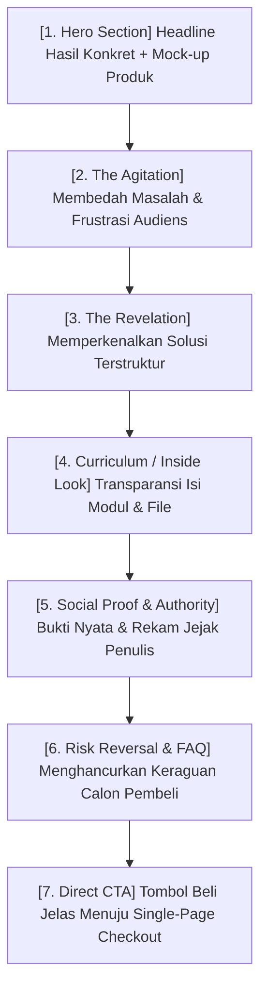

Banyak kreator menghabiskan jutaan rupiah untuk menyewa desainer demi membuat *landing page* dengan animasi 3D yang megah dan efek visual interaktif, namun mendapati tingkat konversi penjualannya di bawah 0,5%.

Kenyataan mendasar dalam psikologi penjualan online adalah:
> **Desain yang berlebihan membingungkan pembeli. Yang melahirkan transaksi bukanlah animasi visual yang rumit, melainkan kejelasan pesan (*clarity of message*) dan relevansi solusi terhadap masalah pembaca.**

Di Indonesia, lebih dari **92% transaksi produk digital terjadi melalui layar ponsel (smartphone)** dengan jaringan internet yang dinamis. Jika landing page Anda lambat dimuat (*slow load time*) atau membutuhkan waktu 30 detik hanya untuk memahami apa yang Anda jual, calon pembeli akan langsung menutup tab peramban mereka.

Dalam **Bagian 4** ini, kita akan membedah arsitektur **7 Blok Esensial Landing Page Konversi Tinggi** serta formula copywriting yang persuasif, transparan, dan tidak manipulatif.

---

## 1. Anatomi 7 Blok Landing Page Penjual Produk Digital

Struktur halaman penjualan yang efektif dirancang mengikuti alur psikologis pengambilan keputusan manusia:

---

## 2. Bedah Teknis Setiap Blok Salinan (Copywriting Blocks)

### Blok 1: Hero Section (3 Detik Pertama)
Tujuan utama hero section adalah membuat pembaca berhenti melakukan *scrolling* dan langsung mengerti proposisi nilai produk Anda:
- **Badge Status:** Penanda kategori yang jelas (misal: *Panduan Praktis UMKM*).
- **Headline Hasil:** Format formula: `Cara [Mencapai Hasil Spesifik] dalam [Jangka Waktu Realistis] Tanpa [Hal yang Paling Ditakuti/Dibenci].`
- **Sub-headline:** Penjelasan satu kalimat tentang siapa yang paling cocok membaca panduan ini.
- **Visual Mock-up:** Tampilkan gambar wujud produk secara realistis (gambar cover buku di atas tablet/laptop, bukan sekadar teks melayang).

### Blok 2: The Agitation (Validasi Emosional)
Tuliskan 3–4 situasi frustrasi yang sedang dialami audiens Anda dalam bentuk poin:
- *"Apakah Anda lelah menghabiskan 4 jam setiap hari mengurus chat pesanan secara manual?"*
- *"Pernahkah Anda mencoba beriklan, tetapi uang habis tanpa menghasilkan satu pun penjualan?"*
Ketika pembaca merasa masalah mereka digambarkan dengan sangat akurat, secara psikologis mereka akan percaya bahwa Anda juga memiliki kunci solusinya.

### Blok 3: The Revelation (Perkenalan Produk)
Perkenalkan produk Anda bukan sebagai "kumpulan teori", melainkan sebagai **jembatan jalan pintas**:
> *"Saya merancang [Nama Produk] untuk menjadi panduan kerja terpadu yang memangkas waktu uji coba Anda dari 6 bulan menjadi 7 hari eksekusi langsung."*

### Blok 4: Inside Look (Transparansi Modul)
Jelaskan secara transparan apa saja yang akan diterima pembeli setelah menyelesaikan pembayaran:
- Daftar bab dan intisari praktisnya.
- Bonus aset kerja: template spreadsheet, checklist PDF, atau rekaman sesi tanya-jawab.
- Format file dan cara mengaksesnya.

### Blok 5: Social Proof (Bukti Sosial yang Kredibel)
Testimoni yang kuat adalah testimoni yang menyebutkan **angka atau perubahan konkret**, bukan sekadar pujian normatif:
- ❌ *Lemah:* "Materinya bagus banget kak, sangat bermanfaat!"
- ✅ *Kuat:* "Setelah menerapkan modul 2 selama 3 hari, tingkat konversi landing page toko saya naik dari 1,2% ke 3,8%, menghasilkan 42 pesanan baru tanpa menambah anggaran iklan."

### Blok 6: FAQ & Penanganan Keberatan (Objection Crushing)
Jawab 4 pertanyaan paling krusial di benak calon pembeli Indonesia:
1. *"Apakah pemula yang tidak paham teknis bisa mempraktikkan materi ini?"*
2. *"Format materinya apa dan bagaimana cara saya mengaksesnya?"*
3. *"Berapa lama akses berlaku? (Jelaskan: Akses seumur hidup / Lifetime Access)"*
4. *"Metode pembayaran apa saja yang diterima? (QRIS instan, GoPay/OVO, dan Virtual Account)"*

### Blok 7: Clear & Unambiguous CTA
Gunakan teks tombol aksi yang menegaskan manfaat, bukan kata generik:
- ❌ *Kurang efektif:* "Submit" atau "Beli Sekarang"
- ✅ *Persuasif:* **"Dapatkan Akses Instan Sekarang (Diskon Khusus) →"**

---

## 3. Checklist Optimasi Mobile-First

Sebelum meluncurkan landing page Anda di platform **[SitusBisnis](https://situsbisnis.com)**:
1. [ ] Pastikan ukuran font isi teks minimal `16px` agar nyaman dibaca di layar HP tanpa harus di-*zoom*.
2. [ ] Letakkan tombol CTA pertama di area yang terlihat tanpa harus scroll jauh (*above the fold*).
3. [ ] Gunakan tata letak satu kolom (*single column*) agar alur membaca mengalir vertikal secara alami.
4. [ ] Hindari form pendaftaran panjang—cukup minta Nama Lengkap, Alamat Email, dan Nomor WhatsApp.

---

*Setelah calon pembeli mengklik tombol CTA, bagaimana memastikan mereka tidak membatalkan niat beli di halaman pembayaran? Simak di **[Part 5: Sistem Checkout & Pengiriman Otomatis 24/7](/posts/cetak-biru-creator-commerce-part-5-checkout-otomasi/)**.*
