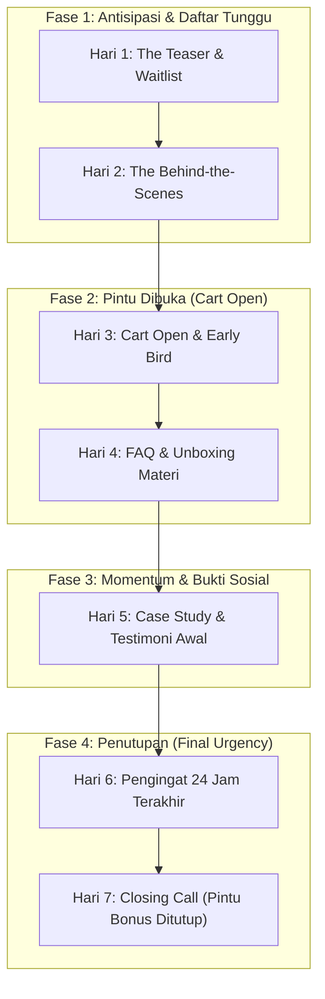

Banyak kreator mengira peluncuran produk digital (*product launch*) hanyalah satu momen di mana mereka memposting link jualan di Instagram Story atau X: *"Teman-teman, e-book saya sudah rilis, link ada di bio ya!"*

Hasilnya? Beberapa likes, segelintir klik, dan **penjualan yang lesu**.

Peluncuran yang sukses bukanlah satu peristiwa tunggal (*event*), melainkan sebuah **rangkaian narasi psikologis (*campaign*)** yang dibangun selama 7 hingga 14 hari:
> **Orang tidak membeli saat pertama kali mereka mendengar nama produk Anda. Mereka membeli ketika rasa penasaran telah mencapai puncaknya dan ada alasan mendesak untuk bertindak hari ini daripada menundanya besok.**

Dalam **Bagian 6** dari seri *Cetak Biru Creator Commerce*, kita akan membedah **The 7-Day Launch Framework**: kalender kampanye harian terstruktur yang telah terbukti membuka keran penjualan secara masif.

---

## 1. Kalender Peluncuran 7 Hari (The Launch Timeline)

Berikut adalah visualisasi alur kampanye 7 hari dari pembukaan keran penawaran hingga penutupan bonus eksklusif:

---

## 2. Bedah Aksi Harian: Apa yang Harus Diposting Setiap Hari?

### Hari 1: The Teaser (Membangun Antisipasi)
- **Fokus Pesan:** Jangan umumkan produknya secara gamblang. Bicarakan masalah besar yang sedang Anda selesaikan.
- **Isi Pesan:** *"Selama 3 minggu terakhir, saya merangkum seluruh SOP sistem konversi yang dulu menyelamatkan toko saya. Sedang saya rapikan agar bisa langsung dipraktikkan orang lain. Siapa yang butuh?"*
- **Call-to-Action:** Minta mereka bergabung ke daftar tunggu (*Waitlist Page*) untuk mendapatkan diskon 50% saat rilis.

### Hari 2: The Behind-the-Scenes (Bukti Otoritas)
- **Fokus Pesan:** Tunjukkan proses pembuatan dan bocoran materi (*sneak peek*).
- **Isi Pesan:** Screenshot daftar modul di dokumen kerja atau video layar pendek saat Anda menyusun template kalkulator. Tunjukkan ketelitian dan bobot materi yang disiapkan.

### Hari 3: Cart Open (Hari Pembukaan Penjualan)
- **Fokus Pesan:** Pengumuman resmi bahwa pendaftaran/pembelian telah resmi dibuka dengan **Penawaran Early Bird Terbatas (hanya 48 jam)**.
- **Insentif:** Berikan bonus eksklusif yang hanya ada di fase peluncuran (misal: template tambahan atau akses sesi Q&A tertutup).
- **Distribusi:** Kirimkan email blast ke seluruh database prospek Anda dan publikasikan link landing page di media sosial.

### Hari 4: FAQ & Objections Crushing
- **Fokus Pesan:** Menghancurkan keraguan mereka yang sudah membuka halaman landing page namun belum checkout.
- **Isi Pesan:** Kumpulkan 5 pertanyaan paling sering ditanyakan di DM atau email, lalu jawab secara terbuka dan transparan: *"Banyak yang bertanya: Apakah materi ini cocok untuk yang baru mulai dari nol? Jawabannya adalah..."*

### Hari 5: Case Study & Social Proof Awal
- **Fokus Pesan:** Tampilkan pengalaman mereka yang sudah mendapatkan akses lebih awal (*beta testers* atau pembeli hari pertama).
- **Isi Pesan:** Tunjukkan tangkapan layar antusiasme pembeli, feedback positif terhadap kelengkapan materi, atau hasil awal yang telah mereka capai.

### Hari 6: Pengingat 24 Jam Terakhir (The Ticking Clock)
- **Fokus Pesan:** Mengingatkan bahwa harga Early Bird atau kuota bonus peluncuran akan segera berakhir dalam 24 jam.
- **Isi Pesan:** Manusia adalah makhluk yang gemar menunda (*procrastinator*). 40% dari total penjualan kampanye biasanya terjadi di 48 jam terakhir saat batas waktu semakin dekat.

### Hari 7: Final Call (Malam Penutupan)
- **Fokus Pesan:** Penegasan batas waktu (*urgency* etis).
- **Isi Pesan:** Kirimkan 2 email di hari ini:
  - Pagi (09:00): *"Malam ini pukul 23:59 penawaran Early Bird resmi ditutup."*
  - Malam (20:00): *"Tersisa 4 jam sebelum harga naik menjadi harga normal."*
- **Integritas:** Tepat pukul 00:00, pastikan harga di landing page memang benar-benar dinaikkan ke harga normal. Jangan berbohong, karena reputasi dan kepercayaan jangka panjang jauh lebih berharga daripada beberapa penjualan sesaat.

---

## 3. Ringkasan & Checklist Langkah Aksi

1. [ ] Susun kalender peluncuran 7 hari dengan pesan spesifik untuk setiap harinya.
2. [ ] Siapkan halaman waitlist minimal 5 hari sebelum hari-H peluncuran.
3. [ ] Sediakan 1 bonus peluncuran yang sangat menarik dan bernilai nyata bagi pembeli awal.
4. [ ] Siapkan draf email dan materi postingan lebih awal agar Anda tidak panik saat hari peluncuran tiba.

---

*Setelah kampanye peluncuran sukses dan Anda mendapatkan ratusan pembeli pertama, bagaimana cara membuat arus kas ini terus mengalir setiap hari tanpa harus meluncurkan produk baru terus-menerus? Simak di bab pamungkas **[Part 7: Scaling & Flywheel Bisnis Mandiri](/posts/cetak-biru-creator-commerce-part-7-scaling-bisnis/)**.*
