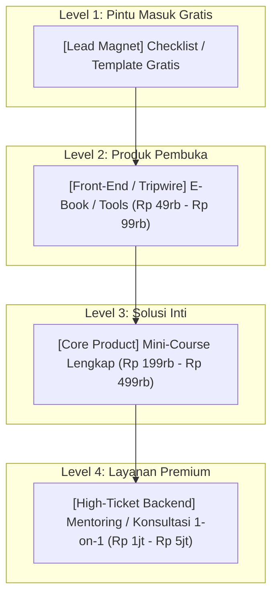

Pernah nggak kamu ngalamin momen ini: peluncuran produk digitalmu sukses besar, tapi seminggu kemudian... penjualan mendadak kembali sepi dan hening.

Banyak kreator terjebak dalam siklus kelelahan ini. Mereka merasa harus selalu membuat produk baru dari nol setiap bulan agar dapur tetap mengepul.

Padahal, pebisnis digital yang cerdas tidak bekerja seperti itu. Mereka tidak terus-menerus membuat produk acak, melainkan membangun sebuah **Ekosistem Tangga Nilai dan Roda Penghasil Pendapatan (Flywheel) yang Berkelanjutan**.

---

## 1. Konsep Tangga Nilai Produk (The Value Ladder)

Orang yang paling berpeluang membeli produk Anda di masa depan adalah **orang yang sudah pernah membeli dari Anda sebelumnya dan puas dengan hasilnya**.

Berikut adalah arsitektur tangga produk ideal yang memaksimalkan *Customer Lifetime Value (LTV)*:



### Mengapa Struktur Ini Sangat Menghasilkan?
1. **Produk Pembuka (Tripwire):** Mengubah prospek menjadi pembeli berbayar secepat mungkin. Biaya psikologisnya sangat rendah (di bawah Rp 100.000).
2. **Produk Inti (Core Offer):** Memberikan sistem lengkap yang menghasilkan mayoritas pendapatan stabil Anda.
3. **Produk Premium (Backend):** Hanya dibeli oleh 5%–10% konsumen paling ambisius, namun memberikan **50% dari total margin keuntungan bersih Anda**.

---

## 2. Meningkatkan Nilai Rata-Rata Pesanan: Taktik Order Bump

Jangan biarkan pembeli checkout hanya dengan satu produk jika Anda memiliki produk komplementer yang relevan.

**Order Bump** adalah penawaran satu centang (*one-click checkbox*) yang diletakkan tepat di formulir checkout sebelum tombol bayar ditekan:

```
┌────────────────────────────────────────────────────────────────────────┐
│ [✓] YA! Tambahkan juga "Koleksi 50+ Template Kontrak Legal Bisnis"      │
│     Hanya dengan menambah Rp 49.000 (Hemat 70% dari harga normal).     │
└────────────────────────────────────────────────────────────────────────┘
```

Secara statistik:
- Sekitar **25% hingga 40% pembeli** akan mencentang kotak order bump jika tawarannya relevan.
- Jika produk utama berharga Rp 150.000 dan order bump berharga Rp 49.000, rata-rata pendapatan per transaksi Anda naik dari Rp 150.000 menjadi hampir **Rp 170.000 tanpa menambah biaya akuisisi sepeser pun**.

---

## 3. Mengubah Kampanye Menjadi Mesin Penjualan Harian (Evergreen Funnel)

Bagaimana agar penjualan tetap mengalir setiap hari tanpa harus meluncurkan promo terus-menerus?

Jadikan alur yang sudah terbukti di [Part 3](/posts/cetak-biru-creator-commerce-part-3-mesin-prospek/) dan [Part 6](/posts/cetak-biru-creator-commerce-part-6-launch-playbook/) menjadi sistem otomatis:
1. **Traffic Konsisten:** Setiap konten edukasi yang Anda rilis di media sosial selalu menyertakan ajakan mengunduh lead magnet gratis di bio profil.
2. **Otomatisasi Selamat Datang:** Setiap subscriber baru otomatis menerima urutan email pengenalan dan edukasi selama 5 hari pertama.
3. **Penawaran Terbatas Personal:** Di hari ke-5, subscriber baru menerima penawaran diskon perkenalan yang hanya berlaku selama 48 jam untuk akun mereka.
4. **Hasilnya:** Setiap hari ada audiens baru yang masuk ke corong Anda, dan setiap hari ada transaksi yang terkonversi secara otomatis.

---

## 4. Rangkuman Peta Jalan Lengkap (The Master Blueprint Recap)

Mari kita tinjau kembali seluruh perjalanan yang telah Anda pelajari dalam seri ini:

| Bagian Seri | Fokus Utama | Hasil Konkret yang Anda Miliki |
| :--- | :--- | :--- |
| **[Part 1: Validasi Ide](/posts/cetak-biru-creator-commerce-part-1-validasi-ide/)** | Audit keahlian & riset keluhan nyata | Ide produk yang dicari pasar dan terbukti ada daya belinya. |
| **[Part 2: Arsitektur Produk](/posts/cetak-biru-creator-commerce-part-2-arsitektur-produk/)** | Format, kurikulum, & value pricing | Struktur materi ringkas berorientasi hasil dan tier harga menguntungkan. |
| **[Part 3: Mesin Prospek](/posts/cetak-biru-creator-commerce-part-3-mesin-prospek/)** | Lead magnet & database email mandiri | Saluran komunikasi langsung milik sendiri tanpa dikendalikan algoritma medsos. |
| **[Part 4: Landing Page Konversi](/posts/cetak-biru-creator-commerce-part-4-landing-page-konversi/)** | 7 blok copywriting persuasif | Halaman penjualan yang mengubah pengunjung kasual menjadi pembeli loyal. |
| **[Part 5: Checkout & Otomasi](/posts/cetak-biru-creator-commerce-part-5-checkout-otomasi/)** | QRIS instan, VA, & zero-fee platform | Infrastruktur transaksi instan 24/7 tanpa admin manual dan tanpa potongan komisi. |
| **[Part 6: Launch Playbook](/posts/cetak-biru-creator-commerce-part-6-launch-playbook/)** | Kampanye peluncuran 7 hari | Gelombang penjualan awal yang menciptakan momentum dan bukti sosial. |
| **Part 7: Scaling & Flywheel** | Tangga nilai & sistem evergreen | Bisnis mandiri yang menghasilkan arus kas berkelanjutan jangka panjang. |

---

## 5. Langkah Nyata Anda Sekarang

Teori terbaik di dunia tidak akan menghasilkan uang sepeser pun tanpa **eksekusi nyata**.

Anda tidak perlu menunggu sampai segalanya terasa sempurna. Buka platform **[SitusBisnis.com](https://situsbisnis.com)**, buat akun gratis Anda, rancang satu landing page pertama Anda, dan mulai tawarkan solusi berharga Anda kepada dunia.

Pasar Indonesia sedang bertumbuh pesat, dan keahlian Anda layak dihargai. Selamat membangun bisnis digital mandiri Anda!
