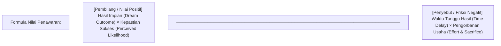
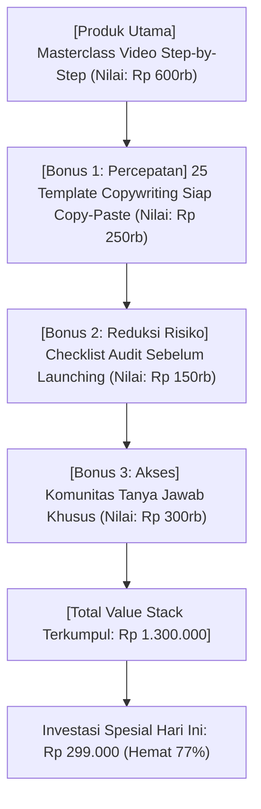

Banyak kreator pemula mengira bahwa alasan produk digital mereka tidak laku adalah karena mereka belum mahir merangkai kata-kata puitis atau belum menggunakan trik hipnosis penjualan.

Faktanya: **Copywriting terbaik di dunia tidak akan pernah bisa menyelamatkan penawaran yang buruk.**

Sebaliknya, penawaran yang luar biasa menarik (*an irresistible offer*) tetap akan menghasilkan konversi tinggi meskipun ditulis dengan bahasa yang sederhana, lugas, dan to the point.

Sebagaimana pepatah praktisi pemasaran:
> *"Make people an offer so good they would feel stupid saying no."* — Alex Hormozi

Dalam **Bagian 1** dari rangkaian *Copywriting Konversi Produk Digital* ini, kita akan membedah formula persamaan nilai (*Value Equation*) dan bagaimana mengadaptasinya secara presisi untuk karakteristik psikologis pembeli digital di Indonesia.

---

## 1. Anatomi Persamaan Nilai (The Value Equation)

Nilai persepsi (*perceived value*) dari suatu penawaran ditentukan oleh interaksi 4 variabel psikologis:

Secara matematis:
$$\text{Perceived Value} = \frac{\text{Dream Outcome} \times \text{Perceived Likelihood of Achievement}}{\text{Time Delay} \times \text{Effort \& Sacrifice}}$$

Untuk melipatgandakan nilai produk Anda tanpa menurunkan harga:
1. **Tingkatkan Pembilang:** Perjelas hasil impian dan tunjukkan bukti konkrit bahwa cara ini pasti berhasil.
2. **Kecilkan Penyebut hingga Mendekati Nol:** Pangkas waktu tunggu hasil dan minimalkan rasa lelah atau kebingungan calon pembeli.

---

## 2. Membedah 4 Variabel untuk Audiens Indonesia

Mari kita bandingkan bagaimana penawaran biasa (*commodity offer*) diubah menjadi penawaran bernilai tinggi (*Grand Slam Offer*):

| Variabel Psikologis | Penawaran Biasa (Low Perceived Value) | Penawaran Bernilai Tinggi (Grand Slam Offer) |
| :--- | :--- | :--- |
| **Dream Outcome** | *"Belajar cara menulis artikel blog."* | *"Membangun sistem konten yang mendatangkan 50 lead WhatsApp baru setiap minggu."* |
| **Perceived Likelihood** | *"Saya sudah berpengalaman 5 tahun."* | *"Framework 4 langkah yang sudah divalidasi oleh 120+ UMKM di 15 kota."* |
| **Time Delay** | *"Pelajari modul 40 jam ini perlahan."* | *"Download template siap pakai, ganti nama bisnismu, dan online dalam 45 menit."* |
| **Effort & Sacrifice** | *"Anda harus belajar koding HTML dan CSS."* | *"100% tanpa sentuh koding. Cukup drag-and-drop menggunakan dashboard visual [SitusBisnis](https://situsbisnis.com)."* |

Perhatikan bagaimana pada kolom kedua, pembeli merasa bahwa mereka tidak sekadar membeli materi, melainkan membeli **jalan pintas menuju hasil akhir**.

---

## 3. Komponen Pelengkap Penawaran: The Value Stack

Ketika Anda menampilkan harga produk Anda di landing page, jangan biarkan produk tersebut berdiri sendirian. Bungkus penawaran utama Anda ke dalam tumpukan nilai (*value stack*):

Dengan teknik penumpukan nilai ini:
- Calon pembeli tidak membandingkan harga Rp 299.000 dengan dompet mereka secara langsung.
- Mereka membandingkan Rp 299.000 dengan total nilai Rp 1.300.000 yang akan mereka dapatkan secara utuh.

---

## 4. Tiga Kesalahan Fatal Saat Menyusun Penawaran

1. **Menambahkan Bonus yang Tidak Relevan:** Menambahkan e-book 200 halaman yang tidak berhubungan hanya akan membuat calon pembeli merasa terbebani (*cognitive overload*).
2. **Klaim yang Terlalu Muluk:** Janji seperti *"Pasti dapat 1 Miliar dalam 3 hari tanpa kerja"* akan memicu alarm skeptisisme dan membuat Anda dicap penipu.
3. **Mengabaikan Karakteristik Pembayaran Lokal:** Penawaran terbaik akan gugur seketika jika Anda hanya menerima kartu kredit di negara di mana mayoritas pengguna lebih suka QRIS dan transfer m-banking.

---

## Rangkuman & Langkah Selanjutnya

Fondasi copywriting yang mematikan bukanlah keindahan rima kalimat, melainkan kejelasan dan kekuatan proposisi penawaran (*offer proposition*) yang Anda tawarkan kepada audiens.

Di **Bagian 2**, kita akan melangkah ke tahap penulisan: **Headline, Hook 5 Detik Pertama, dan Seni Storyselling** yang mengikat perhatian pembeli sejak kalimat pertama.
