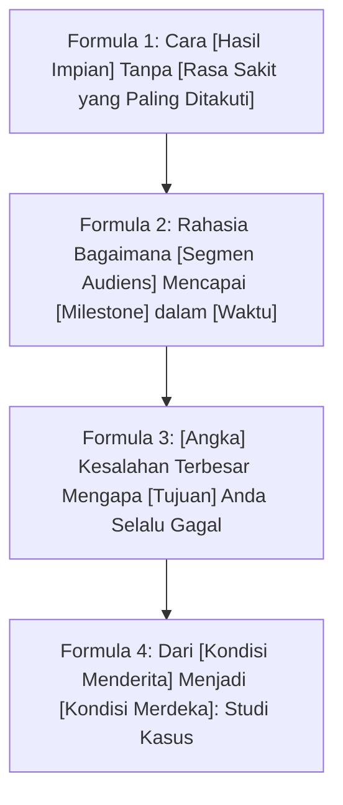
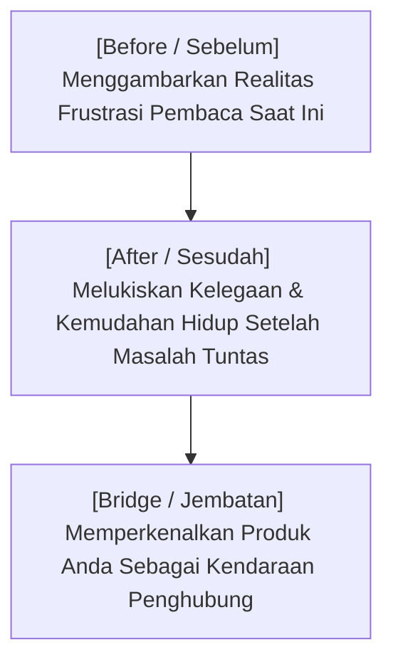

Rata-rata rentang perhatian (*attention span*) manusia modern saat menjelajah internet adalah **kurang dari 5 detik**. 

Ketika seseorang mengklik tautan landing page atau membaca postingan Anda, mereka tidak langsung membaca seluruh tulisan. Mata mereka melakukan pemindaian kilat (*skimming*) untuk menjawab satu pertanyaan kritis di alam bawah sadar mereka:
> *"Apakah halaman ini relevan untuk masalah saya saat ini, atau saya harus segera menekan tombol Back?"*

Jika judul (headline) dan kalimat pembuka Anda gagal memberikan alasan kuat untuk bertahan, maka sebagus apa pun materi modul atau video yang Anda buat, tidak akan ada orang yang pernah melihatnya.

Dalam artikel kedua ini, kita akan membedah formula headline berdaya pikat tinggi dan kerangka narasi **Storyselling** yang menjembatani rasa frustrasi audiens menuju solusi produk Anda.

---

## 1. Empat Formula Headline Pengungkit Klik dan Minat

Gunakan formula teruji ini saat merancang judul utama landing page atau baris subjek kampanye Anda:

Mari kita lihat contoh komparasi penerapannya:

| Jenis Formula | Judul Mentah (Membosankan) | Headline Tajam Berdaya Konversi |
| :--- | :--- | :--- |
| **Formula 'Tanpa Rasa Sakit'** | *"Kursus Pembuatan Website Bisnis"* | *"Cara Membangun Website Penjualan Siap Konversi dalam 1 Hari Tanpa Sentuh Koding dan Tanpa Sewa Agensi Mahal"* |
| **Formula 'Studi Kasus Waktu'** | *"Tips Jualan Template Spreadsheet & SOP"* | *"Bagaimana Mentor Ini Menghasilkan Rp 24 Juta Pertama dari Template Spreadsheet & SOP Sederhana dalam 21 Hari"* |
| **Formula 'Kesalahan Tersembunyi'** | *"Panduan Email Marketing"* | *"3 Kesalahan Fatal yang Membuat Email Penawaran Anda Masuk Folder Spam dan Diabaikan Pelanggan"* |

> **Catatan Strategis:**
> Headline yang kuat tidak berteriak menggunakan huruf kapital berlebih (*caps lock*) atau kata-kata sensasional kosong. Headline yang kuat bekerja karena menyentuh **spesifisitas masalah riil** yang sedang dihadapi target audiens Anda.

---

## 2. Struktur Narasi Penjualan: The Before-After-Bridge (BAB)

Manusia tidak digerakkan oleh daftar fitur teknis (*feature lists*). Manusia digerakkan oleh **transformasi naratif**.

Kerangka *Before-After-Bridge* adalah formula narasi paling elegan untuk menyambungkan empati pembaca dengan produk Anda:

### Tahap 1: The 'Before' (Masuk ke Dalam Percakapan di Kepala Mereka)
Mulailah dengan melukiskan situasi harian pembaca dengan detail yang sangat akurat, hingga pembaca bergumam: *"Ya ampun, ini persis yang saya rasakan semalam!"*

> *Contoh:*  
> *"Pernahkah Anda duduk menatap layar laptop kosong pukul 11 malam, bingung mau posting apa besok, sementara grafik penjualan produk Anda terus mendatar di angka nol?"*

### Tahap 2: The 'After' (Membuka Visi Masa Depan)
Bantu mereka membayangkan dunia di mana masalah tersebut sudah lenyap sepenuhnya.

> *Contoh:*  
> *"Bayangkan jika setiap pagi Anda membuka ponsel dan melihat notifikasi pembayaran QRIS yang masuk saat Anda sedang tidur nyenyak, tanpa harus membalas chat komplain satu per satu."*

### Tahap 3: The 'Bridge' (Hadirkan Solusi Anda)
Tunjukkan bahwa perbedaan antara *Kondisi Sebelum* dan *Kondisi Sesudah* bukanlah faktor keberuntungan, melainkan karena adanya sebuah **sistem teruji**.

> *Contoh:*  
> *"Itulah mengapa kami merancang [Nama Produk]—kerangka kerja yang memotong 90% waktu pembuatan konten dan mengotomasi alur checkout bisnis Anda secara mandiri."*

---

## 3. Menghindari Perangkap "Fitur vs Manfaat" (Features vs Benefits)

Salah satu kebiasaan buruk kreator teknis adalah membanggakan spesifikasi produk ketimbang hasil nyata bagi pembeli:

| Yang Sering Ditulis Kreator (Fitur Teknis) | Yang Sebenarnya Dibeli Konsumen (Manfaat Transformasi) |
| :--- | :--- |
| *"Berisi 42 modul video resolusi 1080p."* | *"Panduan to-the-point yang menghemat waktu Anda belajar otodidak selama 6 bulan."* |
| *"Dilengkapi rumus spreadsheet kompleks."* | *"Anda cukup input 3 angka, dan kalkulator ini otomatis menghitung margin laba bersih Anda."* |
| *"Mendapat file template format Markdown."* | *"Tinggal ganti judul dan langsung siap publish di blog tanpa repot setting tata letak."* |

---

## Rangkuman & Langkah Selanjutnya

Menulis headline dan cerita pembuka yang memukau adalah cara Anda membeli tiket masuk ke dalam pikiran calon pembeli. 

Namun setelah mereka tertarik, alam bawah sadar mereka akan segera memunculkan benteng pertahanan: keraguan, ketakutan rugi, dan rasa tidak percaya.

Di **Bagian 3**, kita akan mempelajari teknik **Menghancurkan 5 Keberatan Terbesar Calon Pembeli**—mulai dari alasan *"Harganya kemahalan"* hingga *"Bagaimana kalau saya gaptek dan tidak bisa pakainya?"*.
