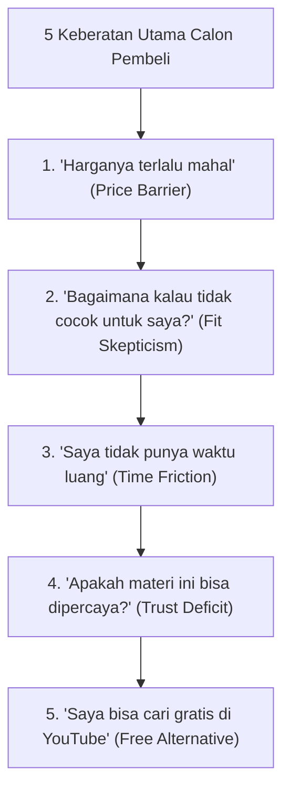

Ketika seorang pengunjung landing page telah membaca materi Anda sampai ke bagian bawah, melihat daftar bonus, dan tertarik pada penawaran Anda, ada satu pertempuran batin terakhir yang terjadi sebelum jari mereka menyentuh tombol bayar:

**Pertempuran antara Keinginan Mendapatkan Solusi vs. Rasa Takut Menyesal.**

Sebagai pembeli di internet, otak kita secara evolusioner diprogram untuk menghindari kerugian (*loss aversion*). Kita jauh lebih takut kehilangan uang Rp 250.000 untuk sesuatu yang mengecewakan daripada kegembiraan mendapatkan keuntungan Rp 1.000.000.

Jika copywriting Anda tidak secara proaktif menjawab dan menetralisir keraguan tersebut di halaman penawaran, calon pembeli tidak akan bertanya kepada Anda—mereka akan diam-diam menutup tab peramban mereka.

Dalam artikel ketiga ini, kita akan membongkar **5 Keberatan Universal Calon Pembeli** dan senjata copywriting untuk meruntuhkannya secara tuntas.

---

## 1. Peta 5 Keberatan Terbesar dan Resep Penangkalnya

Berikut adalah taksonomi keraguan psikologis yang selalu muncul pada transaksi produk digital:

Mari kita bedah formula bahasa dan strategi untuk menetralkan masing-masing poin:

---

## 2. Bedah Strategi Penanganan Keberatan (Objection Handling)

### Keberatan 1: "Harganya Terlalu Mahal bagi Saya"
- **Akar Masalah:** Pembeli belum melihat perbandingan nilai yang adil, atau membandingkan harga produk Anda dengan biaya hidup harian (misal: setara 10 cangkir kopi).
- **Resep Copywriting:** Gunakan teknik **Reframing & Cost of Inaction** (Biaya Akibat Menunda):
  > *"Investasi Rp 299.000 ini setara dengan Rp 10.000 per hari selama sebulan ke depan—kurang dari harga satu gelas es teh manis. Namun pertanyaannya: berapa biaya yang sudah Anda buang selama 6 bulan terakhir karena salah memasang iklan atau salah memilih platform toko online?"*

### Keberatan 2: "Bagaimana Kalau Cara Ini Tidak Berhasil untuk Kasus Saya?"
- **Akar Masalah:** Pembeli merasa situasinya terlalu unik, atau merasa dirinya kurang berbakat (*imposter syndrome*).
- **Resep Copywriting:** Gunakan **Risk Reversal (Pembalikan Risiko)** melalui Garansi Nyata:
  > *"Kami menghapus seluruh risiko dari pundak Anda. Pelajari modulnya, terapkan checklist-nya selama 30 hari. Jika sistem ini tidak membantu Anda meluncurkan toko digital Anda, kirimkan satu pesan WhatsApp kepada tim kami, dan kami kembalikan 100% uang Anda tanpa pertanyaan berbelit-belit."*

### Keberatan 3: "Saya Terlalu Sibuk dan Tidak Punya Waktu Belajar"
- **Akar Masalah:** Ketakutan bahwa produk Anda adalah beban baru yang menuntut komitmen puluhan jam.
- **Resep Copywriting:** Tegaskan **Efisiensi Kurikulum Berorientasi Hasil**:
  > *"Produk ini sengaja dirancang tanpa teori bertele-tele. Anda tidak perlu menonton video 50 jam. Cukup buka modul 15 menit, salin template kerja kami, dan langsung terapkan ke bisnis Anda hari ini juga."*

### Keberatan 4: "Siapa Anda dan Mengapa Saya Harus Percaya?"
- **Akar Masalah:** Rendahnya reputasi atau pembeli baru pertama kali mengenal brand Anda.
- **Resep Copywriting:** Letakkan **Bukti Sosial Terverifikasi (Verifiable Social Proof)**:
  > Sisipkan tangkapan layar asli testimoni WhatsApp, kuitansi transaksi yang telah disamarkan nama pribadinya, atau kutipan pengalaman pengguna yang menyebutkan angka spesifik (*bukan hanya kata klise 'keren banget'*).

### Keberatan 5: "Bukankah Semua Materi Ini Bisa Ditemukan Gratis di Google/YouTube?"
- **Akar Masalah:** Pembeli menganggap informasi gratis sama nilainya dengan sistem terstruktur.
- **Resep Copywriting:** Jelaskan **Perbedaan antara Informasi Acak vs. Sistem Terkurasi**:
  > *"Tentu saja Anda bisa mencari 500 video di internet secara terpisah. Masalahnya: Anda akan menghabiskan waktu 8 bulan menyatukan potongan puzzle yang saling kontradiktif. Di sini, Anda membayar untuk penghematan waktu—sebuah alur kerja sistematis dari titik A ke titik B yang sudah terbukti tanpa trial-and-error."*

---

## 3. Matriks Penempatan Seksi Anti-Keberatan di Halaman Produk

| Komponen Halaman | Elemen Copywriting yang Wajib Ada | Efek Psikologis |
| :--- | :--- | :--- |
| **Hero Section (Atas)** | Micro-badge garansi & bintang rating ulasan | Menanamkan rasa aman sejak detik pertama |
| **Pricing Card (Tengah)** | Value breakdown & perbandingan harga normal | Menunjukkan nilai diskon nyata yang didapat |
| **Seksi FAQ (Bawah)** | Menjawab pertanyaan seputar teknis akses, garansi, & format | Menghilangkan keraguan terakhir sebelum scroll ke form |
| **Checkout Box** | Badge keamanan QRIS resmi & logo enkripsi SSL | Menghilangkan rasa was-was saat transfer dana |

> **Catatan Strategis:**
> FAQ di landing page Anda bukan tempat untuk formalitas basa-basi. Jadikan FAQ sebagai arena strategis untuk melibas keraguan pembeli paling kritis secara transparan dan berani.

---

## Rangkuman & Langkah Selanjutnya

Ketika Anda berhasil menjawab kelima keberatan ini dengan empati dan bukti otentik, pertahanan psikologis pembeli akan luluh secara alami.

Di **Bagian 4 (Penutup Seri)**, kita akan membahas detail terkecil namun paling menentukan: **Microcopy Tombol Checkout & Optimasi CTA**—kata-kata magis di sekitar tombol transaksi yang mampu melesatkan tingkat konversi akhir hingga puluhan persen.
