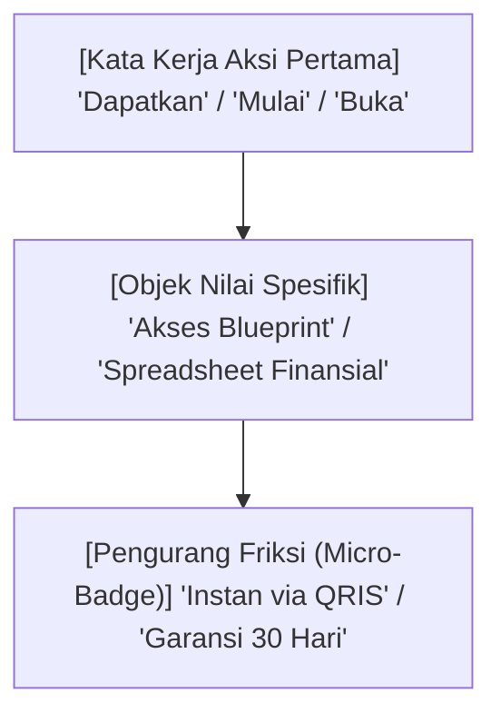
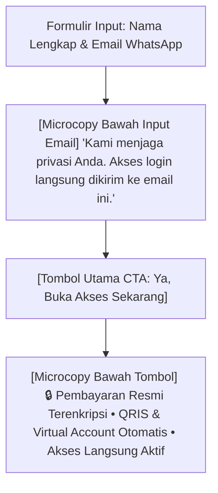

Dalam dunia optimasi konversi (*Conversion Rate Optimization*), ada sebuah pepatah terkenal:
> *"The devil is in the details, but the dollars are in the microcopy."*

Banyak kreator mencurahkan 99% waktu mereka untuk merancang sales page ribuan kata, namun memperlakukan halaman checkout dan teks tombol Call-to-Action (CTA) sebagai formalitas sepele. Mereka membiarkan tombol bertuliskan *"Submit"*, *"Beli"*, atau *"Proses Sekarang"*.

Teks-teks pasif dan kaku seperti itu menuntut komitmen emosional yang tinggi tanpa mengingatkan kembali imbalan (*reward*) yang akan segera diterima oleh pembeli.

**Microcopy**—kata-kata ringkas pada tombol, label formulir, keterangan di bawah input email, dan pesan konfirmasi—adalah garis pertahanan terakhir antara keranjang belanja yang ditinggalkan (*abandoned cart*) atau kuitansi transaksi yang lunas.

Dalam bagian penutup seri *Copywriting Konversi Produk Digital* ini, kita akan membedah formula teks mikro dan optimasi CTA yang telah terbukti menaikkan konversi checkout hingga 25%+.

---

## 1. Tiga Pilar Formula CTA Berdaya Dorong Tinggi

Tombol aksi yang efektif selalu mengandung 3 unsur psikologis:

Mari kita bandingkan variasi teks tombol:

| Teks Tombol Biasa (Generik & Membosankan) | Teks Tombol Berdaya Konversi Tinggi (Value-Driven) |
| :--- | :--- |
| `Beli Sekarang` | `Ya, Berikan Saya Akses Instan Sekarang →` |
| `Daftar` | `Mulai Bangun Mesin Penjualan Saya Hari Ini` |
| `Submit` | `Klaim Diskon & Unduh Template (Hemat 70%)` |
| `Lanjut Pembayaran` | `Amankan Tempat Saya & Bayar Cepat via QRIS` |

> **Catatan Strategis:**
> Gunakan sudut pandang orang pertama (*first-person phrasing*) seperti *"Saya"* atau *"Milik Saya"* ketimbang *"Anda"*. Studi pengujian A/B menunjukkan penggunaan kata ganti pertama dapat menaikkan klik tombol hingga **9% – 14%**.

---

## 2. Merancang Microcopy Sekitar Form Checkout

Di sekitar kotak formulir dan tombol bayar, pembeli sering mengalami keraguan sesaat (*last-second hesitation*). Berikut adalah elemen teks mikro pendukung yang wajib ada di sekitar form checkout:

### 1. Keterangan Pengurangan Kecemasan Spam (Spam-Free Reassurance)
Di bawah input alamat email, cantumkan teks mikro penenang:
> *Contoh:* *"Kami menghargai privasi Anda. Tautan akses dan invoice resmi akan langsung dikirim ke email ini dalam 60 detik."*

### 2. Keterangan Kecepatan Akses (Instant Gratification)
Pembeli produk digital ingin kepastian bahwa mereka tidak perlu menunggu admin memproses pesanan secara manual:
> *Contoh:* *"Akses otomatis 24/7. Setelah transaksi QRIS terverifikasi, Anda dapat langsung login dan mengunduh seluruh materi."*

### 3. Badge Metode Pembayaran Lokal
Tampilkan ikon resmi QRIS, BCA, Mandiri, BRI, BNI, dan e-wallet. Menyertakan logo pembayaran yang familiar bagi masyarakat Indonesia secara instan melipatgandakan rasa aman calon pembeli.

---

## 3. Checklist Audit Microcopy Halaman Penjualan Anda

Gunakan checklist ini sebelum menyebarkan link produk Anda ke publik:

- [ ] **Tombol CTA Menjelaskan Nilai:** Teks tombol tidak hanya berkata "Beli", melainkan menyebutkan nilai atau hasil akhir.
- [ ] **Keterangan Garansi Jelas di Dekat Tombol:** Terdapat catatan kecil mengenai pembalikan risiko (misal: *Garansi Uang Kembali 30 Hari*).
- [ ] **Formulir Ringkas:** Hanya meminta data esensial (Nama, Email, No. WhatsApp). Jangan meminta alamat jalan rumah lengkap untuk produk digital murni!
- [ ] **Notifikasi Keamanan:** Terdapat teks mikro enkripsi data perbankan yang aman.
- [ ] **Kecepatan Muat:** Tombol checkout merespons instan tanpa animasi loading berat yang membuat pembeli ragu apakah klik mereka sudah terdaftar.

---

## Catatan Penutup Buat Kamu

Copywriting yang bagus bukan tentang merangkai kata-kata puitis yang rumit, melainkan tentang **menghilangkan keraguan dan mempermudah jalan bagi orang yang memang butuh solusimu**.

Mulai dari menyusun penawaran yang sulit ditolak, merangkai headline pembuka, menjawab ketakutan pembeli, sampai memoles teks tombol bayar—semuanya bekerja harmonis saat didukung oleh toko mandiri tanpa potongan komisi di [SitusBisnis](https://situsbisnis.com).

Saatnya kamu cek lagi halaman produk tokomu hari ini, poles kata-katanya, dan bersiap menyambut notifikasi transaksi baru!
