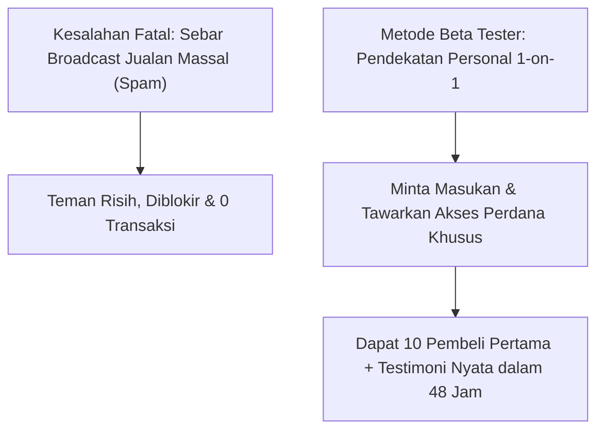
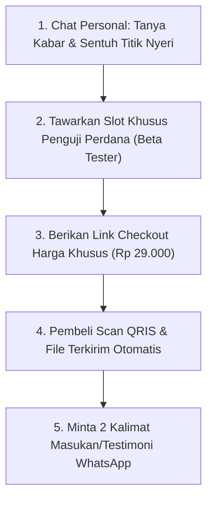

Momen paling menegangkan dalam perjalanan bisnis digital seorang pemula bukanlah saat membuat produk, melainkan saat **menunggu pesanan pertama masuk**.

Bagi orang awam yang tidak punya follower dan tidak paham cara pasang iklan berbayar (Facebook/TikTok Ads), rasa panik sering muncul: *"Produk PDF saya sudah jadi, tapi siapa yang mau beli kalau akun saya followers-nya nol?"*

Jawabannya ada tepat di genggaman tangan Anda: **Aplikasi WhatsApp di ponsel Anda**.

Anda tidak perlu ribet belajar sales funnel rumit atau buang uang jutaan rupiah untuk iklan yang membingungkan. Yang Anda butuhkan hanyalah protokol sederhana: **Metode Beta Tester Lingkaran Hangat (*Warm Circle Protocol*)**.

## Kenapa Jangan Pernah Melakukan Broadcast Jualan Massal

Kesalahan paling memalukan yang dilakukan pemula adalah menyalin teks promosi panjang bertele-tele dengan banyak emotikon, lalu mengirimkannya lewat fitur *Broadcast* ke seluruh kontak di buku telepon.

Hasilnya sudah bisa ditebak:
- Anda dianggap tukang spam yang mengganggu.
- Pesan Anda diabaikan dan tidak dibaca.
- Beberapa teman dekat bahkan mungkin memblokir nomor Anda karena risih.

Orang tidak suka "dijuali", tetapi **orang sangat senang dimintai pendapat dan merasa dilibatkan dalam sebuah proyek penting**.

## Skrip 3 Langkah: Metode Beta Tester Tanpa Bikin Malu

Pilih 15 hingga 25 orang di kontak WhatsApp Anda yang kira-kira pernah mengeluhkan masalah yang bisa diselesaikan oleh panduan digital Anda. Hubungi mereka secara personal satu per satu (*chat 1-on-1*), bukan lewat grup.

Gunakan struktur percakapan berikut:

### Langkah 1: Pancing Rasa Ingin Tahu dan Validasi Masalah
Kirim pesan santai yang ramah tanpa menyebut kata "beli" atau "diskon":

> *"Halo Kak [Nama Teman], apa kabar? Kemarin pas ngobrol saya ingat Kakak sempat cerita lagi pusing ngurus [sebutkan masalah, misal: berkas perizinan usaha / persiapan interview kerja]. Kebetulan 3 hari ini saya lagi beresin dokumen panduan dan checklist ringkas 5 halaman soal cara saya kemarin ngeberesin masalah itu dari nol sampai tuntas."*

### Langkah 2: Minta Masukan Sebelum Rilis Resmi (Beta Test Hook)
Lanjutkan dengan meminta bantuan mereka untuk mengulas:

> *"Rencananya panduan ini mau saya rilis ke publik minggu depan seharga Rp 99.000. Tapi sebelum dirilis resmi, saya butuh 10 orang pertama untuk coba baca dan kasih masukan jujur: apakah ada bagian yang kurang jelas atau perlu ditambahin. Boleh gak kalau saya kirim drafnya ke Kakak?"*

9 dari 10 orang yang memang punya masalah tersebut akan menjawab: *"Boleh banget, kirim dong!"*

### Langkah 3: Penawaran Simbolis Sekali Bayar
Ketika mereka menyatakan tertarik, berikan harga simbolis untuk komitmen membaca:

> *"Asik, makasih banyak Kak! Biar sama-sama komitmen dan saya bisa cover biaya link servernya, untuk 10 orang penguji pertama ini saya buka aksesnya di harga pengganti kopi aja, Rp 29.000 (diskon 70% dari harga rilis resmi nanti). Kalau Kakak cocok, ini tautan langsungnya ya: [tautan toko SitusBisnis Anda]. Begitu pembayaran QRIS masuk, file PDF-nya langsung otomatis terunduh ke HP Kakak."*

## Mengapa Angka 10 Pembeli Pertama Sangat Mengubah Hidup?

Jika 10 orang teman Anda membeli di harga Rp 29.000:
$$\text{Total Pendapatan Awal} = 10 \times \text{Rp } 29.000 = \text{Rp } 290.000$$

Secara nominal rupiah, Rp 290.000 mungkin belum bisa membuat Anda kaya mendadak. Namun secara psikologis, **efeknya luar biasa besar**:

1. **Membunuh Rasa Takut**: Anda membuktikan pada diri sendiri bahwa Anda mampu menghasilkan uang dari internet secara mandiri tanpa bos dan tanpa kantor.
2. **Mendapatkan 10 Bukti Sosial (Testimoni Nyata)**: Setelah 2 hari, hubungi mereka kembali: *"Gimana Kak panduannya, ngebantu gak?"* Tangkapan layar chat balasan mereka yang berisi pujian adalah senjata terkuat Anda untuk menjual ke orang asing di langkah berikutnya.
3. **Validasi Pasar Nyata**: Produk Anda terbukti dicari orang dan mereka rela mengeluarkan uang dompet mereka untuk membelinya.

## Kelola Penjualan Pertama dengan Profesional

Jangan biarkan transaksi pertama Anda berantakan dengan meminta pembeli mentransfer ke nomor rekening pribadi lalu mengirim foto bukti transfer yang buram. 

Dengan memajang produk Anda di toko mandiri [SitusBisnis](https://situsbisnis.com):
- Pembeli merasa tenang karena membayar melalui gerbang resmi dengan QRIS instan.
- File digital langsung tersampaikan tanpa Anda harus membuka laptop di tengah malam.
- Anda memegang 100% laba bersih penjualan pertama Anda karena **tanpa potongan komisi sepeser pun**.
