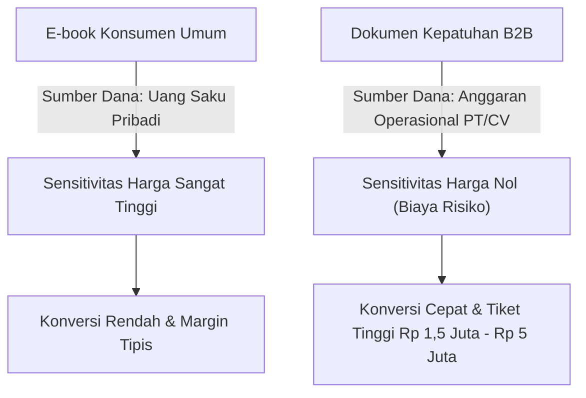
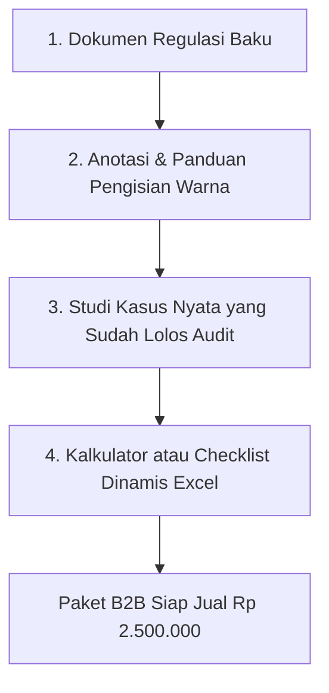

Pernahkah Anda memperhatikan pola belanja kreator pemula? Mayoritas dari mereka mencoba menjual e-book pengembangan diri seharga Rp 49.000, lalu menghabiskan 80% energi untuk berdebat di kolom komentar dengan audiens yang meminta diskon.

Di sisi lain meja bisnis, ada seorang mantan konsultan legal industri yang menjual bundel *Dokumen Kepatuhan Izin Edar Kosmetik BPOM* seharga Rp 2.500.000 per unduhan. Tanpa joget di media sosial, tanpa drama diskon tanggal kembar, ia mencatatkan 40 transaksi setiap bulan. Pendapatan bersih Rp 100 juta per bulan dari satu file digital.

Mengapa jurang nilainya begitu ekstrem? Jawabannya terletak pada **asimetri risiko dan sumber anggaran pembeli**.

## Memahami Psikologi Anggaran Operasional Korporat

Saat konsumen ritel membeli buku motivasi, mereka mengeluarkan uang saku pribadi. Otak mereka menimbang antara membeli buku atau jajan kopi kekinian. Nilai yang dipertaruhkan sangat rendah.

Namun, saat seorang pemilik pabrik maklon atau manajer regulasi membeli *Audit Checklist ISO 22000*, mereka tidak menggunakan uang pribadi. Mereka menggunakan **anggaran operasional perusahaan (OpEx)**. Bagi mereka:

1. **Biaya Kelalaian Jauh Lebih Mahal**: Jika pabrik gagal audit atau produk ditarik dari pasaran karena salah label, kerugiannya mencapai ratusan juta hingga miliaran rupiah. Membayar Rp 2,5 juta untuk dokumen pencegah adalah pengeluaran yang sangat murah.
2. **Penghematan Waktu Konsultan**: Menyewa konsultan eksternal membutuhkan biaya Rp 30 juta sampai Rp 50 juta dan proses berbulan-bulan. Dokumen kerja siap pakai memangkas 70% beban kerja tim internal.
3. **Kepastian Format**: Format birokrasi pemerintahan sering membingungkan. Template yang sudah lolos uji di lapangan memberikan rasa aman psikologis (*peace of mind*).

> [!IMPORTANT]
> Bisnis tidak membeli estetika file. Bisnis membeli **penghilang rasa sakit bernilai tinggi** (*high-stakes painkiller*) yang menyelamatkan mereka dari denda hukum, pembekuan izin, atau pemborosan waktu kerja tim.

## 4 Niche Dokumen Kepatuhan yang Selalu Dicari di Indonesia

Jika Anda memiliki latar belakang hukum, operasional, logistik, manufaktur, atau kesehatan, berikut adalah celah pasar yang luar biasa haus akan dokumen siap pakai:

| Vertikal Industri | Contoh Aset Dokumen Kerja | Kisaran Harga Pasar |
| :--- | :--- | :--- |
| **Kosmetik & Skincare Lokal** | Berkas Pendaftaran Notifikasi BPOM, Formulir CPKB (Cara Pembuatan Kosmetika yang Baik), SOP Uji Stabilitas Produk | Rp 1.500.000 – Rp 3.500.000 |
| **Pabrik & Pergudangan** | Bundel Dokumen SMK3 (Sistem Manajemen Keselamatan Kerja), Matriks Identifikasi Bahaya & Pengendalian Risiko (IBPR) | Rp 1.200.000 – Rp 2.800.000 |
| **Agensi & Vendor Kreatif** | Master Service Agreement (MSA), Klausul Terminasi & Pembayaran Bertahap, Perjanjian Kerahasiaan (NDA) B2B | Rp 750.000 – Rp 1.800.000 |
| **Klinik Pratama & Apotek** | Paket Akreditasi Fasilitas Kesehatan, SOP Tata Kelola Obat Narkotika/Psikotropika, Audit Rekam Medis Elektronik | Rp 2.000.000 – Rp 4.500.000 |

## Cara Mengemas Dokumen Regulasi agar Bernilai Jutaan

Dokumen yang bernilai tinggi bukan sekadar dokumen Microsoft Word polos yang bisa diunduh gratis di internet. Nilai jualnya terletak pada **kemudahan operasional (operational readiness)**.

### 1. Sistem Kode Warna (Color-Coded Placeholders)
Beri tanda visual pada dokumen:
- Kuning: Data yang wajib diisi sesuai nama PT/CV pembeli.
- Hijau: Klausul fleksibel yang bisa disesuaikan dengan kapasitas mesin atau tim.
- Merah: Catatan kepatuhan hukum yang dilarang diubah agar tidak melanggar undang-undang.

### 2. Sertakan Contoh Isian Riil (Real-World Benchmark)
Sertakan satu berkas contoh yang sudah terisi penuh fiktif namun realistis. Dokumen regulasi sering membingungkan bukan karena teksnya sulit, melainkan karena pengguna tidak tahu seberapa detail jawaban yang diminta oleh auditor.

### 3. Sediakan Checklist Dinamis
Buat lembar checklist di spreadsheet dengan rumus otomatis persentase kelengkapan berkas:
- Jika semua kolom checklist berstatus "Selesai", progress bar menunjukkan 100%.
- Ini memberi manajer alat pemantau instan sebelum auditor resmi datang ke lokasi.

## Distribusi Mandiri: Kenapa Hindari Marketplace Konsumen

Menjual aset B2B di marketplace umum seperti Shopee atau Tokopedia adalah kesalahan taktis. Audiens di sana terbiasa dengan barang fisik murah dan pengiriman kurir. Ketika Anda menjual file regulasi seharga Rp 2 juta:
- Calon pembeli korporat meragukan profesionalisme Anda jika toko Anda berdampingan dengan penjual casing HP murah.
- Potongan komisi marketplace memakan margin hingga belasan persen.
- Anda tidak mendapatkan data invoice resmi perusahaan (NPWP, nama instansi, alamat PT) yang wajib disertakan untuk klaim reimbursement kantor pembeli.

Dengan menggunakan toko digital mandiri seperti [SitusBisnis](https://situsbisnis.com), Anda menyajikan etalase profesional dengan checkout instan, opsi Virtual Account Bank, faktur invoice otomatis untuk klaim kantor, dan **0% komisi transaksi**. Anda memegang kendali penuh atas margin laba dan basis data klien korporat Anda.
