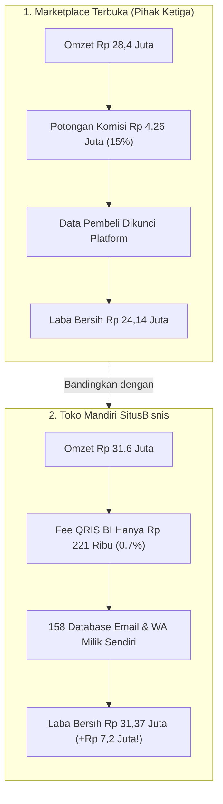

Bulan lalu, kami memutuskan melakukan sebuah eksperimen radikal yang sempat bikin cemas:
**Kami menarik seluruh tautan produk digital kami dari platform marketplace pihak ketiga, lalu memindahkan 100% alur penjualan ke toko independen kami sendiri.**

Sebelum eksperimen ini dimulai, ada ketakutan yang wajar:
- *"Gimana kalau orang nggak mau beli karena nggak kenal website kami?"*
- *"Gimana kalau trafiknya anjlok karena nggak dapat rekomendasi dari algoritma marketplace?"*

Tapi ada satu alasan kuat yang bikin kami nekat: **Biaya potongan komisi platform marketplace makin hari makin terasa mencekik leher.**

Dari setiap transaksi Rp 200.000, platform memotong komisi 12% hingga 15%, belum lagi biaya penarikan dana dan biaya layanan aplikasi. Artinya, kami menyumbang jutaan rupiah setiap bulan hanya untuk izin berjualan di tempat mereka.

Dan setelah 30 hari penuh menjalankan eksperimen ini... hasilnya di luar dugaan kami.

---

## 1. Data Riil: Perbandingan Angka Sebelum vs Sesudah Pindah

Berikut adalah catatan metrik riil selama 30 hari pertama toko mandiri kami berjalan:

| Metrik Evaluasi | 30 Hari Terakhir di Marketplace | 30 Hari Pertama di Toko Mandiri | Perubahan Bersih |
| :--- | :--- | :--- | :--- |
| **Total Transaksi Penjualan** | 142 pesanan | 158 pesanan | **+11.2% (Ternyata Naik!)** |
| **Omzet Kotor (Gross)** | Rp 28.400.000 | Rp 31.600.000 | +Rp 3.200.000 |
| **Biaya Komisi Platform** | -Rp 4.260.000 (15%) | **Rp 0 (Paket Business Scale Zero-Fee)** | **Hemat Rp 4.260.000!** |
| **Biaya Payment Gateway Riil (QRIS)** | Sudah termasuk di fee | -Rp 221.200 (~0.7%) | Sangat hemat |
| **Biaya Langganan Toko Mandiri** | Rp 0 | -Rp 199.000 (Business Scale) | Biaya tetap flat |
| **Database Email & No WA yang Didapat** | 0 (Disamarkan platform) | **158 Kontak Bersih (100% Milik Kami)** | **Aset Jangka Panjang Tak Ternilai** |
| **Laba Bersih yang Masuk Rekening** | Rp 24.140.000 | **Rp 31.179.800** | **+Rp 7.039.800 (+29.1% Profit Tambahan!)** |

> [!NOTE]
> Eksperimen di atas menggunakan paket **Business Scale** di [SitusBisnis](https://situsbisnis.com) yang memiliki fasilitas **0% Potongan Penjualan (Zero Fee)** dengan biaya flat Rp 199.000/bulan. Bahkan setelah dikurangi biaya langganan tersebut, bisnis tetap mengantongi tambahan keuntungan bersih lebih dari **Rp 7.000.000** hanya dalam 30 hari pertama! Bagi kreator pemula, tersedia pula paket **Pro Creator** (hanya 1% fee transaksi, Rp 79rb/bln) dan paket **Starter** (Rp 0 gratis selamanya).

---

## 2. Tiga Pembelajaran Terbesar dari Eksperimen Ini

### Pelajaran 1: Pembeli Sebenarnya Datang Karena "Kamu", Bukan Karena Marketplacenya
Ketakutan terbesar pemula adalah mengira pembeli belanja karena reputasi marketplace. 

Ternyata salah besar!
Ketika kamu membagikan konten berkualitas di media sosial dan followers menyukai caramu menjelaskan solusi, **mereka percaya padamu secara personal**. 

Begitu kamu bilang *"Teman-teman, link template-nya sekarang bisa langsung diunduh di website toko resmi saya di sini ya"*, mereka dengan senang hati mengklik tautan tersebut tanpa ragu.

### Pelajaran 2: Konversi Malah Naik Karena Tidak Ada Iklan Kompetitor
Di marketplace, tepat di bawah produkmu selalu ada rekomendasi: *"Lihat produk serupa dari toko lain seharga Rp 35.000"*. Calon pembelimu gampang terdistraksi dan pindah ke lapak tetangga.

Di toko mandiri seperti [SitusBisnis](https://situsbisnis.com), suasananya 100% bersih dan tenang:
- Pengunjung hanya fokus membaca halaman penawaranmu.
- Tidak ada banner iklan luar yang mengganggu.
- Konversi checkout justru naik karena tidak ada godaan pindah ke produk lain!

### Pelajaran 3: Database Pelanggan Adalah Mesin Duit Seumur Hidup
Ini keuntungan paling dahsyat: dengan mengantongi 158 data email dan nomor WhatsApp pembeli yang sah, dua minggu setelahnya kami mengirimkan satu email penawaran template baru seharga Rp 99.000.

Hasilnya? **42 orang dari pembeli lama langsung membeli template baru tersebut dalam 24 jam pertama!**

Kami mendapatkan tambahan omzet Rp 4.158.000 dalam sehari **tanpa mengeluarkan biaya iklan dan tanpa potongan komisi sepeser pun**. Di marketplace, hal ini mustahil dilakukan karena kamu tidak pernah diberi akses ke data kontak pembelimu sendiri!

---

## Kedaulatan Bisnis yang Sebenarnya

Menjual produk digital di marketplace memang terasa mudah di awal. Tapi begitu tokomu mulai berkembang, potongan komisi belasan persen dan ketiadaan aset data akan menjadi rem yang menahan laju pertumbuhan bisnismu.

Membangun toko mandiri bukan cuma tentang menghemat jutaan rupiah setiap bulan—ini tentang **memegang kendali penuh atas kedaulatan bisnis dan masa depan finansialmu sendiri**.

Kalau kami bisa melakukannya dalam 30 hari, kamu pun pasti bisa!
