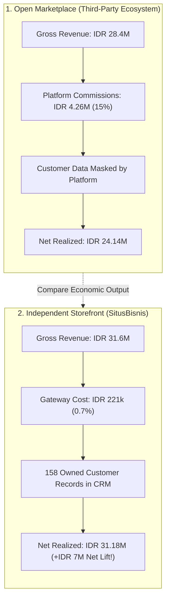

Last month, we initiated an operational experiment that initially felt risky:
**We removed all product links from third-party marketplace channels and migrated 100% of our sales traffic to our own independent storefront.**

Before beginning, familiar concerns surfaced:
- *"What if prospective buyers hesitate because they don't recognize our domain?"*
- *"What if conversion drops without marketplace algorithm recommendations?"*

Yet one driving factor compelled the change: **Platform commission cuts were quietly eroding our business viability.**

On every \$15 purchase, the marketplace platform deducted 12% to 15%, alongside transaction fees and withdrawal costs. We were surrendering hundreds of dollars every month simply for permission to sell on their platform.

After 30 days of running exclusively on our independent storefront, the empirical results surprised us.

---

## 1. The Raw Metrics: 30-Day Before-and-After Analysis

Here are our actual operational numbers from the first 30 days post-migration:

| Evaluation Metric | Final 30 Days on Marketplace | First 30 Days on Independent Storefront | Net Difference |
| :--- | :--- | :--- | :--- |
| **Total Order Volume** | 142 orders | 158 orders | **+11.2% (Order Volume Rose!)** |
| **Gross Revenue** | IDR 28,400,000 | IDR 31,600,000 | +IDR 3,200,000 |
| **Platform Commission Shave** | -IDR 4,260,000 (15%) | **IDR 0 (Business Scale Zero-Fee)** | **Saved IDR 4,260,000!** |
| **Payment Gateway Costs (QRIS)** | Bundled in fee | -IDR 221,200 (~0.7%) | Highly cost-efficient |
| **Platform Subscription Cost** | IDR 0 | -IDR 199,000 (Business Scale) | Predictable flat fee |
| **Captured Customer Contacts** | 0 (Masked by platform) | **158 Clean Contacts (100% Owned)** | **Invaluable Long-Term Asset** |
| **Net Realized Bank Cash** | IDR 24,140,000 | **IDR 31,179,800** | **+IDR 7,039,800 (+29.1% Net Profit Lift!)** |

> **Operational Context:**
> This experiment ran on the **Business Scale** tier of [SitusBisnis](https://situsbisnis.com), featuring **0% Platform Commissions (Zero Fee)** at a flat IDR 199,000/month. Even after factoring in software costs, the business retained an extra **IDR 7,000,000+** in net cash in its very first month. Early-stage creators can also start with the **Pro Creator** plan (1% fee, IDR 79k/mo) or the **Starter** tier (IDR 0 free).

---

## 2. Three Major Takeaways from the Experiment

### Lesson 1: Customers Buy from You, Not the Marketplace
The greatest psychological misconception holding creators back is the belief that customers purchase because of the marketplace's brand.

Our experiment demonstrated the opposite.
When you share high-value educational content across social channels and articulate solutions with authority, **customers place their trust in you personally**.

When you announce: *"All verified toolkits and templates are now available directly through our official independent store at [store.brand.com]"*, followers click through without hesitation.

### Lesson 2: Conversions Actually Rose Without Competitor Distractions
On open marketplaces, product listings are surrounded by competing suggestions: *"View alternative products starting at \$2"*. Prospective buyers are constantly diverted.

On an independent storefront via [SitusBisnis](https://situsbisnis.com), the environment is clean and distraction-free:
- Visitors focus solely on your value proposition.
- Zero external ad banners or third-party listings.
- Checkout conversion rates improved because there were no distractions drawing buyers away.

### Lesson 3: Customer Data Is an Ongoing Revenue Multiplier
The most transformative finding occurred two weeks after the migration. Having captured 158 verified customer records, we dispatched a single email announcement for a new companion template priced at IDR 99,000.

The outcome? **42 existing buyers purchased the companion asset within the first 24 hours.**

That single email generated an additional IDR 4,158,000 in cash flow **with zero advertising expenditure and zero commission cuts**. This was impossible on marketplaces that withhold buyer contact details.

---

## True Commercial Sovereignty

Selling digital deliverables on third-party marketplaces may offer short-term convenience. But as your business scales, double-digit commission penalties and the absence of customer data ownership throttle growth.

Operating an independent digital storefront is about more than saving thousands in fees—it is about **claiming full sovereignty over your customer relationships and financial future**.

If our team proved this model in 30 days, your business can achieve the exact same operational freedom.
