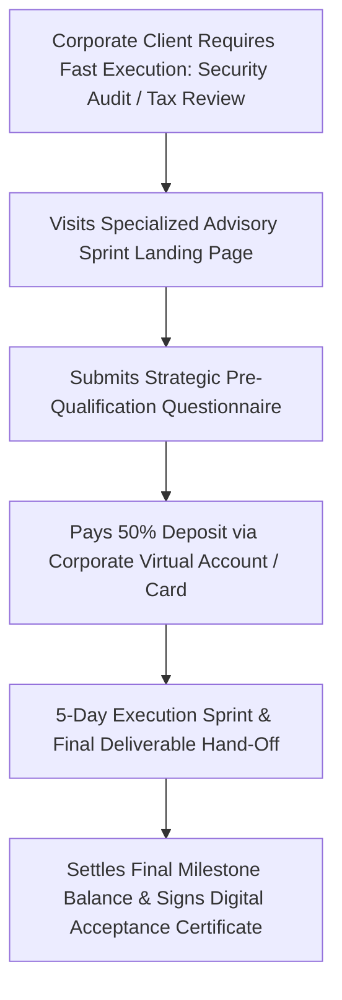
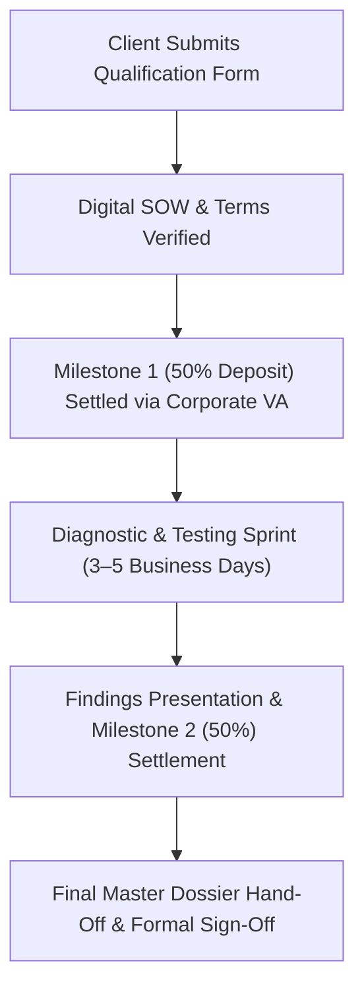

A persistent myth in professional services suggests that: *"To sell engagements valued at \$2,000 to \$5,000+, you must schedule in-person steak dinners, exchange physical business cards, and endure months of informal meetings."*

In practice, modern corporate decision-makers (Chief Marketing Officers, Heads of Engineering, and Operations Directors under 45) actively avoid time-wasting exploratory meetings. They strongly prefer **Productized Advisory Sprints**: specialized engagements with defined scope, guaranteed delivery timelines, and transparent pricing that can be authorized and settled immediately.

A cybersecurity specialist, corporate tax analyst, or conversion rate optimization architect can secure \$2,000 to \$5,000 engagements entirely through an independent web interface.

---

## The 4 Pillars of a Remote High-Ticket B2B Offer

When closing enterprise deals without an in-person pitch, your digital landing page must project institutional authority:

### 1. Rigid Scope of Work (Anti-Scope Creep)
Never sell vague "hourly advisory retainers". Sell a precisely bounded transformation:
- **Product Title:** *5-Day Financial Web Application Vulnerability Audit Sprint*.
- **Included Deliverables:** 1 25-page Penetration Testing Report PDF, 1 Risk-Prioritization Matrix Spreadsheet, and 1 60-minute Executive Solution Briefing via Zoom.
- **Explicit Exclusions:** Does not include refactoring backend repositories or deploying new cloud infrastructure (available as a separate implementation retainer).

### 2. Pre-Qualification Gatekeeper Questionnaire
Never permit arbitrary bookings without qualification. Place four diagnostic questions on your intake checkout page:
- What is your company's current gross monthly revenue range?
- Who is the designated executive sponsor holding final decision-making authority for this initiative?
- What is your leadership team's mandated implementation deadline?
- Has your department allocated at least \$2,500 for this sprint?

High-caliber enterprise buyers view structured qualification questions favorably—it signals that your time is scarce, selective, and in demand.

### 3. Milestone Billing Structure
To eliminate buyer hesitation on multi-thousand-dollar transactions:
- **Milestone 1 (50% Upfront Deposit):** Settled via the storefront checkout page to lock the calendar sprint.
- **Milestone 2 (50% Final Settlement):** Due within 24 hours of draft deliverable hand-off prior to the release of master source files.

### 4. Metric-Driven Performance SLA
Enterprise leaders seek reassurance that their capital will produce measurable results. Provide a concrete performance guarantee:
- *"If our diagnostic fails to uncover at least 3 operational bottlenecks or cost efficiencies that exceed the investment of this sprint, your 50% deposit is refunded in full."*

---

## Why Interactive Storefront Offers Outperform 40-Page PDF Proposals

Traditional 40-page agency proposals often end up neglected in procurement departments. In contrast, presenting high-ticket solutions via an interactive digital storefront delivers significant leverage:
- Corporate sponsors can instantly paste the offer URL into internal leadership messaging channels.
- An instant checkout mechanism with corporate virtual accounts and card support creates operational urgency around limited sprint availability.

With [SitusBisnis](https://situsbisnis.com), you can launch polished B2B offer pages, issue compliant proforma invoices, and process milestone deposits with bank-grade security—all with **0% platform commissions**.
