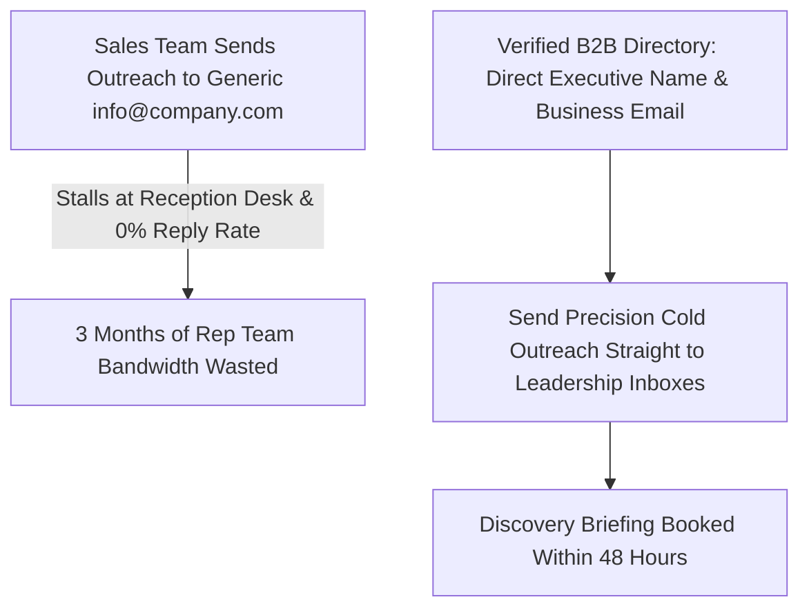
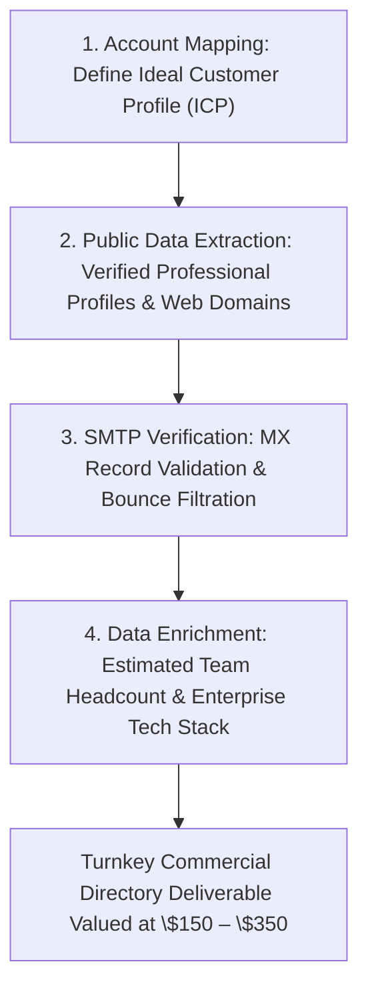

For B2B commercial teams and corporate advisory agencies, the primary operational hurdle is **identifying the right executive point of contact**.

How many times have sales teams dispatched outreach to generic inboxes like `info@company.com` or phoned front-desk receptionists, only to be met with indefinite silence? Sales organizations waste valuable time because they cannot identify the specific procurement lead, VP of People, or Chief Technology Officer within their target accounts.

This creates a high-leverage data asset: **Curated, Verified B2B Decision-Maker Directories**.

---

## Navigating Data Privacy and Rejecting Low-Quality Scraping

A common misconception conflates curated B2B intelligence with illegal personal data reselling. Purchasing scraped directories of personal phone numbers extracted without consent violates privacy statutes (such as the GDPR, CCPA, or regional personal data protection acts like Indonesia's PDP Law), and holds zero commercial value for serious enterprises.

High-value B2B directories exhibit fundamentally different characteristics:

1. **Strictly Public Corporate Business Metadata:** Information is sourced from publicly verifiable corporate channels: verified professional LinkedIn profiles, company domain directories, press statements, and industry trade registry filings (Full Name, Corporate Title, Direct Domain Email `@company.com`, and LinkedIn URL).
2. **Verified Deliverability (>95% Valid Rate):** Every corporate email address is validated through MX Record verification and SMTP ping handshakes (via tools like ZeroBounce or NeverBounce) to ensure bounce rates remain near zero.
3. **Deep Sectoral Segmentation:**
   - Not: "100,000 Generic Business Contacts" (low-utility noise).
   - Instead: "350 Heads of Procurement & Operations Across Industrial Manufacturing Facilities in the Midwest".

---

## Why Enterprise Buyers Gladly Pay Premium Rates

Consider an industrial catering enterprise seeking annual meal supply agreements across regional manufacturing plants. A single corporate agreement represents \$50,000 in gross annual revenue.

For that catering agency:
- Hiring an intern for two months to manually source 300 plant operations managers costs \$1,500 to \$2,500 in wages.
- Acquiring a verified directory of 300 facility directors for **\$250** compresses that timeline from 60 days into 5 minutes.
- If that directory enables them to close **just one corporate contract**, the return on investment exceeds 200x.

---

## Packaging Directories as a High-Value Commercial Asset

Never provide an unformatted spreadsheet of raw email addresses. Elevate product utility by bundling operational action tools:

| Asset Component | File Format | Concrete Buyer Benefit |
| :--- | :--- | :--- |
| **Master Executive Sheet** | Google Sheets / Excel (.xlsx) | Standardized columns: name, verified corporate email, company domain, LinkedIn URL, team size. |
| **Cold Outreach Playbook** | Concise PDF Guide | 3 battle-tested cold email templates designed to prompt replies from corporate directors. |
| **Pipeline Tracking Dashboard** | Spreadsheet Model | Account pipeline tracker: Contacted, Awaiting Reply, Briefing Scheduled, Terms Negotiated. |

---

## Direct Distribution Without Intermediary Cuts

Corporate clients purchasing business data require instant, encrypted access alongside formal business invoices. Listing sensitive data assets on generic consumer marketplaces risks review friction and commission deductions.

Through an independent storefront on [SitusBisnis](https://situsbisnis.com), you provide an authoritative checkout experience supporting instant local and international payment methods, automated tax receipts, and encrypted signed download links—with **zero platform commission deductions**.
