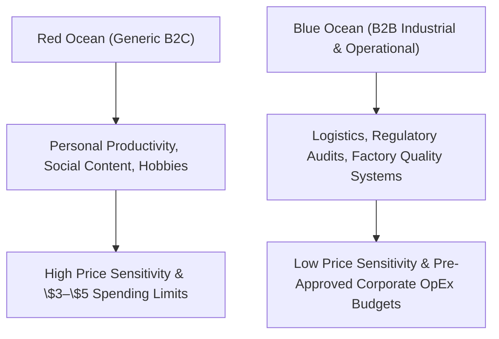
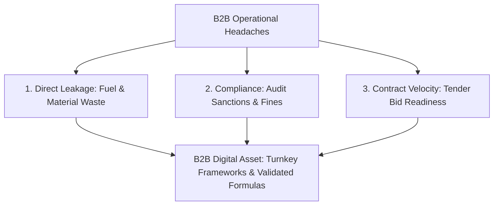

Most digital product creators crowd into the same hyper-saturated waters: daily productivity templates, social media content prompts, or beginner design tutorials. In these consumer-facing niches, pricing dynamics are cutthroat—creators struggle to sell a $5 guide without customers asking for discounts or seeking pirated mirrors.

Why does this happen? Individual retail consumers (*B2C*) purchase with personal pocket money and exhibit extreme price sensitivity.

In contrast, the largest capital allocations in the digital economy flow through sectors often dismissed as "unsexy" (*boring businesses*): **freight logistics, corporate tax compliance, factory ISO certifications, and workplace health and safety (HSE)**.

For an enterprise, operational oversights in these domains risk millions in regulatory fines or audit failure. Allocating \$200 to \$1,000 to acquire a battle-tested document toolkit that eliminates compliance vulnerabilities is an immediate, frictionless commercial decision.

In this opening guide of the *B2B Digital Assets Playbook*, we leave low-ticket price wars behind: **how to target high-liability gaps across real-world industries and transform them into digital assets funded by corporate operational budgets (OpEx)**.

---

## The Anatomy of an Enterprise-Grade Problem

How do you distinguish whether an operational bottleneck justifies enterprise pricing? Evaluate the opportunity through the **3C Framework** (*Cost of Leakage, Compliance, and Contract Speed*):

### 1. Direct Cost of Leakage
When left unresolved, the bottleneck bleeds corporate capital on an ongoing basis.
- *Example:* Freight logistics fleets operating on empty backhaul returns. A spreadsheet toolkit calculating optimal return routing and capacity balancing can prevent thousands of dollars in lost fuel expenses monthly.

### 2. Mandatory Regulatory Compliance
Enterprises face statutory mandates with strict enforcement penalties or permit revocations.
- *Example:* Revisions to Value-Added Tax (VAT) reporting or updated statutory environmental impact filings (EIA/HSE). Document toolkits that guarantee audit compliance are approved without hesitation.

### 3. Speed-to-Contract (Tender Acceleration)
Firms risk forfeiting multi-million-dollar government or commercial contracts simply because they cannot assemble required compliance documentation before bid submission deadlines.
- *Example:* Turnkey Health, Safety & Environment (HSE) tender packages ready for deployment in under two hours.

---

## The B2B Niche Evaluation Matrix

Before drafting a single page of documentation, evaluate candidate concepts against this scoring matrix:

| Evaluation Criterion | Weight | Critical Diagnostic Question |
| :--- | :--- | :--- |
| **OpEx Budget Access** | High (40%) | Is the purchaser spending corporate operating capital or personal savings? |
| **Liability & Non-Compliance Risk** | High (30%) | Does a formatting or reporting mistake trigger regulatory fines or audit disqualification? |
| **Market Scarcity** | Medium (20%) | Is authoritative, actionable guidance absent from search engines and AI models? |
| **Deployment Speed** | Medium (10%) | Can an internal corporate team implement the framework within 24 hours? |

If your concept scores strongly on the first two dimensions (*OpEx Budget Access* and *Liability Risk*), you have uncovered a validated B2B opportunity.

---

## Actionable Next Step

Your objective this week is not writing curriculum, but **conducting five problem-diagnostic interviews**:
1. Connect with five contacts serving as operations managers, consultants, or business owners in a technical vertical.
2. Ask one diagnostic question: *"Which operational reports or internal audit filings create the most friction and waste the most engineering hours each month?"*
3. Track the specific pain points repeated across multiple conversations. That is where your digital asset resides.

In [Part 2: Audit-Proof Document Architecture](/en/posts/b2b-digital-assets-part-2-audit-proof-document-architecture/), we will examine how to structure your files, formulas, and layouts so they pass rigorous scrutiny from corporate legal and internal audit teams.
