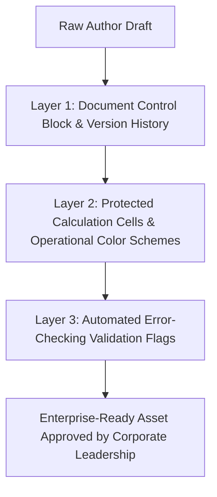
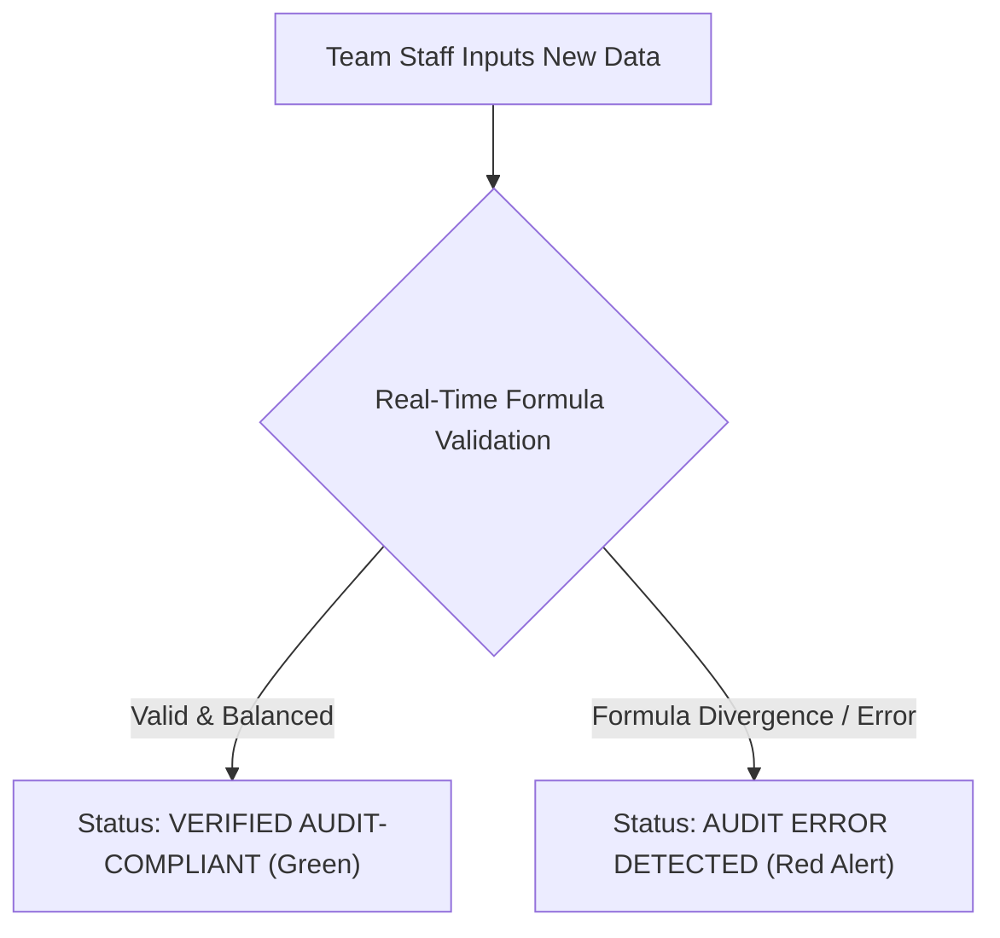

Imagine a corporate operations director purchases an operational SOP package or financial modeling spreadsheet for \$250 from your digital storefront. Upon opening the file: typography is inconsistent, nested calculation formulas break as soon as live data is entered, and there is no audit trail or document control block.

Within five minutes, the asset is written off as amateur work and rejected by corporate steering committees.

In [Part 1](/en/posts/b2b-digital-assets-part-1-identifying-enterprise-headaches/), we examined how to identify high-liability operational problems in corporate verticals. In this second installment of the *B2B Digital Assets Playbook*, we establish technical production benchmarks: **how to engineer institutional-grade document architecture that is truly audit-ready**—delivering locked, error-resilient, and rigorously formatted assets that corporate legal and finance departments readily approve.

---

## The 3 Architectural Layers of Institutional Deliverables

### 1. Document Control Block (Audit Trail Metadata)
Every standard industrial framework (ISO, GMP, or corporate financial SOP) must open with a formal document control table on page one:
- **Document Identification Number:** (e.g., `SOP-OPS-2026-004`).
- **Effective Date & Annual Review Schedule:** Explicit revision timelines.
- **Sign-Off Authorizations:** Mandatory fields for *Prepared By*, *Reviewed By*, and *Approved By*, complete with organizational titles.
- **Revision History Log:** Detailed versioning tracking (Version 1.0 Initial Release, Version 1.1 Regulatory VAT Adjustment, etc.).

This metadata immediately elevates the perceived value of your deliverable from an informal blog download to an authoritative corporate standard operating procedure.

### 2. Fail-Safe Spreadsheet Architecture
When distributing spreadsheet assets (costing models, COGS engines, risk heatmaps):
- **Protect Calculation Cells:** Lock all formula-bearing cells using spreadsheet protection controls. Grant purchasers edit permissions strictly over dedicated, soft-yellow input fields (*Soft Yellow Input Conventions*).
- **Implement Named Ranges:** Replace illegible cell formulas like `=SUM(C4:C29)*D14/E2` with self-documenting human-readable formulas: `=SUM(OperatingExpenses)*TaxRate/TotalUnitsProduced`.
- **Automated Balance & Integrity Flags:** Embed real-time validation flags in header rows. If balance sheets diverge or calculation errors arise, display immediate alerts: `[WARNING: CHECK ROW 42 - BALANCE MISMATCH]`.

### 3. Floating Guidance and Contextual In-Cell Annotations
Corporate purchasers are rarely the sole operators of your file. Your deliverables are typically populated by junior analysts or administrative staff:
- Integrate contextual input notes and data validation tooltips across critical fields.
- Provide clear operational definitions (e.g., *"Enter gross revenue prior to platform discount subsidies"*).

---

## Pre-Launch Stress-Testing Protocols

Before releasing files on your storefront, subject them to rigorous testing scenarios:

| Testing Protocol | Stress Scenario | Expected Outcome |
| :--- | :--- | :--- |
| **Boundary Value Analysis** | Input zero, negative values, and multi-million sums across input fields | Zero formula breaks (`#DIV/0!`, `#VALUE!`, or `#REF!`) |
| **Cross-Platform Compatibility** | Open Word/Excel files across Google Workspace, LibreOffice, and macOS Pages | Table margins, visual alignments, and page breaks remain intact |
| **Non-Technical Usability Test** | Have an external non-specialist navigate the file for 10 minutes | User completes workflow without requiring author assistance |

---

## Supporting Assets That Elevate Deliverable Value

Never deliver a standalone, unadorned `.xlsx` or `.docx` file. Package your asset with two high-utility companion resources:
1. **Quickstart Implementation Guide (3-Page PDF):** Visual walkthrough highlighting the first 10 minutes of onboarding and configuration.
2. **Realistic Benchmark Exemplar (Pre-Filled Sample File):** A populated duplicate featuring realistic corporate scenario data, providing buyers with an immediate visual reference for correct operational depth.

In [Part 3: Multi-Seat Licensing Models & Annual Renewals](/en/posts/b2b-digital-assets-part-3-multi-seat-licensing-models/), we break down commercial pricing structures for corporate deployments and how to secure predictable annual recurring revenue from regulatory updates.
