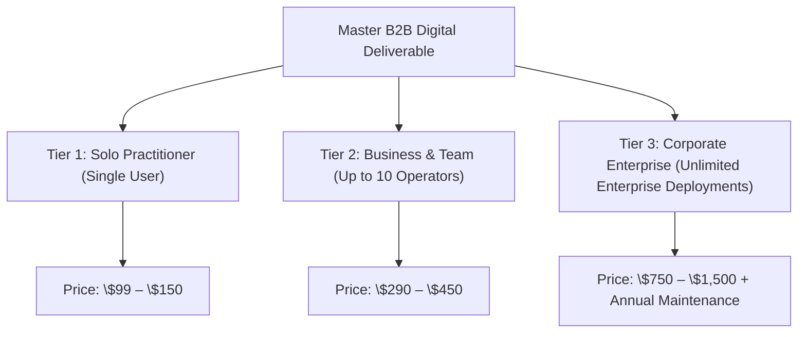
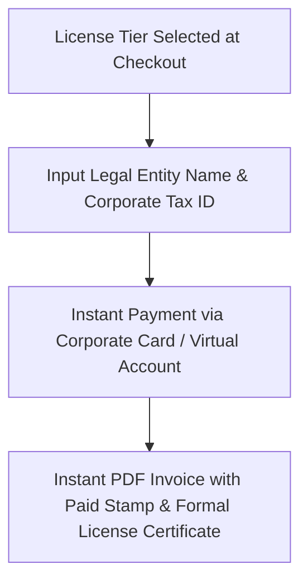

If you offer enterprise-grade digital assets under a flat, "one-size-fits-all" pricing tier, you leave substantial commercial revenue on the table.

Consider this dynamic: an independent solo consultant buys your document template to manage client engagements. Simultaneously, a national logistics enterprise with 20 regional offices purchases the exact same file and distributes it across 150 internal operations managers. Is it reasonable for both to pay an identical price?

Not at all. Large organizations exhibit substantially higher willingness to pay, provided they receive clear commercial licensing terms that satisfy internal compliance audits.

Following our exploration of [audit-proof document architecture](/en/posts/b2b-digital-assets-part-2-audit-proof-document-architecture/), Part 3 of the *B2B Digital Assets Playbook* outlines commercial frameworks: **how to implement Tiered Corporate Licensing and Annual Regulatory Maintenance Passes** to multiply unit sales revenue and secure predictable recurring cash flow.

---

## The 3 Structured Enterprise Licensing Tiers

Prevent situations where a single corporate buyer purchases a single-user seat and deploys it across distributed subsidiaries by defining explicit usage rights:

### Tier 1: Single Practitioner License
- **Target Customer:** Solo consultants, boutique advisors, and single-store operators.
- **Usage Scope:** Restricted to one commercial entity. Re-distribution to third-party subcontractors or external clients is strictly prohibited.
- **Benchmark Pricing:** \$99 – \$150.

### Tier 2: Team & Agency License
- **Target Customer:** Boutique advisory firms, specialized agencies, and departmental teams of up to 10 operators.
- **Usage Scope:** Files may be adapted and deployed repeatedly across client engagements without per-project licensing fees.
- **Benchmark Pricing:** \$290 – \$450 (typically 3x the single-user tier).

### Tier 3: Unlimited Corporate Enterprise License
- **Target Customer:** Mid-to-large-scale corporations, parent holdings, and national franchise networks.
- **Usage Scope:** Unrestricted deployment across all operating branches and corporate subsidiaries. Includes a signed corporate license certificate issued directly to the client entity.
- **Benchmark Pricing:** \$750 – \$1,500+.

---

## Converting Single Sales into Annual Recurring Revenue (Annual Maintenance Passes)

Digital assets in regulatory compliance, corporate tax, and legal frameworks enjoy a massive strategic advantage over generic consumer e-books: **government regulations change continuously**.

Statutory tax adjustments, minister-level revisions, and new compliance mandates render existing operational documents obsolete over time. Leverage these dynamics to build predictable annual recurring revenue:

1. **Included 12-Month Maintenance:** Initial purchases include all regulatory amendments and template updates issued over the first 12 months.
2. **Automated 50% Renewal Offer:** Thirty days prior to the expiration of the maintenance window, dispatch an automated notification to the designated corporate point of contact:
   > *"Good morning [Name]. Statutory reporting standards for upcoming fiscal requirements have been updated. To ensure your operational templates remain fully audit-compliant, you can renew your annual maintenance pass for the next calendar year at an exclusive 50% existing-client rate through this link."*
3. **High Corporate Retention Rates:** For corporate operations teams, approving a renewal expense of \$150 to \$300 is a negligible operational decision compared to the liability of using outdated documentation or vetting new vendors from scratch.

---

## Intellectual Property Protection Without Degrading User Experience

While unauthorized file sharing is a concern, imposing cumbersome digital rights management (DRM) or password-locked macros frustrates corporate clients and impedes enterprise adoption. Implement legal and psychological protections instead:

- **Formal License Agreement Header:** Place clear licensing terms on page one, citing civil intellectual property statutes. Corporate legal teams are inherently risk-averse; they will not jeopardize enterprise compliance to distribute bootleg files.
- **Dynamic Institutional Watermarking:** Include clean footer notations: *"Exclusively licensed for internal operational use by [Corporate Customer Name] - Unauthorized redistribution strictly prohibited."*

In [Part 4: Corporate Procurement Bypass](/en/posts/b2b-digital-assets-part-4-navigating-corporate-procurement/), we unpack operational tactics to navigate enterprise procurement departments, enabling corporate buyers to execute transactions instantly without enduring 90-day vendor onboarding cycles.
