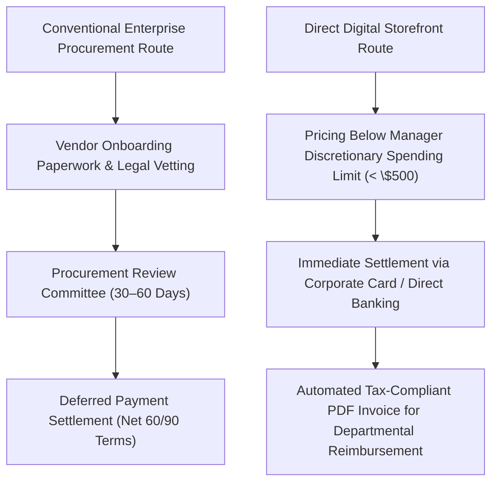
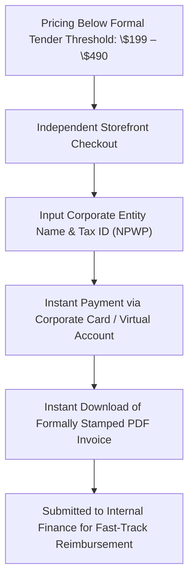

One of the most frustrating moments in enterprise transactions occurs when a departmental operations manager is ready to purchase your asset, only for the deal to stall inside internal procurement bureaucracy.

Suddenly, you are asked to submit dozens of vendor onboarding questionnaires, provide notarized certificates, and accept 60-to-90-day delayed payment terms (*Net 60 / Net 90*). Your operating cash flow can run dry long before settlement arrives.

Does enterprise selling always require this friction? Not necessarily.

Having established [corporate tiered licensing](/en/posts/b2b-digital-assets-part-3-multi-seat-licensing-models/), the final installment of the *B2B Digital Assets Playbook* outlines how modern solopreneurs bypass procurement delays: **The Discretionary Budget and Corporate Expense Strategy**, allowing corporate purchases to settle in five minutes through an independent storefront without getting entangled in formal procurement committees.

---

## Leveraging Managerial Discretionary Spending Caps

Across mid-sized and enterprise companies, departmental directors (Heads of People, Operations Leads, IT Directors) possess pre-approved discretionary spending authority that does not require formal procurement reviews or multi-vendor bids.

These discretionary thresholds typically range from **\$200 to \$500 per transaction**:
1. **Payable via Corporate Cards:** Managers swipe internal corporate credit cards and attach the digital receipt during monthly expense reconciliation.
2. **Reimbursable via Departmental Petty Cash:** Team members settle the purchase directly and submit the expense receipt to finance for reimbursement within 48 hours.
3. **Streamlined Documentation Requirements:** Accounting departments require one standard artifact: **A formal digital invoice showing legal entity name, corporate tax identification, and itemized line items**.

---

## Anatomy of a Finance-Friendly B2B Checkout Flow

To ensure corporate buyers can expense your digital deliverables without internal finance pushback, configure your checkout form with these required corporate data fields:

1. **Company / Entity Name Field:** Allow the customer to enter their legal corporate entity name alongside personal contact details.
2. **Corporate Tax ID Field:** Finance teams require vendor tax identification metadata for internal expense classification and tax reporting.
3. **Instant Tax-Compliant PDF Receipt:** Upon payment verification, automatically issue a formal PDF invoice featuring an invoice number, a digital "Paid" stamp, and transparent line-item details.
4. **Direct Bank Payment Options:** In many regional markets, finance staff prefer direct bank virtual account transfers or corporate debit settlements over standard consumer wallets.

---

## Why Independent Storefronts Outperform Commission-Heavy Marketplaces

Selling high-ticket enterprise deliverables through generic consumer marketplaces or international creator platforms that shave 10% to 20% in fees damages profitability:

- **A 10% take-rate on a \$500 sale is \$50 lost per order.** Across 25 monthly transactions, that equals \$1,250 surrendered to middleman platforms every month.
- **Zero Client Relationship Ownership:** Third-party platforms obscure corporate contact details and domain addresses, preventing you from offering annual maintenance renewals.

By establishing an independent digital storefront on [SitusBisnis](https://situsbisnis.com):
- You provide an enterprise-ready checkout experience with multiple payment options (instant QRIS, national bank virtual accounts, and credit card processing).
- You generate institutional invoices ready for corporate expense reimbursement.
- Most importantly: **0% platform commissions**. Every dollar of revenue earned from your enterprise assets flows directly to your business account.

---

### B2B Digital Assets Playbook Series Summary
1. **[Part 1: Targeting Multi-Billion Pain Points in Unsexy Industries](/en/posts/b2b-digital-assets-part-1-identifying-enterprise-headaches/)**: Identify high-liability operational problems overlooked by consumer creators.
2. **[Part 2: Audit-Proof Document Architecture](/en/posts/b2b-digital-assets-part-2-audit-proof-document-architecture/)**: Build institutional-grade assets with document control blocks, protected formulas, and automated validation flags.
3. **[Part 3: Multi-Seat Corporate Licensing Models](/en/posts/b2b-digital-assets-part-3-multi-seat-licensing-models/)**: Structure tiered enterprise seat pricing and unlock predictable annual maintenance revenue.
4. **[Part 4: Corporate Procurement Bypass](/en/posts/b2b-digital-assets-part-4-navigating-corporate-procurement/)**: Leverage discretionary spending caps and automated invoicing to eliminate enterprise procurement friction.
