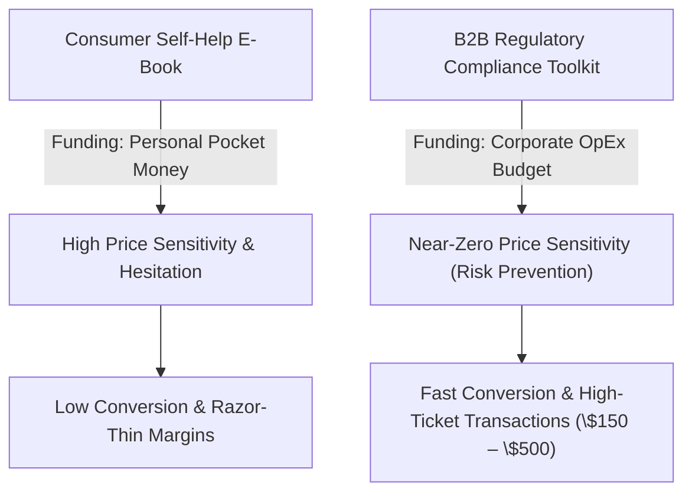
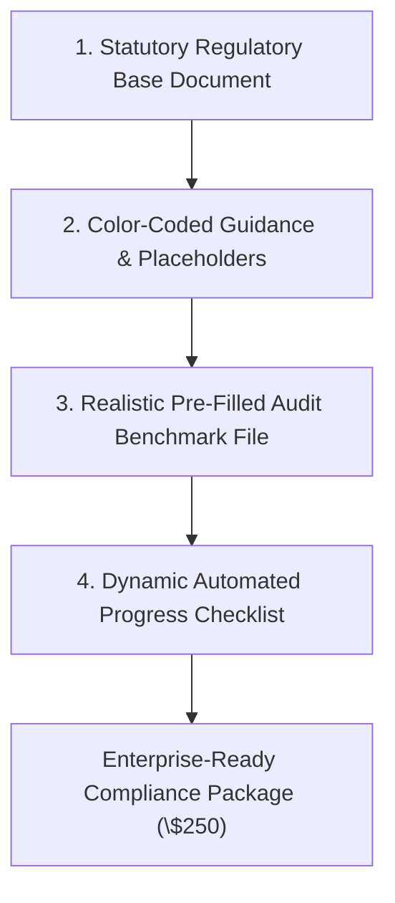

Notice the spending habits of early-stage creators: the majority attempt to sell a \$5 personal productivity e-book, then spend 80% of their operational bandwidth haggling in comments with prospects demanding discounts.

Across the digital economy, a former industrial compliance consultant sells a *Statutory Manufacturing & Cosmetic Licensing Toolkit* for \$250 per download. With zero social media dancing or promotional discounting, they consistently log 40 transactions monthly—generating \$10,000 in monthly net profit from a single digital asset.

Why does this disparity exist? The answer lies in **risk asymmetry and corporate operational budgeting**.

---

## The Psychology of Enterprise Operational Budgets (OpEx)

When an individual consumer evaluates a personal productivity guide, they spend personal disposable income. They mentally weigh purchasing the guide against dining out or buying coffee.

In contrast, when a manufacturing director or regulatory manager acquires an *ISO 22000 Audit & Hazard Matrix*, they do not draw from personal savings. They deploy **corporate operating expenses (OpEx)**. From their perspective:

1. **The Cost of Non-Compliance is Catastrophic:** If an operational audit fails or inventory is recalled due to labeling oversights, damages range into tens or hundreds of thousands of dollars. Spending \$250 to mitigate that liability is a minimal expense.
2. **Compressing Consultant Fees:** Retaining an external regulatory firm costs \$3,000 to \$8,000 across months of billable hours. A turnkey documentation toolkit eliminates 70% of the internal workload immediately.
3. **Audit Certainty:** Complex government formatting standards are notoriously confusing. A toolkit that has successfully passed regulatory audits provides immense operational peace of mind.

> **Commercial Rule:**
> Enterprises do not purchase document aesthetics. They purchase **high-stakes operational painkillers** that protect them from regulatory fines, facility shutdowns, or wasted team hours.

---

## 4 High-Demand Compliance Verticals

If you have a background in corporate law, logistics, health sciences, or manufacturing, these verticals exhibit continuous demand for standardized documentation:

| Industry Vertical | Required Compliance Deliverable | Typical Market Pricing |
| :--- | :--- | :--- |
| **Cosmetics & Skincare Formulations** | Statutory Registration Dossiers, Good Manufacturing Practice (GMP) Forms, Stability Testing SOPs | \$150 – \$350 |
| **Industrial Logistics & Warehousing** | Workplace Health & Safety Management Systems (HSE/SMK3), Hazard Identification & Risk Assessment Matrices | \$120 – \$280 |
| **Agencies & Professional Services** | Master Service Agreements (MSA), Staged Milestone Payment Terms, B2B Mutual Non-Disclosure Agreements (NDA) | \$80 – \$200 |
| **Healthcare Clinics & Pharmacies** | Facility Accreditation Dossiers, Controlled Substance SOPs, Electronic Health Record Compliance Audits | \$200 – \$450 |

---

## Packaging Regulatory Frameworks for Institutional Value

An enterprise-grade document is far more than a basic Word file available on generic internet repositories. Its value stems from **operational readiness**:

### 1. Color-Coded Implementation System
Incorporate clear visual annotations throughout the files:
- **Yellow:** Mandatory fields requiring legal entity and facility data.
- **Green:** Adaptable clauses that can be modified based on equipment capacity or team size.
- **Red:** Protected legal language mandated by statute that must not be altered to avoid non-compliance.

### 2. Pre-Filled Realistic Benchmark Files
Include an unredacted fictional exemplar demonstrating correct operational depth. Compliance templates are confusing not because legal terms are impossible to read, but because operators do not know how much detail auditors expect.

### 3. Dynamic Progress Checklists
Provide an interactive spreadsheet tracker featuring automated progress formulas:
- As departmental staff mark sections as verified, a dynamic status bar updates toward 100%.
- This gives operations managers immediate visibility before external auditors arrive.

---

## Distribution: Avoid Open Consumer Marketplaces

Selling high-liability B2B deliverables on generic retail marketplaces is an operational misstep. Buyers on those platforms expect cheap consumer goods and home delivery. When listing a \$250 compliance framework:
- Corporate prospects doubt your legitimacy when your asset appears adjacent to consumer phone cases.
- Marketplace take-rates consume double-digit percentages of your margins.
- You fail to capture corporate invoice data (tax IDs, entity names) needed for employee expense reimbursement.

By launching an independent storefront on [SitusBisnis](https://situsbisnis.com), you provide an enterprise-grade experience: instant checkout, corporate virtual accounts, automated tax invoices, and **0% transaction commissions**.
