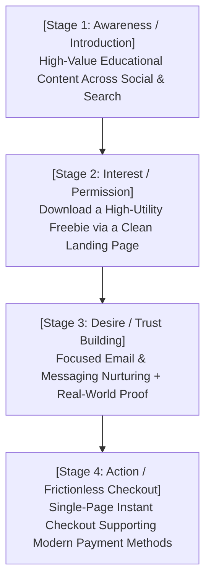
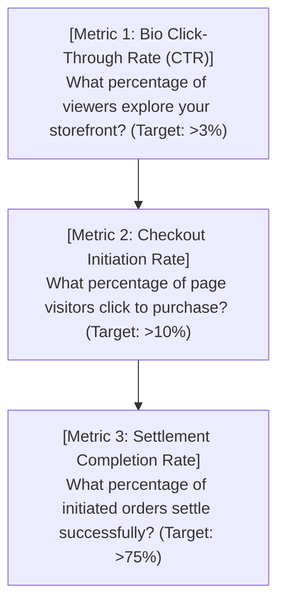

Have you ever wondered:
> *"Why does one creator post casual content twice a week yet wake up to steady customer orders every morning, while another posts multiple times a day until exhaustion, only to struggle to make a single sale?"*

The difference between these two creators has nothing to do with luck or personal charisma.

The distinction lies entirely in **their underlying sales engine architecture**.

Many first-time creators assume commercial success requires producing an endless volume of social content. They become trapped as content laborers for platform algorithms, heading straight for burnout.

Social media feeds are merely the storefront window. If your business lacks an organized system to welcome new visitors, guide their interest, and provide a seamless checkout experience, thousands of passersby will simply keep walking.

In this guide, we break down how to assemble a clean, automated digital conversion engine that generates predictable daily revenue without dominating your life.

---

## 1. Anatomy of an Empathetic Sales Funnel

Avoid viewing a sales funnel as an abstract corporate diagram. A healthy conversion system simply mirrors **the natural development of a relationship**:

Here is how each stage operates in practice:

### Stage 1: Awareness (Top of Funnel)
At this stage, visitors encounter your perspective for the first time.
- **Golden Rule:** Never hard-sell paid products here. Visitors do not yet know you or trust your expertise.
- Focus on sharing a practical insight or deconstructing a common misconception holding people back.

### Stage 2: Permission & Interest (Middle of Funnel)
When visitors appreciate your perspective, offer a targeted free resource (such as a checklist, spreadsheet calculator, or swipe file) in exchange for their email or messaging contact. This transitions them from rented social channels to an owned audience.

### Stage 3: Trust Building (Nurturing)
You now have a direct communication channel to their inbox.
- Avoid bombarding them with relentless promotional pitches.
- Share case studies explaining how real people overcame the challenge. Demonstrate an acute understanding of their everyday bottlenecks.

### Stage 4: Frictionless Transaction (Bottom of Funnel)
When prospects are ready to buy, eliminate friction:
- Never force them through confusing 10-field checkout forms.
- Never make them wait for manual payment confirmation via chat.
- Allow them to settle via instant QRIS or bank virtual accounts in seconds, with deliverables dispatched automatically to their device.

---

## 2. Three Conversion Leaks That Quietly Erode Revenue

If your storefront is struggling to generate sales, examine these three critical drop-off points:

| Funnel Leak Point | Observable Symptom | Tactical Remedy |
| :--- | :--- | :--- |
| **Inbound Traffic Leak** | Content receives views but generates few clicks to your bio link. | Refine content hooks to highlight the specific cost of delaying a solution. |
| **Sales Page Bounce** | Visitors click through to your sales page but immediately close the tab. | Clarify your value proposition: focus on tangible buyer outcomes rather than personal credentials. |
| **Checkout Abandonment** | Visitors initiate checkout but never complete payment. | Replace manual bank transfer instructions with automated, instant payment options. |

> **Operational Insight:**
> Checkout abandonment is the most painful leak. Allowing high-intent prospects who have already decided to buy to drop off due to broken payment flows actively burns revenue.

---

## 3. Metrics That Actually Matter (Beyond Vanity Likes)

Stop measuring business success by video view counts or social likes. Track metrics tied directly to enterprise health:

When you track these three indicators systematically, you operate with clarity—knowing precisely which section of your sales engine requires refinement.

---

## Summary

Building an independent digital enterprise is not about becoming a viral celebrity chasing millions of followers.

It is about establishing **a reliable, automated conversion engine** on an independent storefront platform like [SitusBisnis](https://situsbisnis.com)—a system that operates quietly around the clock, allowing you to focus on high-value creative work while protecting your personal time.
