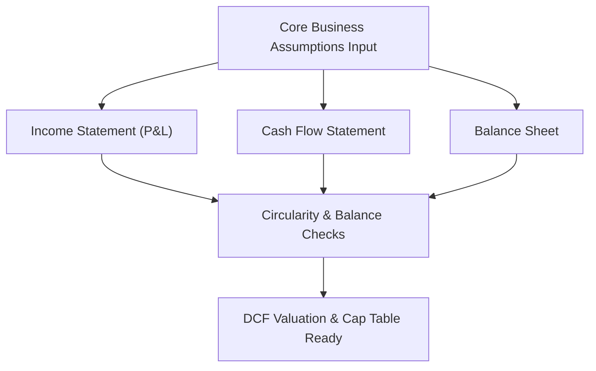
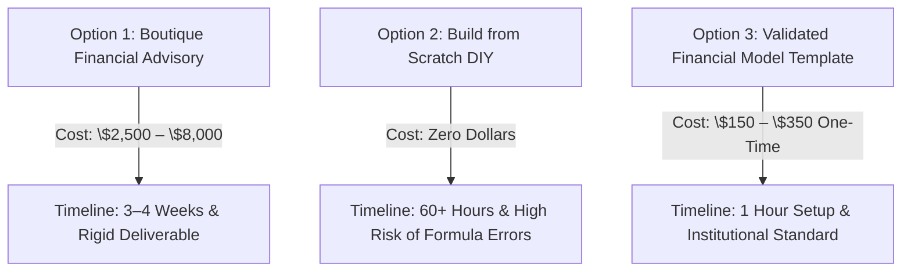

Many creators believe spreadsheet products are limited to basic expense trackers or simple to-do lists. However, in venture capital and commercial banking circles, there is a lucrative market for one specialized digital asset: **The Dynamic 3-Statement Financial Model**.

An experienced financial analyst or former investment banker can sell an integrated model template for \$150 to \$500+ per license. The buyers? Startup founders preparing seed rounds, commercial operators seeking bank debt facilities, boutique M&A advisors, and angel investors.

Why do buyers willingly pay premium rates for a spreadsheet file? Because assembling an integrated financial model from scratch requires at least 60 hours of specialized modeling, with severe financial liability if circular formulas break.



---

## Anatomy of an Institutional-Grade 3-Statement Model

Amateur financial spreadsheets often consist of isolated revenue projections and static cost estimates. In contrast, an institutional model connects three foundational statements dynamically:

### 1. Macro Assumptions & Variable Input Tab
Strict decoupling between user inputs and calculation sheets. All assumptions reside in a dedicated tab:
- Customer Acquisition Cost (CAC) and monthly subscriber cohorts.
- Churn rates segmented by customer cohort.
- Headcount expansion schedule complete with statutory payroll taxes and benefits.
- Working capital cycles (Days Sales Outstanding / Days Payable Outstanding).

### 2. The Integrated 3 Financial Statements
- **Income Statement (P&L):** Calculates gross revenue, COGS, gross margins, operating expenses (OpEx), EBITDA, and net earnings post-tax.
- **Balance Sheet:** Dynamically balances Assets, Liabilities, and Shareholders' Equity using real-time automated balance-check flags.
- **Cash Flow Statement:** Maps operating, investing, and financing cash flows. This tab is essential: startups rarely fail from paper losses; they fail when their physical cash reserves run dry (*runway depletion*).

### 3. DCF Valuation Engine and Cap Table Simulation
Advanced tiers incorporate Discounted Cash Flow (DCF) valuation models based on Weighted Average Cost of Capital (WACC), paired with an automated equity dilution simulator (*Cap Table*) across successive fundraising rounds.

```
Runway Formula:
Cash Runway (Months) = Total Available Liquid Cash / Average Monthly Net Burn Rate
```

---

## Why Founders Prefer Ready-Made Models Over Boutique Retainers

Engaging a boutique corporate finance advisory firm to construct a custom pitch deck model costs between \$2,500 and \$8,000. For an early-stage venture or a growing family business, that expense strains working capital.

Purchasing a validated financial model for \$250 delivers an immediate solution:
1. **Industry-Standard Formatting:** The model adheres to financial conventions expected by VC investment committees and commercial lenders.
2. **Scenario Independence:** Founders can toggle variables across *Best Case*, *Base Case*, and *Worst Case* scenarios in seconds before pitch meetings.
3. **Critical Time Savings:** During investor due diligence, founders often have 48 hours to supply five-year financial forecasts. Deploying a validated template is the only viable path.



---

## Packaging High-Ticket Financial Models for Sale

To successfully sell advanced financial deliverables, your sales presentation must demonstrate technical credibility:

1. **5-Minute Formula Tour Video:** Demonstrate how altering a single assumption (such as a 10% increase in customer retention) flows through the balance sheet and updates the final valuation without creating formula errors.
2. **Interactive Demo Sheet:** Allow prospective buyers to inspect Named Ranges, calculation hierarchy, and color-coded input conventions without enabling export prior to purchase.
3. **Companion Metric Glossary PDF:** Include a concise guide explaining key financial ratios (EBITDA, LTV/CAC, Quick Ratio, Debt Service Coverage Ratio) so non-finance founders can present numbers to investors with confidence.

Through an independent storefront on [SitusBisnis](https://situsbisnis.com), you can distribute protected financial models with automated, encrypted download links—capturing 100% of transaction revenue with zero platform commission deductions.
