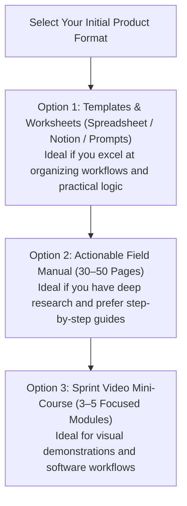

The most common question facing prospective creators and solopreneurs is:
> *"I have domain expertise and professional experience, but what format should my first digital product take? Should I record a comprehensive video course, write an actionable e-book, or build a plug-and-play template?"*

Choosing the wrong format early in your business journey can create serious bottlenecks:
- Selecting an **excessively complex format** (such as a 30-hour video curriculum requiring professional studio production) risks severe burnout before you ever launch.
- Selecting an **overly simplistic format** (such as a generic 5-page PDF summary) makes it difficult to command fair pricing in the market.

In this analysis, we evaluate the three most popular digital product formats, analyze their trade-offs, and map out a practical path forward based on your current resources.

---

## 1. Digital Product Format Comparison Matrix

Here is how the three formats compare across five critical operational parameters:

| Evaluation Dimension | 1. Actionable E-Book / Playbook PDF | 2. Plug-and-Play Template (Spreadsheet, Notion, SOP) | 3. Video Masterclass / Online Course |
| :--- | :--- | :--- | :--- |
| **Initial Production Timeline** | 1 – 2 Weeks | 3 – 7 Days | 3 – 8 Weeks |
| **Required Production Tools** | Google Docs / Office + PDF Export | Spreadsheets, Notion, or Workspace tools | Condenser microphone, screen recorder, lighting |
| **Perceived Value** | Low – Moderate (\$10 – \$29) | Moderate – High (\$19 – \$69) | High – Very High (\$49 – \$299+) |
| **Customer Completion Rate** | 10% – 20% (many save and forget) | **80% – 95%** (duplicated and used immediately) | 20% – 35% (buyers drop off in middle modules) |
| **Production Friction for Introverts** | Very Low (focus entirely on writing) | Very Low (focus on system logic) | Moderate – High (speaking on camera/audio) |

---

## 2. Strategic Profiles for Each Format

### Format 1: Templates & Operating Tools (High Utility)
Templates—such as project management dashboards, small-business financial spreadsheets, or design presets—offer **the highest velocity-to-revenue ratio in modern digital commerce**.

**Why customers love this format:**
- Buyers are not seeking abstract theory; they are purchasing a shortcut to avoid starting from an empty screen.
- Immediate utility: buyers click *"Duplicate to my workspace"* and begin benefiting from the tool within two minutes.

### Format 2: Actionable Field Playbooks / Tactical Guides
Avoid writing 200-page academic textbooks. The most commercially effective format today is a **tight 30-to-50-page Field Manual** focused on tangible outcomes.

Structure your guide around:
1. Real-world case studies detailing solutions you have deployed.
2. Costly pitfalls and misconceptions to avoid.
3. Printable diagnostic checklists that readers can implement immediately.

### Format 3: Sprint Video Mini-Courses
If your domain expertise requires visual demonstration (such as software tutorials, UI/UX design, or data modeling), video is the natural medium.

However, adhere to the **Sprint Mini-Course** rule:
- Keep total duration between 60 and 120 minutes.
- Divide the curriculum into 6 to 8 focused lessons of 10 to 15 minutes each.
- Skip expensive camera gear; clear screen recordings paired with crisp microphone audio project complete professional authority.

---

## 3. The Hybrid Product Stacking Playbook

Rather than locking yourself into a single format indefinitely, experienced creators layer formats over time:

1. **Sprint 1 (Month 1):** Launch a *Plug-and-Play Spreadsheet & SOP Kit* for \$19 to validate market appetite and collect early testimonials.
2. **Sprint 2 (Month 2):** Draft a *Tactical Field Guide* explaining the operating methodology behind the spreadsheet, offering a bundled tier for \$39.
3. **Sprint 3 (Month 3):** Record *3 Practical Implementation Video Teardowns*, assembling a Pro Tier for \$79 on your [SitusBisnis](https://situsbisnis.com) storefront.

Under this approach, you never start from zero; each companion asset compounds the value of your core catalog.

---

## Summary

The delivery format is merely the packaging for your solution. What customers genuinely evaluate and purchase is **time compression and the certainty of a tangible outcome**.

Choose the format you can build and publish within the next 7 days. Capture your first sale, collect feedback, and scale your catalog systematically.
