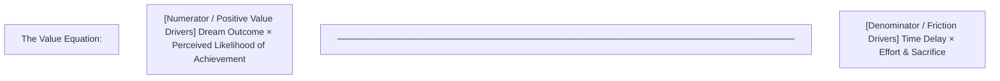
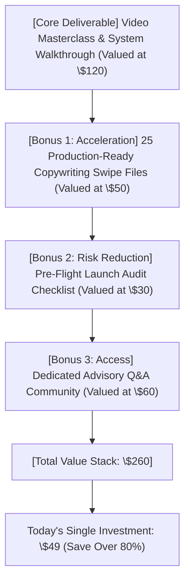

Many first-time creators assume their digital products fail to sell because they lack poetic flair or manipulative sales tactics.

The reality: **The most brilliant copywriting in the world cannot salvage a weak offer.**

Conversely, an exceptional, well-structured proposition (*a grand slam offer*) converts strongly even when communicated in simple, straightforward language.

As direct-response marketers observe:
> *"Make people an offer so good they would feel stupid saying no."* — Alex Hormozi

In Part 1 of the *Digital Product Conversion Copywriting* series, we break down the mechanics of the Value Equation and how to calibrate it specifically for modern digital buyers.

---

## 1. Anatomy of the Value Equation

The perceived value of an offer is governed by four psychological variables:

Mathematically:
$$\text{Perceived Value} = \frac{\text{Dream Outcome} \times \text{Perceived Likelihood of Achievement}}{\text{Time Delay} \times \text{Effort \& Sacrifice}}$$

To multiply your offer's perceived value without discounting prices:
1. **Maximize the Numerator:** Define a specific, tangible outcome and supply credible proof that your mechanism delivers.
2. **Minimize the Denominator Toward Zero:** Shrink the time required to see results and eliminate confusing operational friction.

---

## 2. Comparing Commodity Offers vs. High-Value Propositions

Notice how standard commodity offers are transformed into high-leverage propositions:

| Psychological Variable | Generic Offer (Low Perceived Value) | High-Leverage Offer (Grand Slam Proposition) |
| :--- | :--- | :--- |
| **Dream Outcome** | *"Learn how to write blog posts."* | *"Build a content flywheel that captures 50 qualified commercial leads each week."* |
| **Perceived Likelihood** | *"I have 5 years of industry experience."* | *"A step-by-step framework validated across 120+ independent businesses."* |
| **Time Delay** | *"Work through this 40-hour curriculum at your own pace."* | *"Download plug-and-play templates, insert your brand assets, and deploy in 45 minutes."* |
| **Effort & Sacrifice** | *"Learn custom HTML, CSS, and database configurations."* | *"Zero code required. Configure visually using the intuitive [SitusBisnis](https://situsbisnis.com) dashboard."* |

In the right-hand column, buyers realize they are not purchasing dry educational theory—they are purchasing **time compression and a direct bridge to tangible results**.

---

## 3. Assembling the Value Stack

When presenting your product's pricing on a sales page, never leave the core item standing alone. Frame your offer within a structured *Value Stack*:

Through value stacking:
- Prospective buyers evaluate the \$49 price tag not against an empty wallet, but against the accumulated \$260 in tangible deliverables.
- The relative return on investment becomes immediately apparent.

---

## 4. Three Offer-Creation Pitfalls to Avoid

1. **Attaching Irrelevant Bonuses:** Padding an offer with an unrelated 200-page PDF merely creates cognitive overload and devalues the core proposition.
2. **Making Unsubstantiated Hype Claims:** Promising *"Earn \$10,000 in 3 days with zero effort"* triggers consumer skepticism and destroys operational credibility.
3. **Ignoring Local Payment Preferences:** Even the strongest proposition fails if your checkout rejects the payment methods your audience actually uses every day.

---

## Summary & Next Steps

High-converting copywriting is not about flowery vocabulary; it is founded on the clarity and strength of your core offer.

In [Part 2](/en/posts/conversion-copywriting-part-2-headlines-hooks-storytelling/), we transition to editorial execution: **Crafting arresting headlines, 5-second attention hooks, and the Before-After-Bridge narrative framework**.
