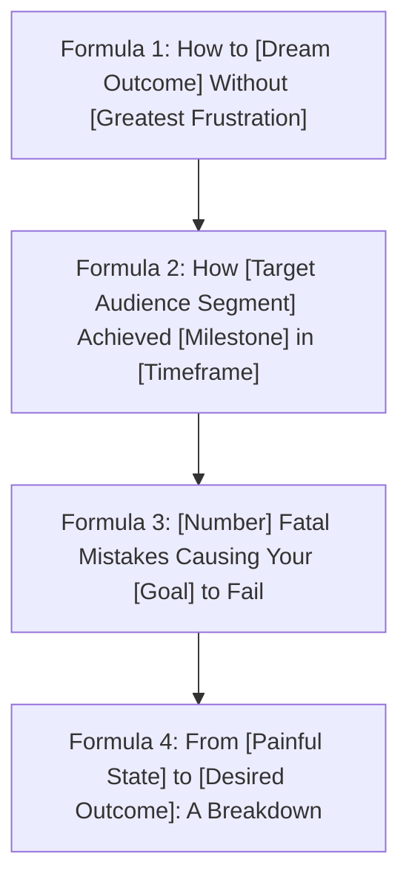
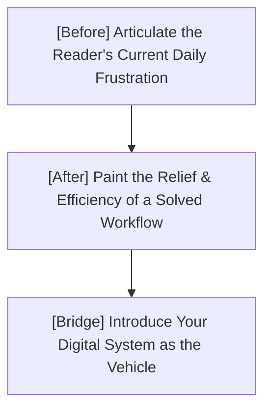

The average human attention span when scanning digital content is **under five seconds**.

When prospective buyers tap your storefront link, they do not read every sentence sequentially. Their eyes perform a rapid visual scan to answer one subconscious question:
> *"Is this page immediately relevant to my current problem, or should I tap Back?"*

If your headline and opening lines fail to supply a compelling reason to stay, the production quality of your modules or templates will never matter—because no one will ever see them.

In Part 2 of the *Digital Product Conversion Copywriting* series, we break down proven headline frameworks and the **Before-After-Bridge (BAB)** storytelling narrative that transitions customer frustration into conversion.

---

## 1. Four High-Converting Headline Formulas

Use these validated formulas when drafting sales page headers and marketing subject lines:

Compare standard commodity titles against high-converting headlines:

| Formula Type | Generic Title (Flat & Ignored) | High-Converting Headline (Intent-Driven) |
| :--- | :--- | :--- |
| **Pain-Free Outcome** | *"Website Creation Course"* | *"How to Launch a High-Converting Sales Storefront in 1 Day Without Writing Code or Hiring Expensive Agencies"* |
| **Time-Bound Case Study** | *"Selling Spreadsheet Templates"* | *"How This Solopreneur Generated \$1,500 in 21 Days Selling Lightweight Operational Spreadsheets & SOPs"* |
| **Costly Mistake Angle** | *"Email Marketing Playbook"* | *"3 Critical Flaws Diverting Your Sales Emails into Spam Folders and Costing You Conversions"* |

> **Editorial Rule:**
> High-converting headlines never rely on all-caps screaming or sensational clickbait. They succeed by pinpointing **specific, recognizable pain points** experienced by qualified prospects.

---

## 2. The Before-After-Bridge (BAB) Narrative Architecture

Customers are not persuaded by dry lists of technical features. They are persuaded by **narrative transformation**.

The *Before-After-Bridge* framework provides a clean narrative bridge connecting reader empathy with your commercial solution:

### Stage 1: The 'Before' (Entering the Conversation in Their Head)
Describe the prospect's daily bottleneck with such operational precision that they pause and reflect: *"This describes my situation exactly."*

> *Example:*  
> *"Have you ever found yourself staring at an empty laptop screen late at night, wondering what content to publish next while your storefront sales graph remains flat?"*

### Stage 2: The 'After' (Illuminating the Desired Future State)
Help them visualize an operational reality where that friction has been systematically removed.

> *Example:*  
> *"Picture opening your device each morning to find instant settlement notifications for orders processed while you were asleep—without answering repetitive support chats."*

### Stage 3: The 'Bridge' (Positioning Your Product as the Mechanism)
Demonstrate that reaching the desired outcome is not a matter of luck, but the direct result of deploying a **tested mechanism**.

> *Example:*  
> *"That is why we engineered [Product Name]—an operational system designed to cut content drafting by 90% and automate checkout transactions on an independent platform."*

---

## 3. Shifting from Features to Transformational Benefits

A common misstep among product creators is cataloging technical specifications rather than communicating real-world outcomes:

| What Creators Often Write (Technical Features) | What Buyers Actually Purchase (Tangible Transformation) |
| :--- | :--- |
| *"Includes 42 HD video modules."* | *"A concise, outcome-driven system saving you 6 months of frustrating trial-and-error."* |
| *"Features complex nested formulas."* | *"Enter three core operational numbers, and this engine automatically calculates your net profit margins."* |
| *"Delivered in clean Markdown format."* | *"Ready to paste into your publishing workflow with zero formatting hassles."* |

---

## Summary & Next Steps

Arresting headlines and empathetic opening narratives earn you attention and goodwill.

However, once interest is established, buyer psychology naturally triggers hesitation: doubt, fear of wasting capital, and skepticism.

In [Part 3](/en/posts/conversion-copywriting-part-3-crushing-buyer-objections/), we unpack how to systematically neutralize **The 5 Universal Buyer Objections**—from *"This is too expensive"* to *"What if I'm not technical enough to use it?"*.
