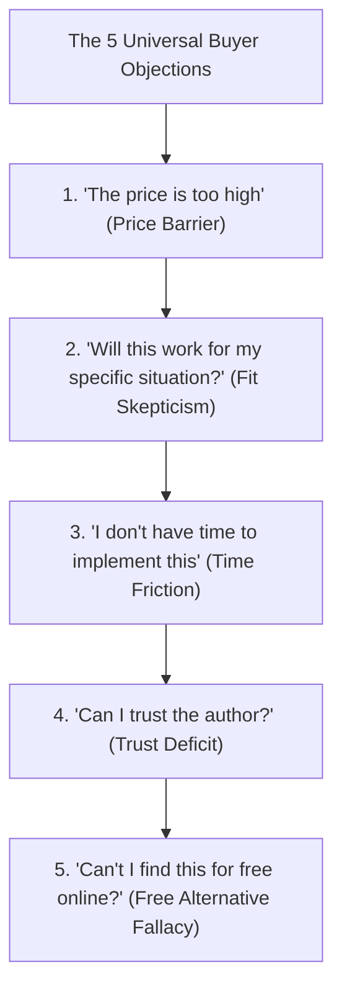

When a prospective buyer reads through your offer page, reviews your deliverables, and reaches the checkout card, a final internal dilemma takes place:

**The tension between Desiring the Solution vs. The Fear of Post-Purchase Regret.**

Human psychology is wired for **loss aversion**. We fear losing \$50 on a disappointing purchase far more intensely than we value gaining \$200 from a successful one.

If your copywriting fails to proactively address these hesitations on the offer page, prospects will not reach out to ask for clarification—they will quietly close their browser tab.

In Part 3 of the *Digital Product Conversion Copywriting* series, we break down **The 5 Universal Buyer Objections** and the strategic copywriting frameworks needed to neutralize them.

---

## 1. The 5 Core Buyer Objections

Every digital transaction encounters a predictable taxonomy of buyer hesitation:

Here is how to resolve each objection systematically:

---

## 2. Strategies for Overcoming Common Objections

### Objection 1: "The Price Feels Too Steep"
- **Root Cause:** The prospect lacks an objective frame of reference, comparing your asset's price to unrelated everyday consumer purchases.
- **Copywriting Framework:** Deploy **Reframing & The Cost of Inaction**:
  > *"This \$49 investment breaks down to less than \$1.60 a day over the next month—less than the price of a daily cup of coffee. The real question is: how much capital have you forfeited over the last six months dealing with fragmented workflows or middleman commission cuts?"*

### Objection 2: "What If This Doesn't Apply to My Specific Workflow?"
- **Root Cause:** The buyer feels their circumstances are an outlier (*imposter syndrome*).
- **Copywriting Framework:** Implement **Risk Reversal via Unconditional Guarantees**:
  > *"We remove 100% of the financial risk. Explore the frameworks and implement the checklists for 30 days. If this system does not provide clear operational value for your business, contact our support team for a full 100% refund—no questions asked."*

### Objection 3: "I'm Too Busy and Lack Time to Learn New Systems"
- **Root Cause:** Fear that your product represents a heavy time commitment requiring dozens of hours to parse.
- **Copywriting Framework:** Emphasize **Concise, Outcome-Driven Design**:
  > *"This asset is engineered specifically to eliminate fluff. You do not need to sit through 40 hours of generic lectures. Review the 15-minute quickstart guide, copy our production-ready templates, and deploy immediately."*

### Objection 4: "Who Are You, and Why Should I Trust This Framework?"
- **Root Cause:** Brand unfamiliarity and healthy consumer skepticism.
- **Copywriting Framework:** Embed **Verifiable Social Proof**:
  > Include authentic screenshots of customer feedback, real metrics, and unedited quotes citing specific operational outcomes rather than generic platitudes like *"great content"*.

### Objection 5: "Couldn't I Just Piece This Together for Free on YouTube?"
- **Root Cause:** The prospect conflates disorganized information with a structured system.
- **Copywriting Framework:** Distinguish **Raw Information vs. Tested Execution**:
  > *"You could certainly spend six months scouring hundreds of disparate videos and forum threads. But you will spend hundreds of hours reconciling conflicting advice. With this toolkit, you pay for time compression: an organized, end-to-end roadmap from Point A to Point B tested in the real world."*

---

## 3. Placement Matrix for Objection-Handling Elements

| Sales Page Component | Required Copywriting Elements | Psychological Function |
| :--- | :--- | :--- |
| **Hero Section (Top)** | Guarantee badges & review rating stars | Establishes credibility within the first five seconds |
| **Pricing Card (Middle)** | Clear value breakdown & regular price anchor | Demonstrates tangible cost savings and ROI |
| **FAQ Section (Bottom)** | Addresses technical access, file formats, and refund policies | Resolves final concerns before form completion |
| **Checkout Form** | Security badges & familiar payment icons | Eliminates hesitation at the moment of payment |

> **Editorial Rule:**
> An FAQ section is not a placeholder for dry administrative notes. It is a strategic tool designed to address critical buyer doubts transparently and decisively.

---

## Summary & Next Steps

When you address these five objections with empathy and authentic proof, buyer hesitation dissolves naturally.

In [Part 4 (Series Conclusion)](/en/posts/conversion-copywriting-part-4-microcopy-checkout-ctas/), we focus on the smallest yet most pivotal conversion element: **Checkout Microcopy and CTA Optimization**—the specific wording around payment buttons that lifts checkout conversions by 20% to 30%.
