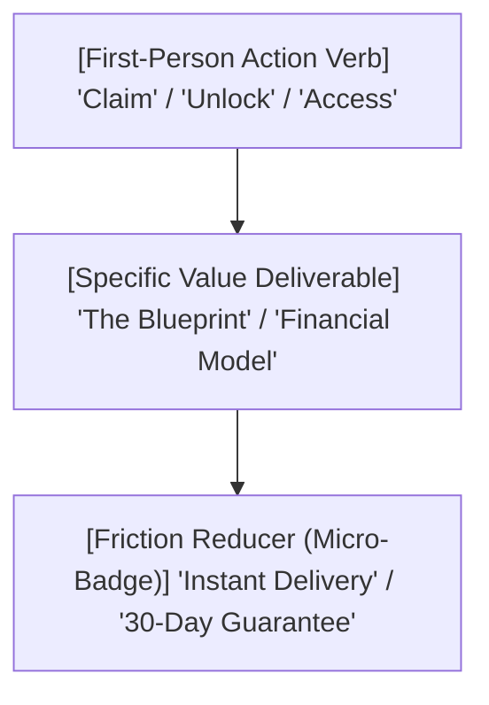
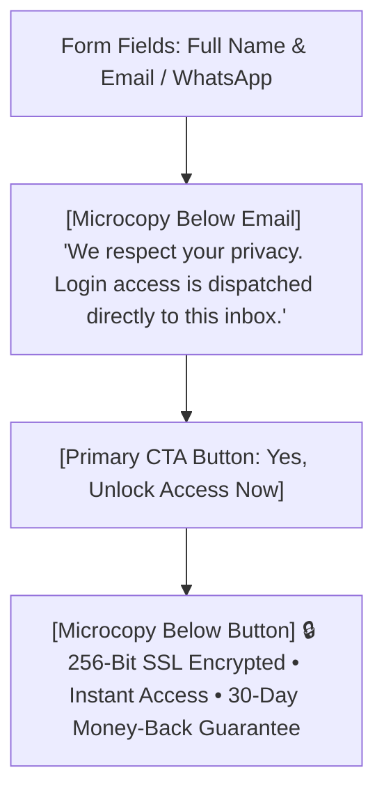

In Conversion Rate Optimization (CRO), there is an enduring rule:
> *"The devil is in the details, but the dollars are in the microcopy."*

Many creators dedicate weeks to polishing thousands of words of promotional copy, yet treat checkout forms and Call-to-Action (CTA) buttons as an afterthought—leaving default labels like *"Submit"*, *"Buy"*, or *"Process Now"*.

Passive, bureaucratic labels demand emotional commitment while offering zero reminder of the tangible reward awaiting the customer.

**Microcopy**—the concise text on buttons, form labels, input placeholder hints, and confirmation notices—serves as the final safeguard against cart abandonment.

In this concluding guide of the *Digital Product Conversion Copywriting* series, we break down high-impact microcopy formulas and CTA optimizations proven to lift checkout conversions by 20% or more.

---

## 1. The Three Pillars of a High-Converting CTA

An effective action button incorporates three psychological levers:

Compare standard generic buttons against high-converting alternatives:

| Generic Button Label (Flat & Bureaucratic) | High-Converting Label (Value-Driven) |
| :--- | :--- |
| `Buy Now` | `Yes, Grant Me Instant Access Now →` |
| `Sign Up` | `Start Building My Independent Storefront Today` |
| `Submit` | `Claim Offer & Download Templates (Save 70%)` |
| `Proceed to Payment` | `Secure My Access & Complete Instant Checkout` |

> **Strategic Principle:**
> Frame buttons in the first person (*"My"* or *"Me"*) rather than second person (*"You"*). A/B testing repeatedly shows first-person button phrasing generates a **9% to 14% lift in click-through rates**.

---

## 2. Structuring Microcopy Around the Checkout Form

At the point of payment, buyers experience natural last-second hesitation. Surround your form with reassuring, friction-reducing microcopy:

### 1. Spam Reassurance Under Email Fields
Place reassuring text directly below email input fields:
> *"We value your privacy. Your login credentials and tax receipt are dispatched to this email address within 60 seconds."*

### 2. Instant Access Affirmation (Instant Gratification)
Digital buyers require certainty that their purchase does not require manual seller approval:
> *"Automated 24/7 delivery. The moment payment is verified, you can log in and download all resources immediately."*

### 3. Familiar Payment Badges
Display recognizable logos of established payment methods (QRIS, major regional debit networks, and credit card providers). Familiar checkout trust badges significantly diminish payment anxiety.

---

## 3. The Sales Page Microcopy Audit Checklist

Before driving traffic to your storefront, run through this operational checklist:

- [ ] **Value-Oriented CTA Text:** Button copy specifies the reward or transformation, not merely the transactional action ("Submit").
- [ ] **Prominent Risk-Reversal Summary:** A concise guarantee note sits directly beneath the primary purchase trigger.
- [ ] **Minimal Form Fields:** Request strictly essential operational fields (Name, Email, Phone/WhatsApp). Do not ask for home addresses for pure digital assets!
- [ ] **Explicit Security Indicators:** Encrypted payment and SSL trust signals are visible.
- [ ] **Instant Button Feedback:** Checkout buttons respond immediately without lag, eliminating confusion over whether a click registered.

---

## Closing Reflection

Exceptional copywriting is not about composing elaborate prose—it is about **removing friction and clarifying the path for customers who already need your solution**.

From designing a compelling offer and writing clear headlines to neutralizing hesitations and optimizing checkout triggers, every element works synergistically when backed by an independent, zero-commission storefront on [SitusBisnis](https://situsbisnis.com).

Review your offer pages today, refine your microcopy, and build a conversion experience that serves your buyers cleanly.
