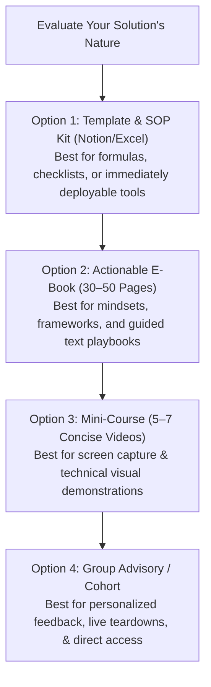

Once you have verified that the market possesses an acute problem and is ready to pay for a solution (as covered in [Part 1](/en/posts/creator-commerce-blueprint-validating-digital-products/)), your next operational challenge is: **how do you package that solution into a high-margin digital asset that leaves buyers thrilled?**

Many early creators fall victim to *"Course Bloat"*—operating under the false assumption that packing 40 hours of video or a 250-page e-book makes a product inherently more valuable. In today's attention-scarce environment:
> **Digital buyers do not buy duration or page counts. They buy compression: the fastest path from Point A (frustration) to Point B (tangible outcome).**

In **Part 2** of the *Creator Commerce Blueprint*, we dissect product architecture: selecting the most efficient production format, engineering an outcome-driven curriculum, and configuring value-based pricing tiers that maximize revenue without buyer friction.

---

## 1. Product Formats: Efficiency vs. Production Velocity

Your initial format should strictly match your available bandwidth and your audience's workflow habits. Never force yourself to build an exhaustive 10-module video curriculum for your commercial debut.

| Product Format | Build Timeline | Completion Rate | Typical Price Range | Best Suited For |
| :--- | :--- | :--- | :--- | :--- |
| **Actionable E-book / Guide** | 3–7 Days | High (60%–70%) | \$15 – \$49 | Structured frameworks, step-by-step playbooks, technical guides. |
| **SOP & Template Kit (Notion/Sheet)** | 2–5 Days | Extremely High (80%+) | \$29 – \$99 | Plug-and-play operational tools: financial models, prompt libraries, contracts. |
| **Video Mini-Course (60–90 Min)** | 7–14 Days | Moderate (40%–50%) | \$49 – \$199 | Screen-heavy skills requiring software demonstrations (Figma, ads, code). |
| **Cohort / Group Advisory** | 1 Week Prep | Very High (85%+) | \$290 – \$990 | Intensive periodic sprints with live teardowns and accountability. |



> **Editorial Recommendation for Product #1:** Start with a **Template Kit** or a **Tactical E-book**. They deliver the fastest production velocity, minimal technical risk, and the highest completion rates among buyers.

---

## 2. Engineering an Outcome-Driven Curriculum (MVT Principle)

Avoid organizing your syllabus like an encyclopedic history textbook. Structure your curriculum using the **Minimum Viable Theory (MVT)** framework:

```
Point A (Acute Bottleneck) ──────[ 3 Concrete Milestones ]──────► Point B (First Tangible Win)
```

Divide your material into three crisp operational phases:
1. **Phase 1: Quick Win (Hours 1–2):** Provide one targeted intervention that the buyer can execute within 30 minutes to generate an immediate small victory. This early win releases dopamine and locks in their confidence in your system.
2. **Phase 2: The Core Mechanism (Days 3–5):** Teach the primary engine or methodology that resolves the systemic bottleneck.
3. **Phase 3: Safeguards & Troubleshooting (Days 6–7):** Deliver pre-emptive edge-case guidance: *"What adjustments should you make if this initial setup encounters resistance in your niche?"*

---

## 3. Configuring Value-Based Pricing

A catastrophic error made by first-time product creators is pricing based on **production cost** (e.g., *"It only took me 4 days on my laptop, so I'll sell it for \$5"*).

Digital pricing must reflect the **economic or emotional value of the transformation**:

$$\text{Price} = \frac{\text{Value of Outcome} - \text{Friction \& Trial-and-Error Time}}{10}$$

### Value Calculation in Practice:
- If your bookkeeping template saves a freelance studio 10 operational hours monthly (worth \$300/month in billable time), offering that system for **\$49** is an absolute no-brainer.
- If your proposal framework helps a junior designer close a single \$1,500 retainer, a **\$79** guide delivers a 19x return on investment.

---

## 4. The 3-Tier Pricing Architecture

Deploy a tiered pricing ladder on your checkout page to capture consumer surplus across varied customer segments:

| Tier | Package Contents | Target Share | Financial Objective |
| :--- | :--- | :--- | :--- |
| **Tier 1: Starter** | Core Guide or Checklist only (PDF). | 20% of orders | Eliminates friction for new, budget-sensitive buyers. |
| **Tier 2: Pro (Best Value ⭐)** | Core Guide + 5 Ready-to-Use Templates + Video Walkthrough. | **70% of orders** | **Hero revenue driver**; anchors maximum perceived value. |
| **Tier 3: VIP / Implementation** | Everything in Pro + Exclusive Community Access + 1x Async Teardown. | 10% of orders | Captures high-margin upside from power operators. |

---

## 5. Execution Checklist

Before building your lead generation funnel:
1. [ ] Select a single format you can realistically finish within 7 days.
2. [ ] Identify the exact *Quick Win* a customer will achieve within 60 minutes of checkout.
3. [ ] Calculate the quantifiable time or capital savings your asset delivers.
4. [ ] Build two or three price tiers on your SitusBisnis storefront to enable upsells.

---

*Next in the series: How to attract hundreds of qualified buyers without spending a dime on paid advertising. Continue to **[Part 3: Lead Magnets & Sovereign Audience Pipelines](/en/posts/creator-commerce-blueprint-part-3-lead-magnets-audience-pipelines/)**.*
