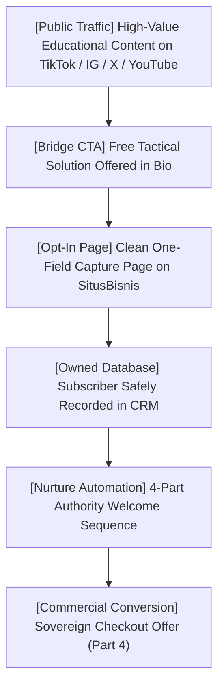

One of the most dangerous vulnerabilities for a modern digital entrepreneur is erecting a commercial empire on **"rented ground"**. 

If your entire distribution engine relies on followers on Instagram, TikTok, YouTube, or X:
- Your account can be shadowbanned or throttled without explanation.
- Algorithmic updates can slash organic post reach by 90% overnight.
- You are forced to pay exorbitant ad auctions just to reach people who already opted into following you.

Enduring creators who survive platform shifts always control one foundational asset: **an Owned Audience and Direct Email Pipeline**.

In **Part 3** of the *Creator Commerce Blueprint*, we dismantle the audience transfer funnel: how to architect ultra-high-converting free assets (*lead magnets*) and deploy automated nurture sequences that turn cold social traffic into primed buyers.

---

## 1. The Bridge Funnel Architecture

Moving prospects from public algorithmic feeds into an owned database requires a frictionless bridge:

Once a prospect enters your owned pipeline, your marginal distribution cost drops to **\$0**, giving you an unthrottled, direct-to-consumer relationship 24 hours a day.

---

## 2. Three Rules for 40%+ Converting Lead Magnets

Many creators package an 80-page generic e-book and wonder why opt-in rates hover below 5%. In an era of acute cognitive overload, nobody wants an exhaustive free book from someone they just discovered.

To achieve consistent 35%–50% opt-in conversions on your landing page, a lead magnet must satisfy three operational criteria:

| Criterion | Strategic Focus | Tactical Execution |
| :--- | :--- | :--- |
| **1. Ultra-Specific** | Solves ONE discrete operational headache, not world peace. | ❌ "The Complete Guide to E-Commerce" ✅ "Automated Contribution Margin Excel Calculator for D2C Brands" |
| **2. Sub-10-Minute Utility** | Can be consumed, understood, and applied in under 10 minutes. | SOP checklists, Notion workspace templates, one-page cheat sheets, prompt matrices. |
| **3. The Logical Gateway** | Answers *"What needs to be done"*, positioning your paid product as *"The complete automated execution engine"*. | The free asset gives the diagnosis; the paid asset provides the guided remedy. |

---

## 3. The 4-Part Authority Welcome Sequence

When a prospect downloads your asset, resist the urge to spam them with aggressive discount pitches. Deploy this automated 4-email sequence over their first 5 days:

### Email 1: Instant Delivery + Expectation Setting (Sent Immediately)
- **Subject:** `[Download] Your requested resource is ready`
- **Objective:** Deliver the download link with zero friction, establish a warm tone, and instruct them to whitelist your address or move it to their Primary Inbox.

### Email 2: The Origin Story & Counter-Intuitive Truth (Sent Day 2)
- **Subject:** `Why I stopped following the conventional playbook...`
- **Objective:** Reveal your defining turning point. Highlight why industry-standard advice fails in practice, and introduce the underlying principle that unlocked your breakthrough.

### Email 3: The Case Study Breakdown (Sent Day 3)
- **Subject:** `The #1 costly bottleneck I see teams make repeatedly`
- **Objective:** Present empirical proof. Dissect a specific client win or personal experiment, contrasting amateur mistakes with professional workflows.

### Email 4: The Frictionless Commercial Bridge (Sent Day 5)
- **Subject:** `Next steps if you want to accelerate implementation`
- **Objective:** Connect the initial victory of the lead magnet to your paid flagship offer: *"You have experienced the leverage this template provides. If you want the full, end-to-end operational architecture without months of trial and error, here is the complete system..."*

---

## 4. Execution Checklist

1. [ ] Build 1 targeted lead asset (a checklist, spreadsheet template, or 3-page teardown).
2. [ ] Connect a clean, single-field capture page to your social bio links.
3. [ ] Configure a 4-part automated welcome sequence to educate and build rapport.
4. [ ] Monitor key engagement benchmarks: target >35% Open Rate and >5% Click-Through Rate.

---

*Once your prospect database is flowing, where do you direct them to transact? Continue to **[Part 4: High-Converting Landing Pages — Writing Persuasive Copy Without Gimmicks](/en/posts/creator-commerce-blueprint-part-4-high-converting-landing-pages/)**.*
