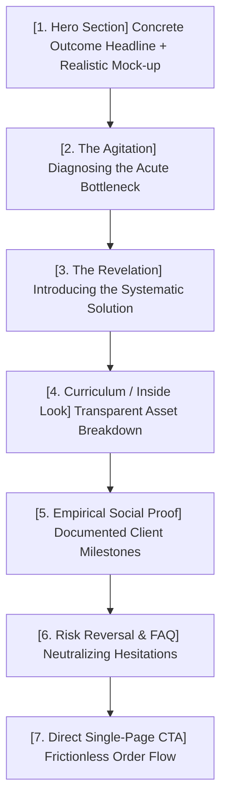

Many creators spend thousands of dollars commissioning elaborate 3D parallax landing pages with intricate animations, only to watch their checkout conversion rate languish below 0.5%.

The fundamental law of online commerce psychology is straightforward:
> **Excessive visual ornament confuses the buyer. Transactions are driven by message clarity and immediate solution relevance, not complicated CSS physics.**

Over **85% of modern digital transactions occur on mobile screens** over variable cell networks. If your page takes 5 seconds to load or requires 30 seconds of scrolling just to explain what is being sold, prospective buyers simply close the tab.

In **Part 4** of the *Creator Commerce Blueprint*, we dismantle the **7 Essential Blocks of High-Converting Sales Pages** and the copywriting architecture required to convert attention into verified orders.

---

## 1. Anatomy of the 7 Essential Sales Blocks

An effective sales page mirrors the natural psychological arc of decision-making:

---

## 2. Technical Breakdown of Each Copywriting Block

### Block 1: The Hero Section (First 3 Seconds)
The hero section must immediately halt mindless scrolling and communicate your core value proposition:
- **Category Badge:** Explicit category signifier (e.g., *Operational Playbook for Founders*).
- **Outcome Headline:** Formula: `How to [Achieve Specific Outcome] in [Realistic Timeframe] Without [Primary Friction Point].`
- **Sub-headline:** One clear sentence clarifying who this system is engineered for.
- **Realistic Visual Mockup:** Show a crisp 3D rendering of the asset on a tablet or laptop screen, giving tangible form to an intangible digital file.

### Block 2: The Agitation (Empathetic Diagnosis)
Articulate 3–4 acute frustrations your prospects currently endure:
- *"Are you exhausted from spending 4 hours every evening manually confirming customer transfers over WhatsApp?"*
- *"Have you poured budget into paid ad campaigns that generated clicks but zero settled revenue?"*
When a prospective buyer feels their situation is described with surgical precision, they instinctively trust that you understand the remedy.

### Block 3: The Revelation (Introducing the Solution)
Present your asset not as "theoretical lectures", but as **an accelerated operational bridge**:
> *"I built [Product Name] to serve as a consolidated, field-tested operating system that collapses your implementation curve from 6 months of trial and error down to 7 days of execution."*

### Block 4: Inside Look (Total Curriculum Transparency)
Remove ambiguity by listing exactly what the buyer receives immediately after payment settles:
- Comprehensive breakdown of all modules, frameworks, and templates included.
- File formats and software prerequisites (Notion, Google Sheets, PDF, MP4).
- Access instructions and downloadable deliverables.

### Block 5: Social Proof (Quantified Proof Over Vague Praise)
High-leverage testimonials feature **concrete numbers and operational shifts**, not polite flattery:
- ❌ *Weak:* "This guide was super helpful, thanks so much!"
- ✅ *Strong:* "Applying module 2 improved our checkout conversion from 1.4% to 3.9%, generating 46 new orders within 72 hours without increasing ad spend."

### Block 6: FAQ & Objection Crushing
Pre-emptively answer the 4 questions active in every buyer's mind:
1. *"Can a beginner with zero technical background implement this system?"*
2. *"What file formats are provided and how quickly do I receive access?"*
3. *"Does access expire? (Clarify: Lifetime access with continuous updates)"*
4. *"What payment methods are supported? (Instant QRIS, Cards, and Virtual Accounts)"*

### Block 7: Clear, Action-Driven CTA
Use button copy that highlights the outcome rather than a generic bureaucratic verb:
- ❌ *Ineffective:* "Submit" or "Buy Now"
- ✅ *Persuasive:* **"Get Instant Access (One-Time Payment) →"**

---

## 3. Mobile-First Performance Checklist

Before deploying your landing page on **[SitusBisnis](https://situsbisnis.com)**:
1. [ ] Set body typography to at least `16px` for comfortable readability on small viewports without pinch-to-zoom.
2. [ ] Place your first primary CTA button above the fold on mobile viewports.
3. [ ] Stick to a clean single-column vertical layout that scrolls naturally.
4. [ ] Eliminate long registration forms—collect only Full Name, Email, and WhatsApp number.

---

*Once a buyer clicks your CTA, how do you prevent checkout abandonment? Continue to **[Part 5: 24/7 Automated Checkout and Instant Settlement via QRIS](/en/posts/creator-commerce-blueprint-part-5-automated-checkout-instant-qris/)**.*
