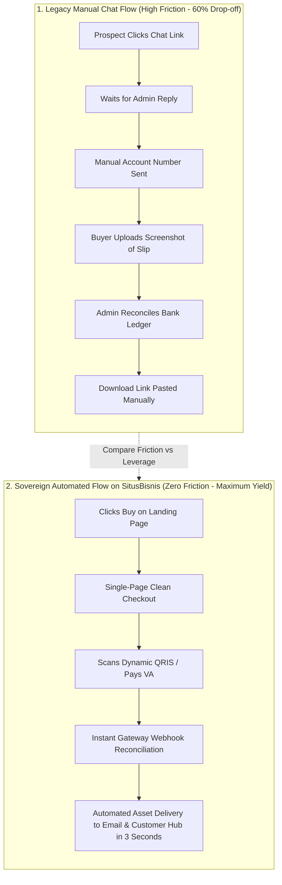

How many times have you watched a high-intent prospect abandon an order because they were forced to:
1. Click a WhatsApp chat link to message an administrator.
2. Wait 4 hours for an administrative reply because the inquiry arrived outside office hours.
3. Manually copy a bank account number, open their banking app, and upload a screenshot of the payment receipt.
4. Wait for an operator to reconcile bank statements before their download link is manually pasted into chat.

In modern e-commerce, **every extra second of payment friction destroys conversion**:
> **The greatest cart abandonment does not occur when the prospect reads your sales copy; it happens the moment they encounter a cumbersome, manual payment flow.**

In **Part 5** of the *Creator Commerce Blueprint*, we dissect transaction architecture: how to build a 24/7 automated payment and delivery engine that requires zero human intervention, and why sovereign, zero-commission infrastructure is essential for scale.

---

## 1. Comparing Funnel Flows: Manual Chat vs. Automated Sovereign Checkout

Contrast the severe conversion drop-off of legacy manual flows against modern sovereign infrastructure:

With an automated infrastructure, when a customer purchases at 2:30 AM on a Sunday morning, funds settle and asset access is granted within **3 seconds** without waking you up.

---

## 2. Essential Payment Rails for Modern Commerce

To maximize digital product checkout velocity, your checkout drawer must support seamless digital rails:

| Payment Rail | Market Preference | Conversion Advantage |
| :--- | :--- | :--- |
| **Instant Dynamic QRIS** | ~55% | Zero manual account entry. Scannable by any mobile banking or digital wallet app in seconds. |
| **Virtual Accounts (Automated Settlement)** | ~35% | Generates unique transaction accounts that settle automatically without odd verification digits or receipt uploads. |
| **Direct Digital Wallets & Cards** | ~10% | Instant one-touch checkout for mobile-native operators. |

---

## 3. The Compounding Math of Zero-Commission Platforms

Many early creators default to third-party marketplaces that slice **10% to 15% from every single sale**. While this seems inconsequential on day one, review the financial reality over 12 months:

### Financial Simulation (Product Priced at \$25):
- **Target Volume:** 1,000 orders annually.
- **Gross Revenue:** $1,000 \times \$25 = \$25,000$.

| Platform Type | Take Rate | Annual Platform Drag | Net Margin Retained |
| :--- | :--- | :--- | :--- |
| **Legacy Marketplace (12% Fee)** | 12% of Gross | **-\$3,000 lost to middleman!** | \$22,000 |
| **Sovereign Store on SitusBisnis (0% Fee ⭐)** | **0% Platform Take Rate** | **\$0** (Only base gateway MDR ~0.7%) | **\$24,825** |

> **Net Difference:** You retain an extra **\$2,825+ every year** simply by choosing a platform that does not penalize your growth. That capital can be reinvested directly into ad campaigns, better video equipment, or new product research.

---

## 4. Digital Asset Security and Delivery Protection

How do you safeguard digital deliverables from illicit leaks while ensuring premium customer experience?
1. **Dynamic Expiring Links:** Asset download links expire after a designated window, preventing unauthorized sharing in public chat groups.
2. **Buyer Identity Stamping:** For high-ticket masterclasses or proprietary SOP documents, automatically watermark the buyer's email address and purchase ID onto the document header.
3. **Centralized Customer Hub:** Buyers can log into their private dashboard on SitusBisnis at any time to re-download files if their local device is upgraded or lost.

---

## 5. Execution Checklist

1. [ ] Terminate manual chat transfer verification for commercial digital assets.
2. [ ] Activate dynamic automated payment methods (instant QRIS & Virtual Accounts).
3. [ ] Confirm that file download credentials land in the buyer's inbox within 5 seconds of settlement.
4. [ ] Audit your platform take rates and migrate away from fee-gouging middlemen.

---

*Your product is packaged and your checkout operates automatically 24/7. Now, how do you orchestrate a launch that generates immediate sales velocity? Continue to **[Part 6: The 7-Day Product Launch Playbook](/en/posts/creator-commerce-blueprint-part-6-launch-playbook/)**.*
