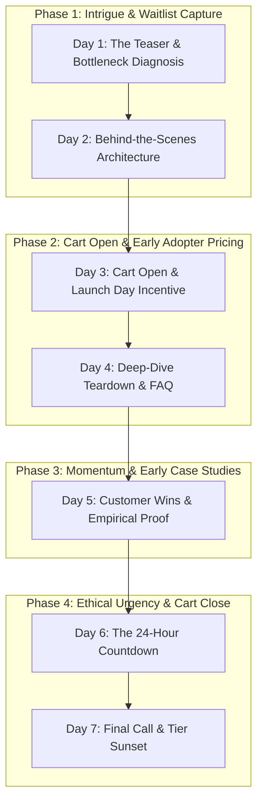

Many creators believe that a digital product launch is a single, isolated event: they post a link on their social story or profile bio announcing: *"My new playbook is live, link in bio!"*

The outcome? A modest handful of likes, a trickle of clicks, and **anemic sales revenue**.

A successful launch is never a single static announcement; it is **a structured psychological campaign** executed over 7 to 14 days:
> **Prospects do not buy the first time they discover your offer. They purchase when anticipation reaches an inflection point and they have a compelling, time-bound reason to act today rather than postpone until next week.**

In **Part 6** of the *Creator Commerce Blueprint*, we dismantle **The 7-Day Launch Framework**: a proven operational calendar designed to generate maximum momentum and order velocity.

---

## 1. The 7-Day Campaign Arc

The campaign orchestrates four psychological phases from initial intrigue to final cart closure:

---

## 2. Daily Operational Blueprint: What to Publish Each Day

### Day 1: The Teaser (Fueling Anticipation)
- **Message Angle:** Never pitch the product outright. Center the message on the acute operational bottleneck you are solving.
- **Sample Copy:** *"Over the last 4 weeks, I codified the exact operating system our team used to reduce onboarding churn from 22% to 4%. I'm packaging it into an executable kit for fellow founders. Who wants early access?"*
- **Call-to-Action:** Direct them to a simple waitlist page on SitusBisnis to lock in 50% early-bird pricing.

### Day 2: Behind-the-Scenes (Establishing Authority)
- **Message Angle:** Reveal the rigor and precision of the preparation process.
- **Sample Copy:** Share a 45-second screen recording demonstrating the automated formulas inside the template or the modular documentation hierarchy. Show, do not merely tell, that this is a premium tool.

### Day 3: Cart Open (Launch Velocity)
- **Message Angle:** Official announcement that doors have opened with **a strictly limited 48-Hour Early Adopter Incentive**.
- **The Incentive:** Include an exclusive launch bonus that expires after the opening window (e.g., an unreleased bonus template or access to a closed Q&A teardown).
- **Distribution:** Send broadcast announcements across your email list and post direct checkout links on your social channels.

### Day 4: Deep-Dive Teardown & Objection Crushing
- **Message Angle:** Answer the specific hesitations preventing warm prospects from finishing checkout.
- **Sample Copy:** Aggregate the 4 most common questions received via email or DMs: *"A lot of people asked: 'What if our business uses software X instead of Y?' Here is exactly how the system adapts..."*

### Day 5: Customer Proof & Implementation Momentum
- **Message Angle:** Highlight early wins from beta testers or Day 1 buyers.
- **Sample Copy:** Share screenshots of real feedback celebrating the clarity of the material and immediate implementation milestones achieved within the first 48 hours.

### Day 6: The 24-Hour Countdown
- **Message Angle:** Remind fence-sitters that the early adopter tier expires in 24 hours.
- **Psychological Reality:** Humans are chronic procrastinators. Between **35% and 50% of total campaign revenue** is typically generated during the final 48 hours as the deadline approaches.

### Day 7: Final Call (Ethical Urgency)
- **Message Angle:** Explicit, respectful final notice.
- **Execution:** Send two targeted communications:
  - Morning (09:00): *"Tonight at 11:59 PM, the early adopter incentive officially sunsets."*
  - Evening (20:00): *"Final 4 hours before pricing transitions to the standard catalog rate."*
- **Absolute Integrity:** When the clock strikes midnight, raise the price on your storefront as promised. Never fabricate false urgency; long-term trust is infinitely more valuable than a few opportunistic orders.

---

## 3. Execution Checklist

1. [ ] Map out the 7-day launch calendar with tailored copy for each phase.
2. [ ] Launch a waitlist capture page at least 5 days prior to Cart Open.
3. [ ] Prepare 1 high-leverage launch bonus reserved exclusively for opening-week buyers.
4. [ ] Pre-draft all email communications and social posts so you remain fully focused on customer support during launch week.

---

*Once your launch campaign succeeds and your first cohort of buyers is onboarded, how do you sustain predictable daily cash flow without burning out on continuous launches? Continue to the finale **[Part 7: Scaling and the Evergreen Revenue Flywheel](/en/posts/creator-commerce-blueprint-part-7-scaling-evergreen-revenue/)**.*
