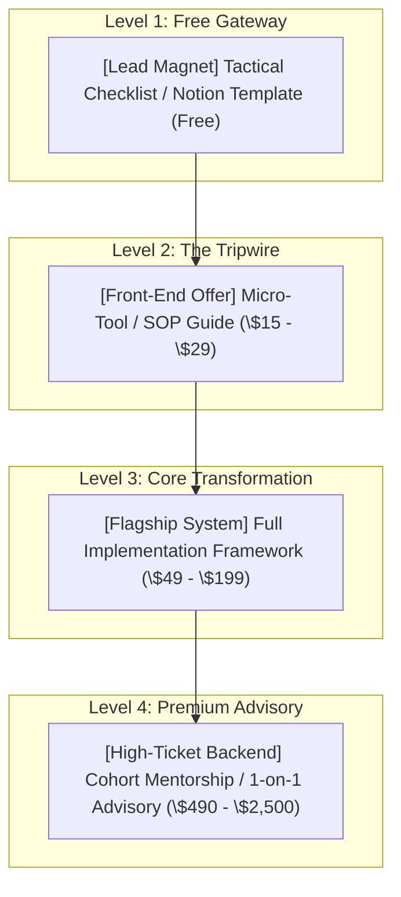

Have you ever experienced this exhausting roller-coaster: your product launch generates a thrilling spike in revenue, but 7 days later... sales grind to a complete halt and silence sets in.

Many digital entrepreneurs remain trapped in this feast-and-famine cycle. They believe they must build a completely new product from scratch every month just to keep their business afloat.

Sophisticated operators do not run on this hamster wheel. Instead of continuously rolling the dice on random products, they engineer **a Compound Value Ladder and an Automated Revenue Flywheel**.

---

## 1. The Value Ladder Architecture

The single highest-probability buyer of your future catalog is **a customer who has already purchased from you and experienced tangible success**.

Maximize Customer Lifetime Value (LTV) by organizing your offers into a progressive value ladder:



### Why This Hierarchy Drives Compounding Profit:
1. **The Tripwire:** Converts skeptical leads into paying customers with minimal friction (sub-\$30).
2. **The Core Offer:** Delivers the comprehensive operating system, generating the bulk of your steady monthly revenue.
3. **The High-Ticket Backend:** Only purchased by the top 5%–10% of power users, yet accounts for **40% to 60% of your total net profit**.

---

## 2. Expanding Average Order Value (AOV): The Order Bump

Never let a customer complete an order with just one item if you own complementary operational assets.

An **Order Bump** is a frictionless, single-click checkbox placed directly on the checkout drawer before payment confirmation:

```
┌────────────────────────────────────────────────────────────────────────┐
│ [✓] YES! Add the "Complete Agency Client Agreement & SOW Vault"       │
│     for only $19 (Save 75% off the standard catalog rate).            │
└────────────────────────────────────────────────────────────────────────┘
```

Statistically:
- Between **25% and 40% of checkout buyers** check the order bump box if the utility is closely aligned with the core purchase.
- If your primary guide sells for \$39 and your order bump is \$19, your Average Order Value jumps from \$39 to nearly **\$46 with zero additional acquisition cost**.

---

## 3. Transitioning from Campaigns to an Evergreen Revenue Engine

How do you generate consistent daily sales without orchestrating high-stress promo launches every month?

Automate the proven machinery established in [Part 3](/en/posts/creator-commerce-blueprint-part-3-lead-magnets-audience-pipelines/) and [Part 6](/en/posts/creator-commerce-blueprint-part-6-launch-playbook/):
1. **Steady Top-of-Funnel Distribution:** Every social insight breakdown ends with a call to download your free lead asset via the bio link.
2. **Automated Onboarding:** Every new subscriber immediately enters your 5-day authority email sequence.
3. **Dynamic Time-Bound Incentive:** On Day 5, the subscriber receives an automated welcome incentive that expires 48 hours from arrival.
4. **Predictable Compounding:** Daily inbound traffic enters the top of the funnel, and daily orders settle in your merchant account automatically.

---

## 4. The Complete Master Blueprint Recap

Review the holistic journey covered throughout the seven installments of this series:

| Milestone | Strategic Objective | Concrete Deliverable |
| :--- | :--- | :--- |
| **[Part 1: Idea Validation](/en/posts/creator-commerce-blueprint-validating-digital-products/)** | Audit unfair advantage & diagnose urgent demand | A validated commercial concept with confirmed purchasing intent. |
| **[Part 2: Product Architecture](/en/posts/creator-commerce-blueprint-part-2-product-architecture/)** | Format selection, MVT syllabus, & value pricing | A lean, outcome-driven digital asset and multi-tier pricing ladder. |
| **[Part 3: Lead Engines](/en/posts/creator-commerce-blueprint-part-3-lead-magnets-audience-pipelines/)** | Lead magnets & owned audience pipelines | Direct-to-consumer distribution insulated from algorithmic swings. |
| **[Part 4: Sales Pages](/en/posts/creator-commerce-blueprint-part-4-high-converting-landing-pages/)** | 7-block outcome-driven copywriting | High-performing mobile-first sales pages that convert traffic into buyers. |
| **[Part 5: Automated Checkout](/en/posts/creator-commerce-blueprint-part-5-automated-checkout-instant-qris/)** | Instant digital rails & zero-fee infrastructure | Frictionless 24/7 transaction processing with instant file fulfillment. |
| **[Part 6: Launch Playbook](/en/posts/creator-commerce-blueprint-part-6-launch-playbook/)** | 7-day launch campaign psychology | Structured opening velocity that generates immediate cash flow and proof. |
| **Part 7: The Scaling Flywheel** | Value ladders, order bumps, & evergreen funnels | An enduring, compounding digital business producing predictable daily cash flow. |

---

## 5. Your Next Operational Move

The most elegant business framework in the world produces zero revenue without **resolute execution**.

Do not delay your launch waiting for a mythical sense of perfection. Open your free storefront on **[SitusBisnis.com](https://situsbisnis.com)**, configure your first sovereign landing page, and begin delivering high-value solutions to the global market today.
