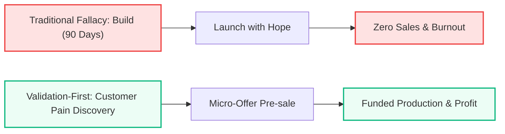

Most creators, mentors, and skilled operators fall into the exact same trap when attempting to monetize their craft: **they retreat into a cave for three months to build the "perfect" product**. 

They design 60 presentation slides, record 40 hours of 4K video, obsess over font pairings on an e-book cover, and build intricate membership portals—only to be met with deafening silence and **zero sales on launch day**.

The brutal truth of the creator economy is simple:
> **The market does not reward you for how hard you worked on creating material. The market only pays for a tangible, accelerated resolution to an urgent problem they are currently suffering from.**

When a digital asset fails to sell, 90% of the failure occurred in the first week: **the product was built on personal assumptions rather than verified market demand.**

This is **Part 1** of the *Creator Commerce Blueprint*. In this essay, we break down a reproducible system to identify your unfair advantage, pinpoint acute market pain points, and secure paying customers before writing a single page of content.

---

## 1. The Trap of "Building First, Selling Later"

Traditional product development teaches us to design, manufacture, package, and then market. In physical manufacturing, this sequence is unavoidable. In digital commerce, following this sequence is economic suicide.

When you validate first:
1. **You eliminate financial downside:** You don't spend months building something nobody wants.
2. **Your customers write your marketing copy:** The exact phrases prospects use during interviews become your headline and bullet points.
3. **Cash flow precedes production:** Pre-sale commitments fund your tools, software, and design budget.

---

## 2. The 3 Signals of a Validated Market Problem

A profitable idea sits at the intersection of three non-negotiable criteria:

### A. Acute Pain vs. Casual Curiosity
Nobody pays for "nice-to-have" general knowledge when ChatGPT and YouTube can provide it for free. Customers pull out their cards when the pain is:
- **Financial bleeding:** "Our client acquisition cost rose 40% this quarter."
- **Wasted operational hours:** "I spend 3 hours every night manually generating invoices."
- **Status risk:** "If I don't master this system, I will lose my biggest account."

### B. Demonstrated Purchasing Power
Targeting audiences that actively refuse to pay for software or knowledge leads to perpetual frustration. You want buyers who have already proven they spend money solving this category of problem.

### C. Speed to Outcome
Digital products do not sell by word count or video runtime. In fact, longer runtimes often decrease perceived value because they demand more time from an already overwhelmed buyer. Your value proposition is **compression**: turn a 3-week struggle into a 2-hour checklist.

---

## 3. The 48-Hour Pre-Sale Playbook

Here is the exact step-by-step protocol to validate an offer without building the curriculum:

1. **Publish a High-Friction Insight Post:** Share a comprehensive breakdown of a specific operational bottleneck on your social channels or newsletter.
2. **Filter Qualified Prospects:** At the bottom, add a simple call to action: *"I am packaging the exact template and SOPs our team uses to solve this. I'm accepting 10 founding beta testers at a 50% discount in exchange for direct feedback."*
3. **Direct to a Simple One-Page Checkout:** Point them to an independent checkout page (built on SitusBisnis with instant QRIS / Virtual Account) with clear delivery timelines.
4. **Evaluate the Benchmark:**
   - **Fewer than 3 sales:** The problem is not urgent enough, or the audience does not trust your solution yet. Refund immediately, interview the non-buyers, and pivot without sunk cost.
   - **5 to 10 sales:** You have confirmed product-market fit. Build the exact solution requested by these paying testers with 100% confidence.

---

## What Comes Next

Validating demand ensures you never build in vain. In **Part 2 of the Creator Commerce Blueprint**, we will explore how to architect high-margin digital product tiers—from front-end tripwires to high-ticket cohort advisory—maximizing lifetime customer value on your own domain.
