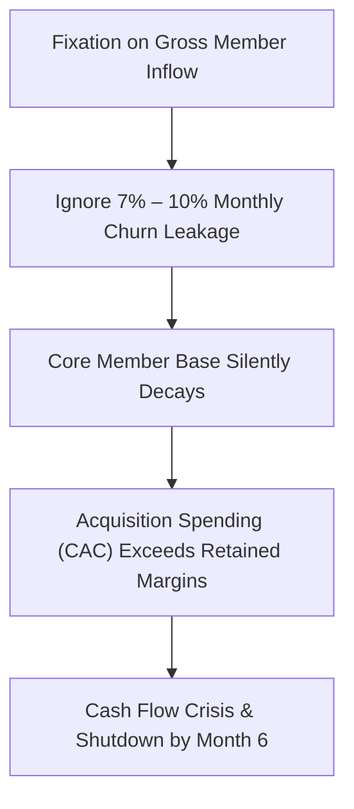
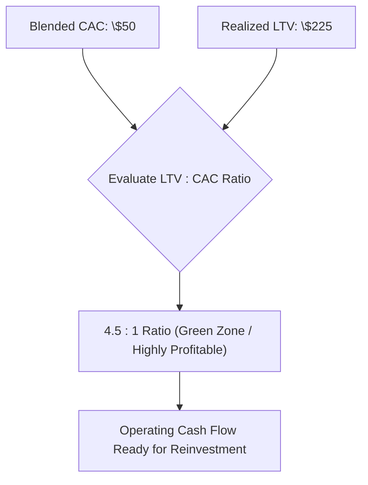

Recurring subscription models and paid communities are frequently romanticized as the holy grail of passive digital revenue. Many creators imagine: *"If I secure 1,000 members paying \$10 per month, I will enjoy a permanent, hands-off \$10,000 monthly income."*

In reality, 90% of early digital subscription ventures experience severe cash crunches by month six. Founders often fixate on vanity acquisition metrics while neglecting two critical unit economic variables: **Monthly Churn Rate** and **Blended Customer Acquisition Cost (CAC)**.

A subscription model with unmanaged churn is an exercise in pouring water into a leaky bucket: the more aggressively you spend to acquire new members, the more capital drains through the floor.

---

## The Compounding Math of Monthly Churn

Consider a realistic scenario: your private community charges \$15/month with an average **Monthly Churn Rate of 6%** (a standard benchmark in consumer memberships).

Losing 6% of your members monthly may appear manageable at first glance. However, examine the mathematical compounding across 12 months:

$$\text{Annual Retention Rate} = (1 - 0.06)^{12} \approx 0.4759 \ (47.6\%)$$

In other words, across a single calendar year, **52.4% of your entire membership base disappears**.

To maintain static scale without expanding, you must replace over half of your customer base every single year just to break even.

---

## Evaluating the LTV:CAC Ratio

To determine whether your subscription economics are sustainable or burning capital, track your **Customer Lifetime Value (LTV)** against your **Customer Acquisition Cost (CAC)**.

### 1. Customer Lifetime Value (LTV) Formula
LTV reflects total expected gross profit per customer prior to cancellation:

$$\text{LTV} = \frac{\text{Average Revenue Per User (ARPU)} \times \text{Gross Margin \%}}{\text{Monthly Churn Rate}}$$

Example:
- Subscription dues (ARPU): \$15 / month.
- Gross Margin (post-gateway and server costs): 90% = \$13.50.
- Monthly Churn: 6% (0.06).

$$\text{LTV} = \frac{\$13.50}{0.06} = \$225.00$$

### 2. Blended Customer Acquisition Cost (CAC)
Avoid calculating CAC based solely on direct ad spend. True unit economics requires calculating **Blended CAC**:

$$\text{Blended CAC} = \frac{\text{Total Paid Ad Spend} + \text{Marketing Headcount Costs} + \text{Software Subscriptions}}{\text{Total New Paying Customers Acquired}}$$

### 3. The LTV:CAC Health Matrix
- **Below 1:1:** Red Alert (You forfeit capital on every customer acquired).
- **Between 1:1 and 2:1:** Danger Zone (Margins are too tight to absorb operational shocks).
- **3:1 or Higher:** The Industry Gold Standard (Healthy, profitable, and ready to scale).
- **Above 5:1:** Excessively Conservative (You are likely under-investing in market acquisition).

---

## Three Financial Levers to Neutralize Churn

### 1. Prioritize Upfront Annual Plans
Never present monthly dues as the default option. Offer a 2-month-free incentive for upfront annual billing:
- Annual payments secure 12 full months of operating cash flow on Day 1.
- Mathematically, annual subscriber churn is locked at 0% for the initial 365 days.

### 2. Net Revenue Retention (NRR) via Modular Add-Ons
Expand revenue from existing members by offering one-time companion assets (*expansion revenue*): advanced masterclasses, 1-on-1 diagnostic sessions, or corporate seat licenses.

### 3. Automated Dunning and Failed Payment Recovery Workflows
A significant portion of subscription cancellations stem from **involuntary churn: expired payment cards or forgotten manual transfers**:
- Deploy automated reminder messaging 3 days and 1 day prior to billing dates.
- Supply single-click dynamic payment links.

With an independent storefront on [SitusBisnis](https://situsbisnis.com), you retain full ownership of customer transaction records, pay zero platform commissions, and operate with the unit economics required to protect your LTV:CAC ratio.
