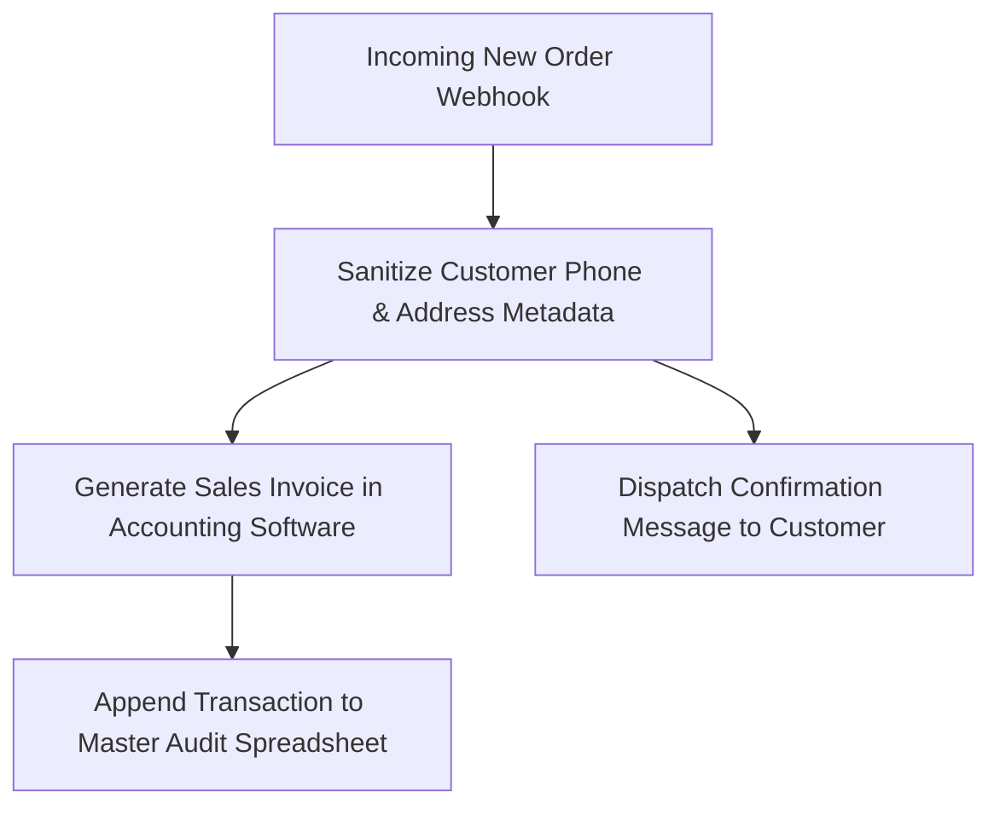

Building a Software-as-a-Service (SaaS) application is often celebrated as the pinnacle of digital entrepreneurship. Yet the operational realities can be harsh: SaaS demands substantial capital, 24/7 server monitoring, customer support coverage, and compounding infrastructure expenses every month.

There is a commercially viable alternative delivering near-100% net profit margins: **Selling Importable Automation Pipelines and Workflow Blueprints**.

Modern businesses rely on dozens of disconnected software applications: e-commerce storefronts, point-of-sale systems, accounting software, team communication channels, and inventory spreadsheets. The fundamental problem? **These platforms do not communicate with each other natively**.

Business owners spend hundreds of dollars monthly paying administrative staff to manually copy and paste records between disparate software interfaces.

```mermaid
graph TD
    A["Online Store / POS System"] -->|Admin Copies Data Manually (Error-Prone & Slow)| B["Accounting Software (QuickBooks / Xero / Jurnal)"]
    A -->|Manual Hourly Chat Dispatches| C["WhatsApp Logistics Updates & Courier Tracking"]
    
    D["Importable n8n / Make Workflow Blueprint"] --> E["Instant, Real-Time Automated Data Synchronization"]
    E --> B
    E --> C
```

---

## What Makes an Automation Blueprint Commercially Valuable?

A high-value automation asset is not an abstract script; it is a battle-tested JSON configuration resolving a specific, costly operational bottleneck:

### 1. Storefront-to-Accounting Synchronization
A major operational bottleneck for wholesalers and distributors is manually generating accounting invoices and tax receipts.
- A pre-built JSON workflow for n8n or Make.com.
- Dynamic data mapping: product SKUs, tax calculations, discounts, and ledger account codes populated with zero human intervention.
- Automated error recovery if warehouse inventory is insufficient during sync events.

### 2. Automated WhatsApp & SMS Shipment Notifications
Customers expect real-time delivery status alerts.
- A workflow reading logistics webhook events, automatically dispatching personalized updates when a courier picks up or delivers an order.
- Reduces repetitive customer support inquiries ("Where is my shipment?") by up to 80%.

### 3. Contact Enrichment & B2B Pipeline Lead Scoring
For B2B commercial teams:
- A pipeline detecting new inbound leads, verifying corporate email deliverability, enriching company domain metadata, and appending clean records into a CRM or spreadsheet.



---

## Selling Automation Assets Without Providing Endless Tech Support

A common concern when selling automation blueprints is fielding endless technical support inquiries from non-technical buyers. The remedy lies in **standardized delivery documentation**:

1. **Standardized JSON Architecture:** Export workflows from open-source engines like **n8n** (which buyers can self-host at zero license cost) or Make.com. Buyers simply click *Import Workflow* and upload the file.
2. **15-Minute Uncut Screen Walkthrough Video:** Record a clear, step-by-step video showing exactly where to insert API keys. Avoid assuming buyers understand concepts like *Bearer Tokens* or *Payloads*.
3. **The Done-For-You Implementation Upsell:**
   - Standard JSON Blueprint + Documentation: \$79 (100% passive digital asset).
   - "White-Glove 24-Hour Implementation" Add-On: Additional \$150. Busy corporate operators gladly select the white-glove upgrade.

---

## Self-Hosted Storefronts for Automation Deliverables

Distributing digital workflows requires a platform engineered for secure file fulfillment and instant checkout.

With an independent storefront on [SitusBisnis](https://situsbisnis.com), you can build visual offer pages featuring workflow screenshots, process instant payments via cards or local virtual accounts, and deliver Google Drive links containing JSON blueprints and setup guides—with **zero platform commission cuts**.
