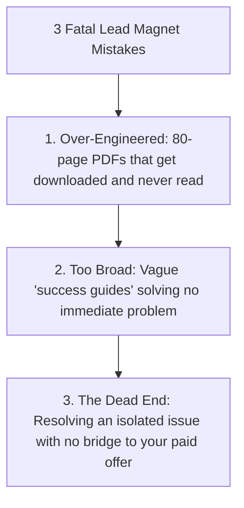
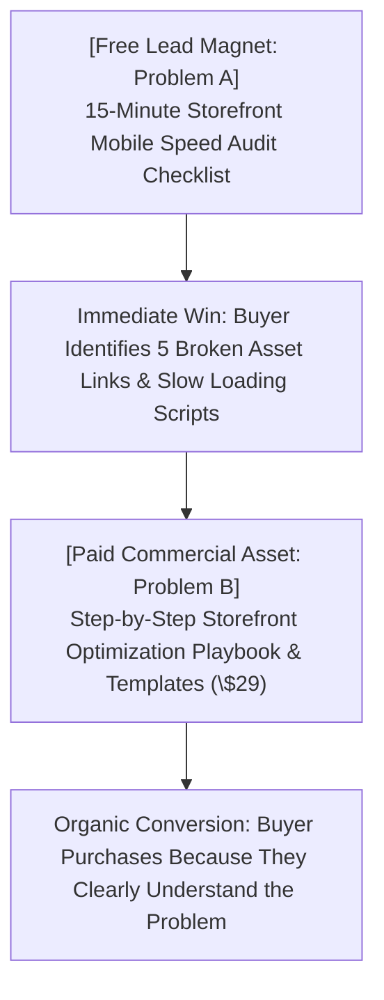

Have you ever landed on a website only to be greeted by an intrusive popup declaring:
> *"Enter your email now to subscribe to our weekly newsletter!"*

Be honest: how often do you submit your email address to prompts like that?

Almost never.

Unless you are a passionate fan of that specific author, modern internet users suffer from inbox fatigue. We do not need another generic weekly digest. We need **immediate solutions to the specific bottlenecks frustrating us today**.

This is why strategic creators never ask for contact details without offering value in return. They provide a **High-Intent Lead Magnet**—a concise, high-utility asset consumable within 10 minutes that leaves the reader thinking:
> *"If their free resource is this practical and actionable, their paid products must be exceptional."*

When you trigger that internal realization, your customer acquisition friction disappears.

---

## 1. The Three Critical Lead Magnet Design Pitfalls

Before assembling your free asset, avoid these three common mistakes:

### Pitfall 1: Bloated 80-Page E-Books
Many first-time creators assume page count determines perceived value.

In reality, dense documents overwhelm prospective buyers. When someone downloads an 80-page PDF, they think: *"I'll read this when I have free time over the weekend."*

And they never open it. The file languishes in their Downloads folder. If your free material remains unread, trust is never established.

### Pitfall 2: Overly Abstract Topics
Titles like *"A Complete Guide to Online Business"* generate minimal interest. Broad topics are already covered in millions of free search results.

Notice the difference:
- ❌ *"Small Business Financial Management Tips"* (Vague, dry, uncompelling)
- ✅ *"Automated Spreadsheet Model: Calculate Recipe COGS and Food Margins Without Formulas"* (Specific, immediate, actionable)

### Pitfall 3: The Dead End (No Bridge to Core Offers)
An effective lead magnet must resolve **Initial Friction (Problem A)**, which naturally illuminates the need for the **Comprehensive System (Problem B)** that your paid product delivers.

---

## 2. The Bridge to Paid Offers

Here is how the relationship between your free asset and commercial product should function:

Notice the pattern:
- The free asset delivers a **diagnostic small win**.
- The paid asset delivers the **implementation solution and time-saving shortcut**.

---

## 3. High-Converting Lead Magnet Formats

Empirical conversion data indicates that four formats perform best:

| Lead Magnet Format | Why Prospective Buyers Prefer It | Real-World Example |
| :--- | :--- | :--- |
| **Spreadsheet / Notion System** | Eliminates formula setup and dashboard configuration. | Daily small-business cash flow and ledger tracker. |
| **Swipe File / Script Library** | Removes the difficulty of starting from a blank page. | 30 Customer support response templates for dispute resolution. |
| **Interactive Calculator** | Generates personalized metrics reflecting the user's situation. | Freelance hourly billing and emergency fund simulator. |
| **Single-Page Audit Checklist** | Provides a structured step-by-step verification framework. | 10 Pre-flight technical checks before launching a digital store. |

---

## 4. Distribution Tactics That Drive Inbound Leads

A high-utility asset generates zero leads if it sits unnoticed on a quiet page:

1. **Clean Bio Links:** Feature a single, dedicated link pointing directly to your opt-in landing page, avoiding cluttered directories with dozens of options.
2. **The Hand-Raiser Post:** Share a brief case study on LinkedIn, X, or Threads, concluding with: *"I just finalized this spreadsheet checklist. Drop 'INTERESTED' in the comments and I'll send over the link."*
3. **Automated Instant Delivery:** Connect your opt-in form to an independent platform like [SitusBisnis](https://situsbisnis.com) so digital files are dispatched automatically to inboxes within seconds.

---

## Summary

A lead magnet is not an academic exercise to showcase how much theoretical knowledge you possess. It is an operational tool demonstrating that **you can solve specific problems quickly, cleanly, and reliably**.

Publish one focused asset this week, distribute it to your audience, and build an owned subscriber list ready to explore your commercial catalog.
